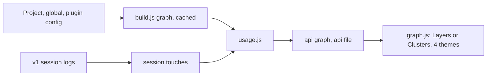

# Memory: Phase 2 Config Graph

**ID:** `mem-config-graph`
**Parent:** `mem-project-context`
**Status:** 2026-10-19 — spec approved, Gemini-ready plan written and verified. **Execution started 2026-10-19 00:05** (files appearing step by step in the working tree; Task 2 at 00:06). Review it with the PvM playbook sections 5 and 11.5.
**Spec:** [`.cursor/plans/design/2026-10-18-config-graph.md`](../plans/design/2026-10-18-config-graph.md)
**Plan:** [`.cursor/plans/implement/2026-10-18-config-graph.md`](../plans/implement/2026-10-18-config-graph.md) (8 tasks, 2,367 lines, complete code)

## What it is

A Graph screen in the v1 tool: one project's AI config drawn as a map. Every config file is a node; lines are **mentions** (file A names or links file B) and **loads** (a client gets the file, from config and from session logs). Outside sources (global `~/.claude`, `~/.codex`, each enabled plugin) are closed boxes that open into their files. Side panel per file, read-only full-text reader, per-session overlay.

## Owner decisions (2026-10-18)

| Decision | Note |
|---|---|
| Purpose | See the big picture of the AI brain; owner had only "a feel" for how config, memory, playbooks connect |
| Duplicates (identical memories, duplicate concepts or bugs) | Out of phase 2; a later "data analysis" phase |
| Lines | Both mentions and loading; loading both by config and by logs |
| Outside files | Black boxes; click opens the sub-graph inside |
| Layout | Both Layers and Clusters, chosen in Settings like theme |
| Click a file | Highlight neighbours, side panel, Read button for full text |
| Session overlay | Pick a session, map lights up what it touched |
| Spec path | `.cursor/plans/design/`, not the `desh-phase2.md` path in the request |

Claude's calls (owner kept or did not object): hubs start closed with "open all"; plain-text reader with node names as links; config side for 4 clients, log side Claude and Codex only; one project per map; chars/4 estimate; hand-written SVG, no library; docs off by default.

## Facts verified on disk (2026-10-18, PvM)

| Fact | Consequence |
|---|---|
| 26 rules, 15 `HUB:` rows, 205 memories with `**Parent:**`, 3 enabled plugins | Test numbers for Task 8 |
| Claude logs `attachment.type: hook_success` with `command` (or the hook's `statusMessage`, or unexpanded `${CLAUDE_PLUGIN_ROOT}`) and `toolUseID`; `UserPromptSubmit` has no `hook_success` lines | Per-script observed hook runs; event-only lines credit all scripts of the event as "named" when several share it |
| Plugin hooks: superpowers in `hooks/hooks.json`, caveman and ponytail in `.claude-plugin/plugin.json` `hooks` | Read both |
| Global `~/.claude/settings.json` runs `C:/Users/PC/.orca/agent-hooks/claude-hook.cmd` on every event | Hook script nodes live in the box of the settings that run them, wherever on disk |
| Codex injects global and project AGENTS.md as one block `# AGENTS.md instructions for <dir>` | One touch credits both |
| Most file reads go through Bash (247 commands name a `mem-` or rule path vs 51 Read calls); Bash uses Git Bash paths `/g/...` | Weaker "named" strength; resolver maps `/g/` to `g:/` |
| Codex reads files via `custom_tool_call` code (`exec_command`, `node_repl`) | Named tokens from `input` / `arguments` |
| Real graph: 680 nodes, 2,959 mention edges, ~1 MB JSON; build 0.7 s, cached 0.06 s | Fine without paging |

## Plan verification method (repeat it)

1. Built all code in a scratch copy (`scratchpad/wt`), `node --test` 69/69.
2. Ran it against PvM; headless Chrome screenshots of all themes and both layouts; CDP script clicked a node, opened a box, Read, followed a reader link, searched, checked Settings and "Show on map".
3. Generated the plan from a template with `<<FILE:path>>` / `<<FROM:path:marker>>` markers spliced from the scratch files (verbatim by construction).
4. `apply-plan.cjs` parsed the plan text and applied every Create / Replace / Append / Find-Replace to a clean copy: byte-identical to scratch, 69/69; per-task cumulative counts 49, 52, 61, 62, 64, 69 checked by applying the plan cut after each task. Both scripts are saved as reusable tools: `G:\Unity\Project\PetVsMonster\.cursor\playbooks\tools\splice-plan-code.cjs` and `apply-plan-text.cjs` (re-verified on a `HEAD` export, 39 operations, 69/69).
5. Review aid: the verified code is the reference. Regenerate it by applying the plan to a `HEAD` export, then `diff -r` against the executor's tree.

Full lessons: PvM playbook `.cursor/playbooks/external-executor-plan-review.md` section 15.

## Next

1. Execution in progress; then Claude reviews (playbook sections 5, 11.5): diff against the plan applied to `HEAD`, own `node --test` (expect 69), Task 7 browser table, Task 8 numbers.
2. Commit spec, plan, `.claude/package.json` and memory on owner's go-ahead (nothing from the 2026-10-18 session is committed in AIConfigGraph).
