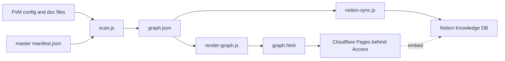
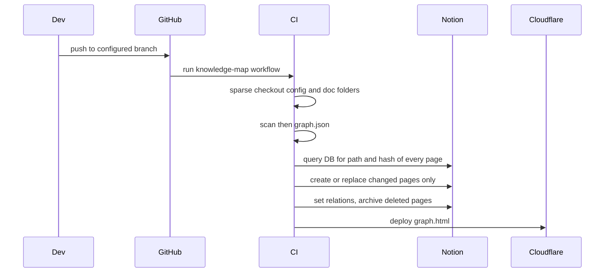
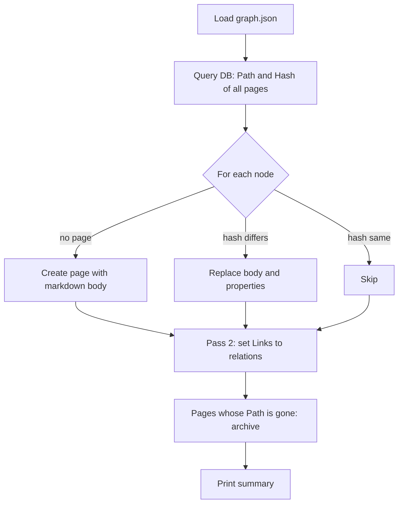

# SP3 Knowledge Map — Design Spec

> **History, copied from PetVsMonster on 2026-10-18.** Superseded by [2026-10-18-ai-config-graph.md](2026-10-18-ai-config-graph.md): the tool is now local-first with Notion optional, and the token report comes before the graph. Kept as groundwork for phase 2 (config graph): reference counts, hairball and hub grouping, prior art. Decisions below that conflict with the new spec do not apply. The Notion product-hub vision stays in PvM.

**Date:** 2026-09-26
**Status:** Design for owner review. Not built.
**Parent:** `PetVsMonster/.cursor/plans/design/2026-09-26-notion-product-hub-vision.md` §4 SP3, §5 (every decision below is recorded there with the owner's answer).
**Order (owner, Q12 A):** AI repair **P1 first** (builds the shared `lib/index.js` link parser), then SP3. Hubs use the `**Parent:**` header until repair P2 adds `HUB:` rows.

---

## 1. Goal

Let everyone on the team **understand** how PvM's AI config and dev knowledge fit together — rules, memory, docs, playbooks, skills, hooks — by browsing a Notion Knowledge database and an embedded mind-map graph. Read-only; git stays the master.

Success:
- Every in-scope file is one Notion page with its full content, its properties and clickable links to the pages it mentions (and backlinks).
- The graph opens collapsed to hubs, colours by type and scope, expands on click, and every node opens its Notion page.
- A push to the configured branch (default `main`) refreshes both within one CI run; unchanged files cost no API writes.

Out of scope: editing from Notion, diagnostics (orphans, broken links — the P1 L2 check already does that), other projects' data, tasks/GD/bugs (SP1/SP2/SP5).

## 2. Decisions (from the vision doc §5)

| Topic | Decision |
|---|---|
| Purpose | Understand (read-only map) |
| Sources | PvM files + origin tag: Universal (master manifest), Framework (package `GENERATED from` header), Project |
| Renderer | Knowledge DB with relations **and** own `graph.html` embedded via `/embed` |
| Page body | Full file content |
| Trigger | Manual command + CI on push |
| Branch | One configured branch, default `main` |
| Graph host | Cloudflare Pages + Cloudflare Access |
| Node | One file = one node; grouped by type and hub; opens collapsed |
| Code home | Universal: `claude-unity-shared/files/claude/tools/knowledge-map/` |
| Engine | Node built-ins + Notion **Markdown Content API** (`2026-03-11`); no npm deps |

## 3. Architecture





## 4. Components

All files under `claude-unity-shared/files/claude/tools/knowledge-map/`. Each is a module with a CLI; each is testable alone.

| File | Does | Input → Output |
|---|---|---|
| `scan.js` | Finds in-scope files, tags type/scope/origin/hub, extracts edges | `--project <p> [--master <path>]` → `graph.json` |
| `notion-sync.js` | Mirrors `graph.json` into the Knowledge DB | `graph.json` + `NOTION_TOKEN` + `--db <id>` → Notion writes; `--dry-run` prints the plan only |
| `render-graph.js` | Writes one self-contained `graph.html` (cytoscape.js inlined from `cdn.jsdelivr.net` at build time, or vendored) | `graph.json` (+ page URLs from sync) → `graph.html` |
| `lib/notion.js` | Thin `fetch` client: retries on 429 with `Retry-After`, ~3 req/s pacing, injectable `fetch` for tests | — |
| `.github/workflows/knowledge-map.yml` (template, copied into each project) | CI wiring | — |

Shared: `../ai-audit/lib/index.js` from repair P1 (`extractLinks`, `readText`, `toSlash`).

Per-project config — `knowledge-map.config.json` at the project root (Project scope):

```json
{
  "notionDatabaseId": "<id>",
  "branch": "main",
  "cloudflareProject": "pvm-knowledge-map",
  "include": [".claude/rules/*.md", ".cursor/memory/mem-*.md", ".cursor/playbooks/*.md",
              "docs/**/*.md", ".claude/skills/*/SKILL.md", ".claude/hooks/*.js",
              "CLAUDE.md", "AGENTS.md"]
}
```

## 5. Data model

### 5.1 `graph.json`

```json
{
  "project": "PetVsMonster", "commit": "a5cdd01ef", "generatedAt": "2026-09-26T00:00:00Z",
  "nodes": [
    { "id": ".cursor/memory/mem-trader-pet-roll.md", "title": "Trader pet roll", "type": "memory",
      "scope": "Project", "origin": null, "hub": "mem-layer2-3-main", "bytes": 18234, "hash": "sha256:…",
      "description": "text of its index row, if any" }
  ],
  "edges": [ { "from": "<node id>", "to": "<node id>", "kind": "link" } ]
}
```

### 5.2 Classification rules

| Field | Rule |
|---|---|
| `type` | Path: `.claude/rules/` → rule; `mem-*-playbook.md` or `.cursor/playbooks/` → playbook; other `.cursor/memory/mem-*` → memory; `docs/` → doc; `SKILL.md` → skill; `.claude/hooks/` → hook; `CLAUDE.md`/`AGENTS.md` → root |
| `scope` | Path listed in master `manifest.json` → **Universal**; first 5 lines contain `GENERATED from com.hung.<x>@<ver>` → **Framework** (`origin` = `com.hung.<x>@<ver>`); else **Project** |
| `hub` | `HUB:` row in `mem-arch-assemblies-canonical.md` (after repair P2) → that hub; else memory `**Parent:**` header; else the type name |
| `title` | First `# ` heading, else file name |
| `description` | The file's row text in the canonical memory index, if present |

### 5.3 Edge extraction

An edge exists when file A references a node B by any of: Markdown link resolving to B's path, `[[B]]` wikilink, or B's file name (e.g. `mem-x.md`, `layer-architecture-dispatch.md`) appearing as a word. One edge per ordered pair; self-links dropped; references to unknown files ignored (the L2 check reports those).

### 5.4 Notion Knowledge DB properties

| Property | Notion type | From |
|---|---|---|
| Name | title | `title` |
| Path | rich text (unique key) | `id` |
| Type | select | `type` |
| Scope | select | `scope` |
| Origin | rich text | `origin` |
| Hub | select | `hub` |
| Size KB | number | `bytes` |
| Hash | rich text | `hash` — drives incremental sync |
| Git link | url | `https://github.com/<repo>/blob/<branch>/<path>` |
| Links to | relation (self, two-way → **Linked from**) | `edges` |
| Synced commit | rich text | `commit` |

Views created once by hand: by Type (board), by Hub (grouped table), by Scope, Largest files.

## 6. Sync algorithm (`notion-sync.js`)



- **Stateless CI:** the hash lives on the Notion page, so no state file is committed.
- **Pass 2 relations** run after all pages exist, so a link to a newly created page resolves. Relations are rewritten only for nodes whose outgoing edge set changed.
- **Body:** file Markdown as-is via the Markdown API. Hooks (`.js`) are wrapped in a fenced `js` block. Mermaid stays a `mermaid` code block.
- **Too big:** on `validation_error` for size, split by `##` into child pages ("<title> — part N") under the node's page; the parent keeps the first part.
- **Relation cap:** Notion accepts at most 100 related pages per relation property in one request. Registry files that exceed it (canonical index, master context) get no `Links to` relation; the graph still draws their edges. Logged as a warning.
- **Secrets guard:** if a body matches a secret pattern (API key/token/private key regexes), push properties only and put "content withheld — open in git" in the body. Logged.
- **Failures:** 429 → wait `Retry-After`, retry; other API error on one page → log, continue, exit code 1 at the end with the failed paths. A partial run is safe to re-run (hash compare makes it idempotent).

## 7. Graph page (`render-graph.js`)

- One HTML file, no server. Nodes coloured by **type**, border by **scope**, size by `bytes`.
- Opens as **compound nodes per hub**, collapsed; click a hub → expand its files; click a file → highlight neighbours; double-click → open its Notion page URL (from sync output) or git link.
- Filters: type, scope, hub; search box by title/path.
- Deployed by CI to Cloudflare Pages; Cloudflare Access policy = team email list.

## 8. Testing

`node:test`, fixtures only, no network:

| Test | Proves |
|---|---|
| scan: type/scope/hub classification on a fixture tree incl. a manifest and a `GENERATED from` header | Classification rules §5.2 |
| scan: edges from md link, wikilink, bare file name; self-link and unknown target dropped; Windows backslash paths | §5.3 |
| notion-sync with fake `fetch`: create / update / skip / archive decided by hash | Incremental sync |
| notion-sync: 429 then success; one page 400 → others still written, exit 1 | Failure handling |
| notion-sync: oversize → child pages; >100 edges → no relation + warning; secret → withheld body | Limits |
| render-graph: output contains every node id and is valid HTML | Renderer |

`--dry-run` against real PvM is the manual smoke check before the first real sync.

## 9. Spikes before implementation (verify, then adjust this spec)

| # | Question | How |
|---|---|---|
| K1 | Does the Markdown API accept our biggest files (ledger 1.29 MB, tutorial playbook 307 KB) and render Mermaid and pipe tables? | Push 3 files to a scratch Notion page with a personal token |
| K2 | Does Cloudflare Access login work inside a Notion `/embed` iframe? | Deploy a hello page behind Access, embed it, open in Notion desktop + browser |
| K3 | Exact relation limit per property and whether two-way self-relations show backlinks | Create 2 test pages via API |

If K2 fails: the Notion page shows a link that opens the graph in a new tab instead of an embed.

## 10. Rollout

1. Owner creates the Notion integration (internal, capabilities: read/insert/update content), shares a new "Knowledge" teamspace page with it, stores `NOTION_TOKEN` as a GitHub secret.
2. Run spikes K1–K3.
3. Build and test the modules on a `claude-unity-shared` branch; PR per DQ6.
4. First import: manual `notion-sync.js` from the owner's machine (dry-run, then real).
5. Add the CI workflow + `knowledge-map.config.json` to PvM; Cloudflare project + Access policy.
6. Create the 4 DB views and the embed page by hand; share the teamspace with Art/GD/Dev.

## 11. Risks

| Risk | Mitigation |
|---|---|
| Project knowledge leaves the machine (Notion, Cloudflare) | Secrets guard; Access-protected graph; owner decides H5 (what may never go to Notion) before first import |
| PvM does not yet receive Universal tools via sync (pull blocked until repair P4) | CI checks out `claude-unity-shared` directly for the tool code |
| Notion API rate limit (~3 req/s) | Incremental by hash; first import of ~350 pages takes minutes, acceptable |
| People edit mirrored pages in Notion | Teamspace permission: Knowledge DB read-only for everyone except the integration |
