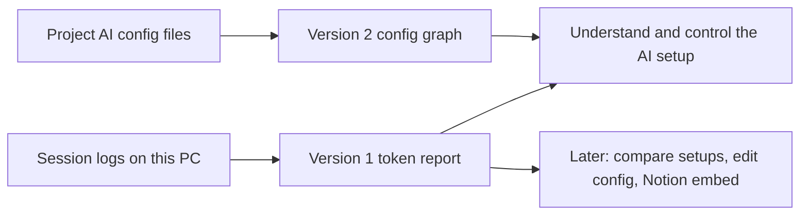
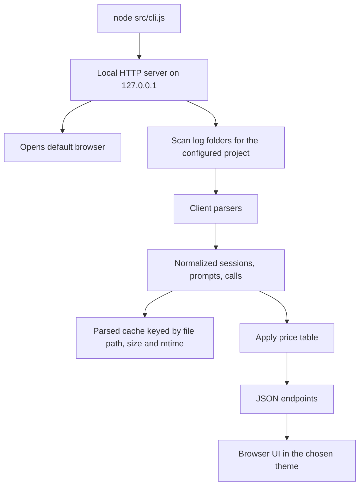
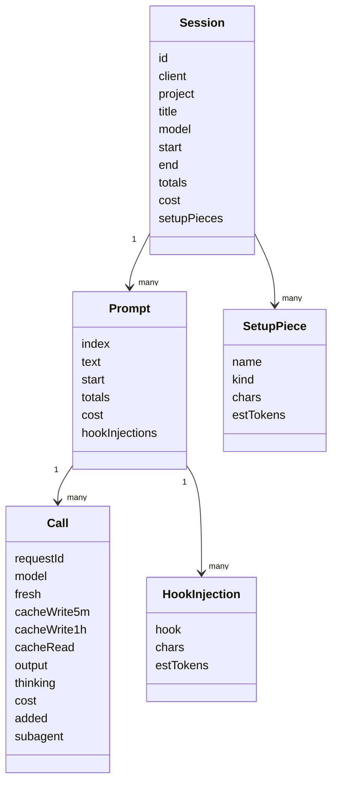

# AIConfigGraph — Design Spec

**Status:** Spec v1, written 2026-10-18 from the brainstorm. Awaiting owner review. Nothing built.
**Scope of this spec:** Version 1, the token report. The config graph and later phases are outlined at the end for direction only.

## 1. Intent

The owner wants to see an AI setup as a whole and where its tokens go, to understand how the AI "brain" (rules, memory, playbooks, skills, hooks) behaves and to find token-efficient ways for the team to work. Version 1 answers one question well: **for a session, and for each prompt in it, how many tokens went in and out, what filled them, and what did it cost?**

## 2. Goals, non-goals, anti-goals

| Goals (v1) | Non-goals (v1) | Anti-goals (failure even if it works) |
|---|---|---|
| Per session and per prompt: fresh input, cache write, cache read, output, thinking, dollar cost | Comparing setups, tagging sessions | Numbers that silently disagree with the logs |
| Drill session to prompt to API call | Config graph | Any write to logs, config or projects |
| Fixed setup cost split into pieces | Editing config | Sending any data off the machine |
| Hook injection cost per hook | Notion | Hiding a client's missing detail behind fake equal detail |
| Four switchable themes | Teammates, accounts, hosting | A dependency on Notion or any online service |
| Claude Code first, Codex second | Cursor, Gemini | |

## 3. Decisions

| Topic | Decision | Whose call |
|---|---|---|
| First version | Token report per session and per prompt, input and output | Owner |
| Dollar cost | Included in v1 | Owner |
| Projects | PvM first; vision is any project using the master config. Project is a path in settings, never hard-coded | Owner (scope), Claude (setting) |
| Users | Owner only | Owner |
| Notion | Optional later, never a dependency | Owner |
| Look | Four themes switchable in Settings | Owner |
| Default theme | A, Midnight Craft | Claude |
| Runtime | Local Node program on 127.0.0.1, opens the browser, read-only, no network | Claude |
| Dependencies | None: Node built-ins on the server, plain HTML, CSS and JS in the browser, charts drawn as SVG by hand | Claude |
| Clients | Claude Code, then Codex; Cursor and Gemini later | Claude |
| Price table | JSON file in the repo, edited by hand; values copied from the official pricing pages at build time, not from memory | Claude |
| Per-piece setup cost | Estimate at about 4 characters per token, labelled "estimate"; call totals are exact | Claude |
| Workspace | `G:\Projects\AIConfigGraph`, Universal config from `claude-unity-shared` | Owner |

## 4. How it runs

- Start: `node src/cli.js` (optional `--project <path>`, `--port <n>`). Prints the URL and opens it.
- Server binds `127.0.0.1` only. It reads files; it never writes outside its own cache file and settings file inside the workspace.
- Settings file `settings.local.json` in the workspace root (gitignored): project paths, active project, theme.
- Re-scan on page load; unchanged log files come from the cache.

## 5. Data sources

### 5.1 Claude Code (verified on session `1045f30c`, Claude Code 2.1.302)

Location: `~/.claude/projects/<slug>/<sessionId>.jsonl`. The slug is the project's absolute path with the drive colon and path separators turned into dashes, for example `G:\Unity\Project\PetVsMonster` becomes `G--Unity-Project-PetVsMonster`.

| Line | Fields used |
|---|---|
| `type: user` | `promptId`, `timestamp`, `message.content` (first text = prompt text), `isSidechain` |
| `type: assistant` | `requestId`, `message.model`, `message.usage` (`input_tokens`, `cache_creation_input_tokens`, `cache_creation.ephemeral_5m_input_tokens`, `cache_creation.ephemeral_1h_input_tokens`, `cache_read_input_tokens`, `output_tokens`, `output_tokens_details.thinking_tokens`), `message.content` tool_use blocks, `isSidechain` |
| `type: attachment`, `attachment.type: hook_additional_context` | `hookName` or `hookEvent`, `content` |
| `type: api-request-shape` | `shape.system` blocks = the full system prompt as sent |
| `type: ai-title` | session title |

Rules:
- **Dedupe calls by `requestId`.** One API call writes several `assistant` lines with the same `requestId` and repeated `usage`. Summing lines double-counts. Session `1045f30c` had 67 assistant lines for 36 calls.
- **A prompt** is a user line carrying text the person typed, plus every call until the next such line. Tool-result user lines belong to the current prompt.
- **Sidechain** lines (`isSidechain: true`, subagents) count toward the prompt that spawned them and are marked as subagent calls. Builder checks whether subagent transcripts also live in separate files and avoids counting them twice.
- **What filled a call:** the tool_use blocks of the previous call and the size of their tool results. Shown per call as "added: Read `path` 4.1k chars".

### 5.2 Codex

Location: `~/.codex/sessions/YYYY/MM/DD/rollout-*.jsonl`. Project match: `session_meta` working directory equals the project path.

| Line | Fields used |
|---|---|
| `event_msg` `task_started` / `task_complete` | prompt boundaries |
| `event_msg` `token_count` | `info.last_token_usage`: `input_tokens`, `cached_input_tokens`, `output_tokens`, `reasoning_output_tokens`; `rate_limits.primary.used_percent` |
| `response_item` `message` (role user) | prompt text |

Normalize: Codex `input_tokens` **includes** cached tokens; Claude `input_tokens` **excludes** them. Model stores `fresh = input - cached` for Codex. Codex has no per-call breakdown inside a turn and no setup-piece split; the UI says so on those panels.

## 6. Data model

`totals` = sums of the Call fields. A Codex prompt has one synthetic Call holding the turn totals.

## 7. Setup pieces (Claude only)

Split the `api-request-shape` system blocks into named pieces:

| Piece | How found |
|---|---|
| Base instructions | System text before the first project section |
| `CLAUDE.md` (global, project) | Sections headed `Contents of <path>` for CLAUDE.md files |
| Each rule | `Contents of <path>` sections under `.claude/rules/` |
| Auto-memory index | `Contents of ...MEMORY.md` |
| Skill list | The skills listing block |
| MCP server instructions | The MCP instructions block |
| Tool definitions | Tool schemas, if present in the shape; if absent, show "not in log" |
| Other | Remainder, so the pieces add up to the whole |

Each piece shows characters and estimated tokens. The panel header shows the exact cache write of the session's first call next to the estimate sum, so the owner sees how close the estimate is. Builder confirms the exact section markers against a real shape and keeps the matcher in one function.

## 8. Cost

`prices.json` in the repo, one row per model id, USD per million tokens: `input`, `output`, `cacheWrite5m`, `cacheWrite1h`, `cacheRead`. Thinking tokens are billed as output. Codex rows use that provider's published prices.

The logs show a subscription login (Claude `oauth` beta; Codex usage-limit percentages), so the owner's real bill is a plan fee, not per token. The UI labels every dollar figure **"API-equivalent cost"**: what the same tokens would cost on the pay-per-token API. It is a yardstick for comparing sessions, not the invoice. Codex also shows the usage-limit percent from its log. (Claude's call.)

Cost per call = each token field times its price. Unknown model: tokens shown, cost shown as "no price" and listed in a banner, never zero.

## 9. Screens

| Screen | Content |
|---|---|
| Sessions list | Project and client filter, date range. Rows: date, title, client, model, prompts, fresh in, cache write, cache read, output, cost. Sort by any column. Totals row |
| Session view | Header totals and cost; cache hit rate; stacked bar of fresh, cache write, cache read, output; setup pieces panel; hook injections per hook; prompt timeline (one bar per prompt, height = cost); prompt table |
| Prompt view | Prompt text, totals, cost; calls table with every token field, "added" column, subagent marker; hook injections for this prompt |
| Settings | Project paths (add, remove, pick active), theme picker with live preview, path of price table, last scan time |

Numbers: compact (`412k`, `4.6M`), exact value on hover. Cost to cents, sub-cent as `<$0.01`.

## 10. Look

Four themes per `.claude/rules/ui-design-system.md` (A Midnight Craft default, B Paper Workspace, C Blueprint, D Signal Terminal). Themes are CSS custom properties on `:root[data-theme]` plus a few structural flags. A theme check page renders one Session view in all four themes side by side; every screen passes it before done. Theme choice saved in settings.

## 11. Verification

- `node --test` with trimmed fixture logs in `test/fixtures/` (one Claude session with repeated `requestId`, a sidechain call, a hook injection; one Codex rollout).
- One assertion per rule: requestId dedupe, Codex fresh normalization, prompt boundaries, unknown-model cost, setup pieces summing to the whole.
- Manual: run against PvM, compare one session's totals with a hand `node -e` sum over the raw log. Record both numbers in the report.

## 12. Left to the builder

File layout under `src/`, exact endpoint names, table and chart details, cache file format, how the theme preview is laid out. Keep it boring and dependency-free.

## 13. Later phases (direction only, not specified)

| Phase | Outline |
|---|---|
| 2. Config graph | Groundwork: [2026-09-26-sp3-knowledge-map.md](2026-09-26-sp3-knowledge-map.md) (history). Nodes = files (rules, memories, playbooks, skills, hooks, entry files), edges = links and backticked `mem-` references, grouped by hub; show which client receives each file; link nodes to their token cost from v1. Mockup in brainstorm `visual-style-graph.html` |
| 3. Compare | Tag sessions after the fact, compare tagged groups, a quality signal per session (rating or retry count) |
| 4. More clients | Cursor (SQLite), Gemini |
| 5. Editing | Edit project-owned config from the tool, respecting master ownership (Universal and generated files read-only) |
| 6. Notion | Optional embed or link of a static export |
| 7. All projects | Every project with `project.config.json`; already a setting in v1 |
