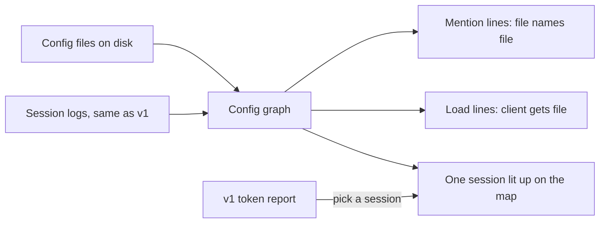
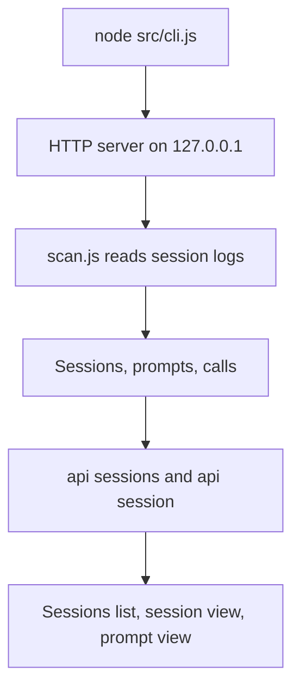
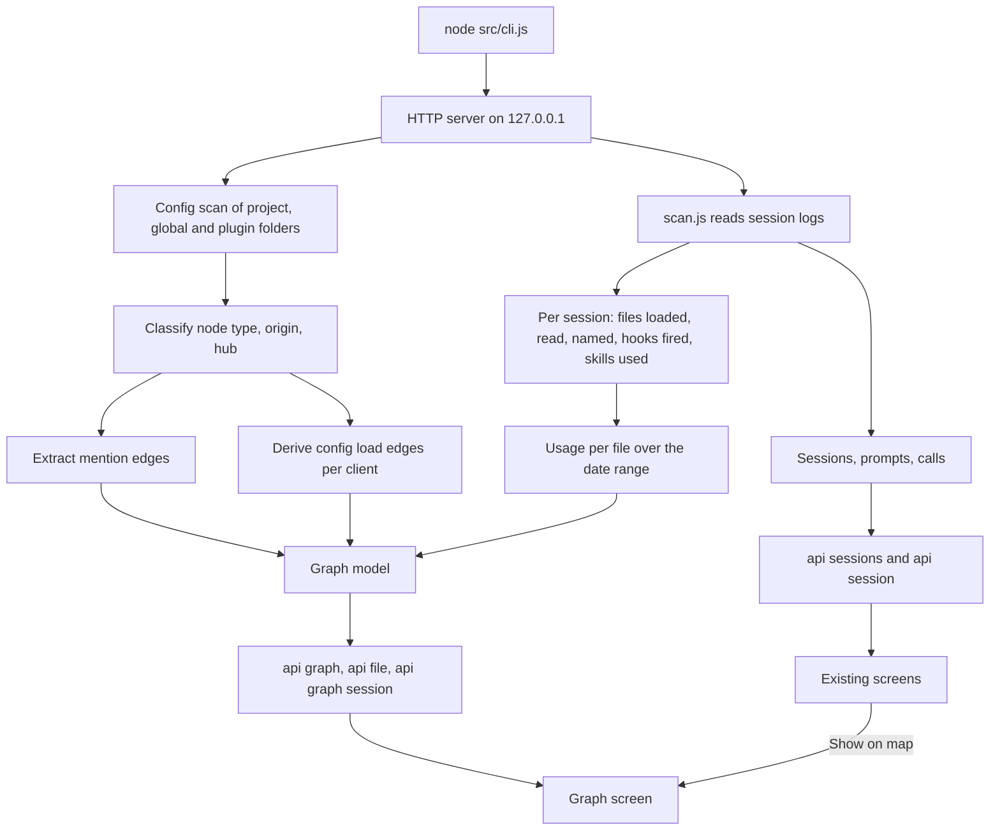
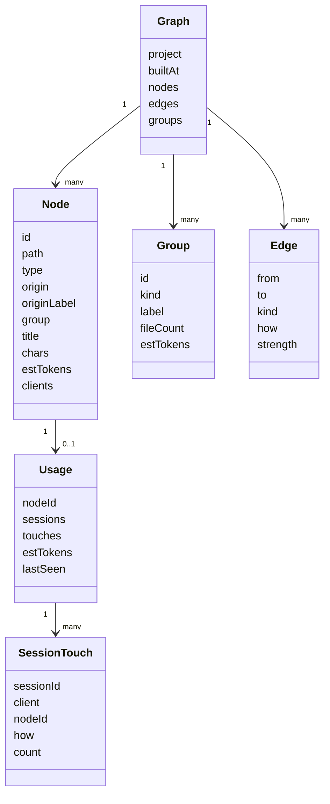
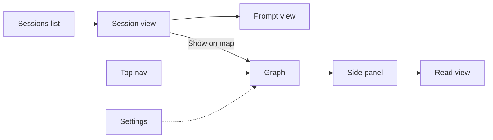

# AIConfigGraph Phase 2: Config Graph — Design Spec

**Status:** Spec written 2026-10-18 from the brainstorm. Awaiting owner review. Nothing built.
**Builds on:** [2026-10-18-ai-config-graph.md](2026-10-18-ai-config-graph.md) (v1 token report, built and verified). Groundwork: [2026-09-26-sp3-knowledge-map.md](2026-09-26-sp3-knowledge-map.md) (history; its Notion, CI and Cloudflare parts do not apply).
**Brainstorm mockups:** `G:\tmp\brain-lens-brainstorm\.superpowers\brainstorm\3126-1792340622\content\graph-layout.html` (two layouts, outside boxes open on click); `...\657-1792328748\content\visual-style-graph.html` (four themes).

## 1. Intent

The owner has a rough feel for how the AI config, memory and playbooks connect, but no way to see it whole. Phase 2 draws the AI brain of one project as a map, so the big picture is something to look at instead of something to rebuild in the head. It answers: **which files make up the brain, how do they point at each other, and which ones does each AI client actually load and read?**

## 2. Goals, non-goals, anti-goals

| Goals (phase 2) | Non-goals (phase 2) | Anti-goals (failure even if it works) |
|---|---|---|
| Every config file of one project as a node: entry files, rules, hooks, memory index, hubs, memories, playbooks, skills, agents | Finding duplicate concepts, duplicate files or duplicate bugs (later analysis phase, owner's call) | A load line drawn as fact when it was only guessed; observed and inferred must look different |
| Mention lines: Markdown link, wikilink, file name as a word | Editing any file | Any write to config, logs or projects |
| Load lines by config: what Claude, Codex, Cursor and Gemini would load, and how (startup, hook, on demand) | Reading Cursor or Gemini logs | Sending any data off the machine |
| Load lines by logs: what Claude and Codex sessions actually loaded and read, how often, estimated tokens | Several projects on one map | A 300-node hairball on open |
| Outside sources (global `~/.claude`, `~/.codex`, each plugin) as closed boxes that open into their files | Notion, CI, hosting | Hiding a client with no entry file; it shows as missing, not absent |
| Two layouts, Layers and Clusters, picked in Settings | Physics or animated force layout | A new dependency |
| Side panel per file and a read-only full-text view | Showing file content of outside sources beyond their own files | |
| Session overlay: pick a session, see the files it touched | | |
| All four themes, each with its own node shape and edge routing | | |

## 3. Decisions

| Topic | Decision | Whose call |
|---|---|---|
| What lines mean | Both mentions and loading | Owner |
| Loading source | Both config (would load) and logs (did load) | Owner |
| Duplicates | Out of phase 2, belongs to a later analysis phase | Owner |
| Outside files | Shown as closed black boxes; click opens the sub-graph inside | Owner |
| Layout | Layers and Clusters both shipped, chosen in Settings like theme | Owner |
| Click a file | Highlight neighbours, side panel, Read button for full text | Owner (Claude proposed, owner kept) |
| Session overlay | Pick a session, the map lights up the files it touched | Owner |
| Hubs closed on open | Hubs start closed with file count and token size; skeleton (clients, entry files, rules, hooks, index) stays open; "open all" button | Claude (owner asked for a recommendation) |
| Full-text view | Plain monospace text; file names that are nodes become links to their node; no Markdown rendering | Claude |
| Client coverage | Config side for all four clients; log side for Claude and Codex only, as v1 | Claude |
| Project scope | The active project from v1 Settings; one project per map | Claude |
| Token size of a file | Characters divided by 4, labelled estimate, same rule as v1 setup pieces | Claude |
| Rendering | Hand-written SVG with pan and zoom, no library | Claude |
| Spec path | `.cursor/plans/design/2026-10-18-config-graph.md` per `plan-files.md` | Owner |

## 4. How it runs

Current v1 flow:

Target flow, phase 2 added:

- No new process, port or setting file. The graph scan reuses v1's settings (active project), log scan and parsed cache.
- Graph build is cached in memory keyed by each file's path, size and mtime, like v1's parsed cache. Rebuilt on page load when anything changed.
- Still read-only. The only new file read beyond v1 is the config files themselves.

## 5. Data sources (verified 2026-10-18 against PetVsMonster)

### 5.1 Project files

| Node type | Where (PvM count) | Notes |
|---|---|---|
| Entry | `CLAUDE.md`, `AGENTS.md` at root; `GEMINI.md` absent in PvM | AGENTS.md is a copy of CLAUDE.md content in PvM |
| Rule | `.claude/rules/*.md` (26) | All arrive in the Claude `instructions` attachment, so all are loaded at startup |
| Cursor rule | `.cursor/rules/*.mdc` (4) | Front matter `alwaysApply: true` means loaded every request; otherwise on demand |
| Hook | `.claude/hooks/*.js` (1: `memory-index-injector.js`) plus scripts named in `.claude/settings.json` `hooks` (also `.claude/tools/ai-audit/check-ai-index.js`, PostToolUse) | Hook node = the script; event name from settings |
| Memory index | `.cursor/memory/mem-arch-assemblies-canonical.md` (path from `memory-first-workflow.md` PROJECT CONFIG; 328 table rows) | The fixed name the shared hook reads |
| Hub | Index rows starting `HUB:` (15 in PvM), each with a backticked file name | |
| Memory | `.cursor/memory/mem-*.md` and `.cursor/memory/bugs/*.md` (324 entries in the folder, incl. sub-folders) | |
| Playbook | `.cursor/playbooks/**/*.md` | |
| Skill | `.claude/skills/*/SKILL.md` (13), `.agents/skills/*/SKILL.md` (23, Codex), `.codex/skills/`, `.cursor/skills/` | Same skill name in two folders = two nodes, one per client folder |
| Agent | `.claude/agents/*.md` (1) | |
| Docs | `docs/**/*.md` | Off by default (SP3 counted many); a Settings toggle shows them |

### 5.2 Origin of a file

| Origin | Rule | Verified |
|---|---|---|
| Universal | Path is a `dest` of a `files` entry in the shared repo `manifest.json` (34 entries, bucket `universal` or `templated`) | Shared repo path from env `SHARED_CONFIG_DIR`, else `G:\Unity\claude-unity-shared`, same as `sync.ps1` |
| Generated | Path is in manifest `generated` (6, e.g. `.claude/settings.json`) | |
| Framework | First 5 lines contain `GENERATED from com.hung.<pkg>@<ver>` (e.g. `pkg-autotest-autotest-usage.md`) | Origin label = `com.hung.<pkg>@<ver>` |
| Project | Anything else inside the project | |
| Global | Under `~/.claude` or `~/.codex` | |
| Plugin | Under an enabled plugin's `installPath` | |

Origin shows as node border style and in the side panel. It never changes node type.

### 5.3 Hub membership

1. A file named in a `HUB:` row is a hub.
2. A memory's first `**Parent:**` line names a parent by its first backticked token (205 PvM files have one; forms seen: `` `mem-layer5-main` ``, `` `mem-arch-assemblies-canonical` — note``). Follow parents upward until a hub is reached; stop on a loop.
3. Files under `.cursor/memory/bugs/` belong to the `bugs/README.md` hub.
4. Parent is the index itself or nothing resolves: the file goes in an **Unfiled** group, which renders like a hub.

### 5.4 Outside sources

| Box | Contents | Verified |
|---|---|---|
| Global Claude | `~/.claude/CLAUDE.md`, the auto-memory folder for this project (`~/.claude/projects/<slug>/memory/`, MEMORY.md plus files), `~/.claude/skills/*/SKILL.md`, scripts named in `~/.claude/settings.json` `hooks` | Global CLAUDE.md appears as type `User` in the `instructions` attachment |
| Global Codex | `~/.codex/AGENTS.md` | exists |
| One box per enabled plugin | From `~/.claude/settings.json` `enabledPlugins` plus `~/.claude/plugins/installed_plugins.json` `installPath`: its `skills/*/SKILL.md`, `hooks/` scripts, `agents/*.md` | superpowers 15 skills, caveman 7, ponytail 6 |

A closed box shows label, file count, token size. Open shows its files as nodes with their own mention edges.

### 5.5 Config load lines

| Client | Startup | Hook | On demand |
|---|---|---|---|
| Claude | Global and project CLAUDE.md, every `.claude/rules/*.md`, MEMORY.md, skill list (names only) | Each hook script, from project and global `settings.json` and plugin `hooks.json` | Skills (body loads when invoked), memories, playbooks |
| Codex | `~/.codex/AGENTS.md`, project `AGENTS.md` | none found | `.agents/skills`, `.codex/skills`, memories |
| Cursor | `.cursor/rules/*.mdc` with `alwaysApply: true` | none | Other `.mdc`, `.cursor/skills`, memories |
| Gemini | `GEMINI.md` if present | none | |

A client with no startup file (Gemini in PvM) shows dashed, as in the mockup. On-demand lines are not drawn from the client to every memory; the client reaches memories through the entry file and the index via mention lines.

### 5.6 Log load lines (verified on all 15 PvM Claude sessions and a PvM Codex rollout)

| Signal | Claude log | Codex rollout | Strength |
|---|---|---|---|
| Loaded at startup | `attachment.type: instructions`, `files[].path` and `type` (`User`, `Project`, `AutoMem`) | User message text `# AGENTS.md instructions for <dir>` | Observed |
| Hook fired | `attachment.type: hook_additional_context`, `hookName` or `hookEvent` (PvM: UserPromptSubmit 678, SessionStart 15) and content chars | none | Observed; matched to a hook node by event, and by script when only one script serves that event |
| Skill used | `tool_use` `Skill`, `input.skill` (11 in PvM) | none | Observed |
| File read or written | `tool_use` `Read`, `Edit`, `Write`, `input.file_path` (Read 51, Edit 417, Write 74) | none | Observed |
| File named in a command | `tool_use` `Bash` `input.command`, `Grep` input; a node file name as a word (247 Bash calls name a `mem-` file or rule path) | `custom_tool_call` `input`, `function_call` `arguments` (Codex reads files via `exec_command` and `node_repl`) | Named, likely read; drawn weaker than observed |

Rules:
- Paths compare case-insensitively with slashes normalized (logs hold both `g:\` and `G:\`).
- Subagent transcripts count, as in v1.
- A tool-results file under the session folder is not a node and is ignored.
- Estimated tokens for a touch = file characters / 4 per touch. The exact per-file number is not in the log; the panel says so.

## 6. Data model

| Field | Values |
|---|---|
| `Node.id` | Normalized absolute path; clients use `client:claude` style ids |
| `Node.type` | `client`, `entry`, `rule`, `cursor-rule`, `hook`, `index`, `hub`, `memory`, `playbook`, `skill`, `agent`, `doc` |
| `Node.origin` | `project`, `universal`, `generated`, `framework`, `global`, `plugin` |
| `Node.clients` | Per client: `startup`, `hook`, `on-demand` or absent |
| `Group.kind` | `hub`, `unfiled`, `outside` |
| `Edge.kind` | `mention`, `load` |
| `Edge.how` | load: `startup`, `hook`, `on-demand`; mention: `link`, `wikilink`, `name` |
| `Edge.strength` | `config` (would load), `observed` (log saw it), `named` (log command named it) |
| `SessionTouch.how` | `startup`, `hook`, `skill`, `read`, `write`, `named` |

Mention edge extraction follows SP3 §5.3: Markdown link resolving to a node path, `[[name]]` wikilink, or a node's file name appearing as a word. One edge per ordered pair, self-links dropped, unknown targets ignored. Edges between a node and a closed group are drawn once to the group, with a count.

## 7. Screens

| Screen | Content |
|---|---|
| Graph | Header: project, node counts by type, date range for usage (v1 date filter), session picker, search box, "open all" and "close all", type and origin filters. Body: the map in the chosen layout |
| Side panel | Path, type, origin (with Framework package label), size and estimated tokens, per-client load mode, usage (sessions that touched it in range, touches, estimated tokens, last seen), "mentions" list and "mentioned by" list, each entry clickable. Read button |
| Read view | Full file text, monospace, read-only. Node file names in the text link to their node. Back returns to the map with selection kept |
| Session overlay | With a session picked: touched nodes and their edges at full strength, the rest dimmed; groups holding a touched file open automatically; touch kind shown per node (startup, hook, skill, read, write, named) |
| Settings (added rows) | Layout: Layers or Clusters. Show docs: on or off |

### 7.1 Opening state

- Open: clients, entry files, rules, Cursor rules, hooks, memory index.
- Closed: every hub group, Unfiled, every outside box. A closed group shows label, file count, token size.
- Search opens the group holding the match and selects it.

### 7.2 Layouts

| Layout | Placement |
|---|---|
| Layers | Columns in load order: client, entry, rules and hooks and skills, index, hubs, hub members. Outside boxes sit in the column where they load. Open groups expand in place and push later rows down |
| Clusters | Entry file in the middle, hubs around it, each hub's members gathered around the hub, outside boxes on the left edge |

Both are deterministic: same data, same picture. Node order inside a column or cluster is by name. Pan with drag, zoom with wheel. Builder picks the exact spacing.

### 7.3 Lines

| Line | Look |
|---|---|
| Load, config | Solid, thin |
| Load, observed in logs | Solid, thicker, accent colour when a session is picked |
| Load, named in a command | Solid, thin, accent dashed |
| Mention | Dotted |
| Selected node's lines | Full strength; everything else dimmed |

## 8. Look

Same four themes, same tokens in `public/themes.css`. Graph adds structural flags per theme, taken from the approved mockup `visual-style-graph.html`:

| Theme | Node shape | Edge routing | Label case |
|---|---|---|---|
| A Midnight Craft | Circle | Curved | As written |
| B Paper Workspace | Circle | Curved | As written |
| C Blueprint | Square with ink border | Orthogonal | Uppercase |
| D Signal Terminal | Diamond | Curved, dotted when idle | Uppercase |

Node fill per type comes from new tokens (`--n-entry`, `--n-rule`, `--n-hook`, `--n-index`, `--n-hub`, `--n-memory`, `--n-playbook`, `--n-skill`, plus `--e-line`, `--e-hot`), values copied from the mockup. The theme check page gains a Graph panel: a fixture graph in all four themes and both layouts. Every new screen passes it before done.

## 9. Verification

- `node --test` with a fixture tree in `test/fixtures/config/`: a small project (entry, 2 rules, a hook in `settings.json`, an index with 2 `HUB:` rows, memories with `**Parent:**` chains incl. a loop and an unresolved parent, a `bugs/` file, a Framework header, an `alwaysApply` `.mdc`), a fake manifest, a fake global folder and one fake plugin.
- One assertion per rule: type classification, origin (manifest, generated, Framework header), hub walk incl. loop and Unfiled, mention extraction (link, wikilink, name, self-link dropped, unknown dropped, Windows paths), config load lines per client, log touches (instructions attachment, hook, Skill, Read, Bash named, Codex AGENTS.md line), path case normalization.
- Manual on PvM, recorded in the report: rule count 26, `HUB:` count 15, enabled plugins 3, and one session's touch list compared with a hand `node -e` count over its log.
- `/api/file` refuses any path not in the current node set (test).

## 10. Left to the builder

File layout under `src/` and `public/`, endpoint names, layout spacing numbers, pan and zoom details, panel layout, how the overlay picker lists sessions, cache structure. Keep it boring and dependency-free, matching v1.

## 11. Risks

| Risk | Mitigation |
|---|---|
| Name-as-word matching over-links short or common file names | Match only full file names with extension or the `mem-` stem; one function owns the matcher, tested |
| `**Parent:**` format drifts | First backticked token only; anything else goes to Unfiled, so drift shows instead of hiding |
| Bash-named touches overstate reads | Shown as `named`, drawn weaker, counted separately in the panel |
| `/api/file` becomes a file reader for any path | Only serves paths in the built node set; still 127.0.0.1 and host check as v1 |
| Plugin folders hold many non-config files (tests, docs) | Only `skills/*/SKILL.md`, `hooks/` scripts and `agents/*.md` become nodes |
