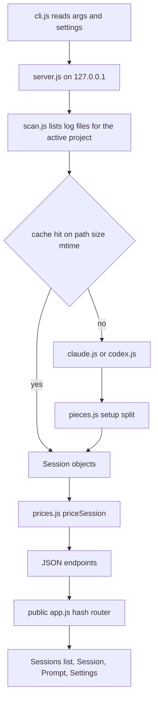

# AIConfigGraph v1 Token Report Implementation Plan

> **For agentic workers (Gemini, Claude, Codex):** Execute inline, task by task, in order. Do NOT use subagent-driven development. Steps use checkbox (`- [ ]`) syntax for tracking. Commit steps run only once the owner has said commits are wanted.

**Goal:** A local, read-only web tool that shows, per Claude Code or Codex session and per prompt, the tokens in and out, what filled them, and the API-equivalent cost.

**Architecture:** `node src/cli.js` starts an HTTP server on 127.0.0.1. Parsers turn log files into one normalized `Session` shape; a scan step caches parsed sessions by path, size and mtime; prices are applied per request. A plain HTML/CSS/JS page with hash routing renders four screens in four token-based themes.

**Tech Stack:** Node 24 built-ins only (`node:http`, `node:fs`, `node:path`, `node:os`, `node:util`, `node:child_process`, `node:test`, `node:assert/strict`), ES modules. Browser: plain HTML, CSS custom properties, vanilla JS modules, hand-drawn SVG. No npm dependencies, no `npm install`.

**Spec:** [`.cursor/plans/design/2026-10-18-ai-config-graph.md`](../design/2026-10-18-ai-config-graph.md)

## How to execute this plan

This plan carries the **complete code**. It was built and run before the plan was written:

- `node --test` → **41 tests, 41 pass, 0 fail** (Node v24.12.0, Windows 11).
- The scan, run on the real PvM logs, gave session `1045f30c` exactly the same numbers as an independent hand sum: 78 calls, fresh 156, cache write 210,872, cache read 13,489,241, output 57,786.

Rules for the executor:

1. **Copy every code block verbatim** into the named file. Do not rename, reformat, "improve", add dependencies, add TypeScript, or add files the plan does not name.
2. Work in `G:\Projects\AIConfigGraph`. The shell is **Windows PowerShell 5.1**: use `curl.exe` (not `curl`), use `node -e` for checks (there is no `grep`), and quote paths that contain spaces.
3. Run each verification command and compare with the **Expected** line. If the result differs, **stop and report** the command and its output to the owner. Do not patch around a failure.
4. Never write to `~/.claude`, `~/.codex`, or any project folder. The tool only reads those.
5. `.gitignore` already ignores `settings.local.json` and `cache/`. Leave it alone.
6. In test output, `test\helpers.js` appears as one extra passing file. That is expected and is part of the 41.

## Global Constraints

- No dependencies: Node built-ins on the server; plain HTML, CSS and JS in the browser; charts as hand-drawn SVG.
- Server binds `127.0.0.1` only. No outbound network at runtime, no web fonts, no CDN.
- Read-only: never write to logs, config or projects. Writes go only to `settings.local.json` and `cache/` in the workspace root.
- Project is a path in settings, never hard-coded.
- Dedupe Claude calls by `requestId`; dedupe Codex calls by `response_id`.
- Codex `fresh = input_tokens - cached_input_tokens - cache_write_input_tokens`; Claude `fresh = input_tokens`.
- Every dollar figure labelled **"API-equivalent cost"**. Unknown model: tokens shown, cost `null`, shown as "no price", listed in a banner, never zero.
- Setup-piece and hook sizes: `estTokens = Math.ceil(chars / 4)`, labelled "estimate". Call totals are exact.
- Numbers compact (`412k`, `4.6M`), exact on hover. Cost to cents, sub-cent as `<$0.01`.
- Four themes per `.claude/rules/ui-design-system.md`, default A. Every screen checked in all four.
- `prices.json` values copied from the official pricing pages during Task 4, never from memory.

## Findings that refine the spec

Checked on the real logs (PvM session `1045f30c` and all 35 Codex rollouts on this PC):

| Spec assumption | Log reality | Plan response |
|---|---|---|
| Setup pieces are `Contents of <path>` sections in `api-request-shape` `shape.system` | `shape.system` is 3 blocks of about 8.6k chars. CLAUDE.md, rules and MEMORY.md arrive in one `attachment` of type `instructions` as `files: [{ path, type: User or Project or AutoMem, content }]`. Skill list = `skill_listing.content`; MCP = `mcp_instructions_delta.addedBlocks`; tool schemas = `shape.tools` (about 81k chars) | `src/pieces.js` builds one piece per file plus base, skills, MCP and tools |
| A typed prompt is a user line with text | Modern lines carry `origin: { kind: "human" }` on typed prompts only; an interrupt notice is a text user line without it | Use `origin.kind === "human"` when any user line has `origin`; otherwise fall back to content shape |
| Hooks belong to a prompt | `SessionStart` hooks come before the first prompt; `UserPromptSubmit` hooks come right after their prompt line | Pre-prompt hooks join the first prompt; others join the current prompt |
| Codex has only per-turn totals | Every rollout has a `token_usage_record` line per API call (`response_id`, `turn_id`, `usage`) | Codex gets real per-call rows grouped by turn; no synthetic call |
| Codex user message = prompt | The first user messages of a session are injected `# AGENTS.md …` and `<environment_context>` blocks | Prompt text = first `input_text` that starts with neither `<` nor `# AGENTS.md` |
| Slug = path with colon and separators as dashes | Folders mix `g--` and `G--` for the same drive; Claude Code dashes every non-alphanumeric character | `claudeSlug` replaces `[^a-zA-Z0-9]`; folder match ignores case |
| Thinking billed as output | Anthropic and OpenAI both count thinking or reasoning inside `output_tokens` | Cost bills `output` only; `thinking` is a breakdown, never added again |
| Duplicate `assistant` lines per `requestId` | Each line holds one content block; usage is identical on all of them | Count usage once; collect `tool_use` blocks from every line |

## Review Focus

Each item has a test in the named task.

1. Slug folder case differs from the configured path (`g--Unity-...` vs `G:\Unity\...`): the sessions still appear. Task 5, `slug folder found regardless of case`.
2. A log being written right now ends in a half line: it is skipped and counted in `badLines`, never thrown. Task 2, `bad lines skipped and counted`.
3. Calls before the first typed prompt, or `<synthetic>` model lines: early calls land in prompt 0 `(before first prompt)`; synthetic lines are not calls. Task 2, `prompt boundaries` and `bad lines … synthetic`.
4. Thinking counted twice in cost: cost uses `output` only. Task 4, `thinking not billed twice`.
5. Model ids that share a stem (`claude-opus-5` and `claude-opus-5-5` are both in the logs): `claude-opus-5-5` is never priced as `claude-opus-5`. Only an 8-digit date suffix falls back to its base id; no match gives "no price", never $0. Task 4, `date-suffixed id uses the base row`.

---

## Flow

Current: nothing built. Target:



## File structure

| File | Responsibility | Task |
|---|---|---|
| `package.json` | ES modules, `start` and `test` scripts | 1 |
| `src/model.js` | Totals helpers, JSONL reader, Session and Prompt constructors | 1 |
| `test/helpers.js`, `test/fixtures/*.jsonl` | Fixture reader, fake log folders, synthetic logs | 1 |
| `src/pieces.js` | `splitSetupPieces`: the one matcher for setup pieces | 2 |
| `src/parse/claude.js` | `parseClaudeSession`: JSONL text to Session | 2 |
| `src/parse/codex.js` | `parseCodexRollout`: JSONL text to Session | 3 |
| `src/prices.js`, `prices.json` | Price lookup and cost | 4 |
| `src/scan.js`, `src/settings.js` | Find log files, parsed cache, settings file | 5 |
| `src/server.js`, `src/cli.js` | HTTP API, static files, CLI | 6 |
| `public/*` | UI: format, themes, layout, charts, screens, theme check | 7 |

## Shared shapes

Every module uses these names.

```js
// Totals
{ fresh, cacheWrite5m, cacheWrite1h, cacheRead, output, thinking }   // integers

// Call
{ requestId, model, timestamp, ...Totals, added: [{ tool, target, chars }], subagent, cost }

// HookInjection
{ hook, chars, estTokens }

// Prompt
{ index, text, start, calls: Call[], hookInjections: HookInjection[], totals: Totals, cost }

// SetupPiece  (kind: base | claude-md | rule | memory-index | other | skills | mcp | tools)
{ name, kind, chars, estTokens }

// Session
{ id, client, project, file, title, model, start, end, prompts: Prompt[],
  setupPieces: SetupPiece[] | null, firstCallCacheWrite: number | null,
  rateLimitPercent: number | null, badLines, totals: Totals, cost, unpriced: string[] }
```

`cost` fields stay `null` until `priceSession` (Task 4) fills them on a copy. Parsers fill `totals`.

---

### Task 1: Scaffold, shared model, fixtures

**Files:**
- Create: `package.json`, `src/model.js`, `test/helpers.js`
- Create: `test/fixtures/claude-session.jsonl`, `test/fixtures/claude-subagent.jsonl`, `test/fixtures/codex-rollout.jsonl`

**Interfaces:**
- Produces (`src/model.js`): `FIELDS`, `emptyTotals()`, `addTotals(a, b)`, `estTokens(chars)`, `readJsonl(text) → { rows, bad }`, `mostCommon(values)`, `newSession(fields)`, `newPrompt(index, text, start)`, `finishSession(session)`.
- Produces (`test/helpers.js`): `FIXTURES`, `readFixture(name)`, `tempDir()`, `fakeLogs() → { dir, claudeRoot, codexRoot, claudeDir, cacheFile }`.

The fixtures are synthetic: no real log content. Each line is one JSON object; keep every line exactly as written, including the deliberately broken line `{"type":"user", broken` in `claude-session.jsonl`.

- [ ] **Step 1: Create `package.json`**

```json
{
  "name": "ai-config-graph",
  "private": true,
  "type": "module",
  "scripts": {
    "start": "node src/cli.js",
    "test": "node --test"
  }
}
```

- [ ] **Step 2: Create `src/model.js`**

```js
export const FIELDS = ['fresh', 'cacheWrite5m', 'cacheWrite1h', 'cacheRead', 'output', 'thinking'];

export function emptyTotals() {
  return Object.fromEntries(FIELDS.map(f => [f, 0]));
}

export function addTotals(a, b) {
  const t = {};
  for (const f of FIELDS) t[f] = (a[f] || 0) + (b[f] || 0);
  return t;
}

export function estTokens(chars) {
  return Math.ceil(chars / 4);
}

// Parse JSONL; a half-written or corrupt line is skipped and counted, never thrown.
export function readJsonl(text) {
  const rows = [];
  let bad = 0;
  for (const line of text.split('\n')) {
    if (!line.trim()) continue;
    try { rows.push(JSON.parse(line)); } catch { bad++; }
  }
  return { rows, bad };
}

export function mostCommon(values) {
  const counts = new Map();
  for (const v of values) if (v) counts.set(v, (counts.get(v) || 0) + 1);
  let best = null;
  for (const [v, n] of counts) if (best === null || n > counts.get(best)) best = v;
  return best;
}

export function newSession(fields) {
  return {
    id: null, client: null, project: null, file: null, title: null, model: null,
    start: null, end: null, prompts: [], setupPieces: null, firstCallCacheWrite: null,
    rateLimitPercent: null, badLines: 0, totals: null, cost: null, unpriced: [],
    ...fields,
  };
}

export function newPrompt(index, text, start) {
  return { index, text, start, calls: [], hookInjections: [], totals: null, cost: null };
}

// Fill prompt and session totals and the session model from the calls.
export function finishSession(s) {
  for (const p of s.prompts) p.totals = p.calls.reduce(addTotals, emptyTotals());
  s.totals = s.prompts.reduce((t, p) => addTotals(t, p.totals), emptyTotals());
  s.model = mostCommon(s.prompts.flatMap(p => p.calls.map(c => c.model)));
  return s;
}
```

- [ ] **Step 3: Create `test/fixtures/claude-session.jsonl`**

What each line tests: 1 title; 2 SessionStart hook before any prompt; 3 call before the first prompt; 4 first typed prompt; 5 UserPromptSubmit hook; 6 to 9 setup sources; 10 and 11 one call `r1` written as two lines (thinking block, then tool_use); 12 tool result of 40 chars; 13 call with no cache split; 14 `<synthetic>` line; 15 half-written line; 16 meta user line (not a prompt); 17 second typed prompt; 18 sidechain call; 19 last call.

```json
{"type":"ai-title","aiTitle":"Fixture session","sessionId":"s1"}
{"type":"attachment","timestamp":"2026-10-18T09:58:00Z","attachment":{"type":"hook_additional_context","hookEvent":"SessionStart","content":["x"]}}
{"type":"assistant","requestId":"r0","timestamp":"2026-10-18T09:59:00Z","message":{"model":"claude-test-1","content":[{"type":"text","text":"hi"}],"usage":{"input_tokens":5,"cache_creation_input_tokens":0,"cache_read_input_tokens":0,"output_tokens":1}}}
{"type":"user","promptId":"p1","origin":{"kind":"human"},"timestamp":"2026-10-18T10:00:00Z","message":{"role":"user","content":"first prompt"}}
{"type":"attachment","timestamp":"2026-10-18T10:00:01Z","attachment":{"type":"hook_additional_context","hookName":"UserPromptSubmit","hookEvent":"UserPromptSubmit","content":["abcd","efgh"]}}
{"type":"attachment","timestamp":"2026-10-18T10:00:01Z","attachment":{"type":"instructions","files":[{"path":"C:\\u\\.claude\\CLAUDE.md","type":"User","content":"GG"},{"path":"P\\.claude\\rules\\a.md","type":"Project","content":"RRR"},{"path":"C:\\u\\memory\\MEMORY.md","type":"AutoMem","content":"MMMM"}]}}
{"type":"attachment","timestamp":"2026-10-18T10:00:01Z","attachment":{"type":"skill_listing","content":"SKILLS"}}
{"type":"attachment","timestamp":"2026-10-18T10:00:01Z","attachment":{"type":"mcp_instructions_delta","addedNames":["m"],"addedBlocks":["MCP"]}}
{"type":"api-request-shape","timestamp":"2026-10-18T10:00:02Z","shape":{"system":[{"type":"text","text":"BASE"}],"tools":[{"name":"Read"}]}}
{"type":"assistant","requestId":"r1","timestamp":"2026-10-18T10:00:03Z","message":{"model":"claude-test-1","content":[{"type":"thinking","thinking":"..."}],"usage":{"input_tokens":10,"cache_creation_input_tokens":1000,"cache_creation":{"ephemeral_5m_input_tokens":0,"ephemeral_1h_input_tokens":1000},"cache_read_input_tokens":0,"output_tokens":20,"output_tokens_details":{"thinking_tokens":8}}}}
{"type":"assistant","requestId":"r1","timestamp":"2026-10-18T10:00:03Z","message":{"model":"claude-test-1","content":[{"type":"tool_use","id":"t1","name":"Read","input":{"file_path":"a.md"}}],"usage":{"input_tokens":10,"cache_creation_input_tokens":1000,"cache_creation":{"ephemeral_5m_input_tokens":0,"ephemeral_1h_input_tokens":1000},"cache_read_input_tokens":0,"output_tokens":20,"output_tokens_details":{"thinking_tokens":8}}}}
{"type":"user","promptId":"p1","timestamp":"2026-10-18T10:00:04Z","message":{"role":"user","content":[{"type":"tool_result","tool_use_id":"t1","content":"0123456789012345678901234567890123456789"}]}}
{"type":"assistant","requestId":"r2","timestamp":"2026-10-18T10:00:05Z","message":{"model":"claude-test-1","content":[{"type":"text","text":"done"}],"usage":{"input_tokens":3,"cache_creation_input_tokens":50,"cache_read_input_tokens":1000,"output_tokens":5}}}
{"type":"assistant","requestId":"rs","timestamp":"2026-10-18T10:00:06Z","message":{"model":"<synthetic>","content":[],"usage":{"input_tokens":0,"output_tokens":0}}}
{"type":"user", broken
{"type":"user","promptId":"p2","isMeta":true,"timestamp":"2026-10-18T10:04:59Z","message":{"role":"user","content":"skill text"}}
{"type":"user","promptId":"p2","origin":{"kind":"human"},"timestamp":"2026-10-18T10:05:00Z","message":{"role":"user","content":[{"type":"text","text":"second prompt"}]}}
{"type":"assistant","requestId":"r3","isSidechain":true,"timestamp":"2026-10-18T10:05:10Z","message":{"model":"claude-test-1","content":[],"usage":{"input_tokens":7,"cache_creation_input_tokens":0,"cache_read_input_tokens":100,"output_tokens":2}}}
{"type":"assistant","requestId":"r4","timestamp":"2026-10-18T10:06:00Z","message":{"model":"claude-test-1","content":[],"usage":{"input_tokens":1,"cache_creation_input_tokens":0,"cache_read_input_tokens":2000,"output_tokens":3}}}
```

- [ ] **Step 4: Create `test/fixtures/claude-subagent.jsonl`** (`r3` duplicates the main file; `r5` is new)

```json
{"type":"assistant","requestId":"r3","isSidechain":true,"timestamp":"2026-10-18T10:05:10Z","message":{"model":"claude-test-1","content":[],"usage":{"input_tokens":7,"cache_creation_input_tokens":0,"cache_read_input_tokens":100,"output_tokens":2}}}
{"type":"assistant","requestId":"r5","isSidechain":true,"timestamp":"2026-10-18T10:05:30Z","message":{"model":"claude-test-1","content":[],"usage":{"input_tokens":2,"cache_creation_input_tokens":0,"cache_read_input_tokens":0,"output_tokens":1}}}
```

- [ ] **Step 5: Create `test/fixtures/codex-rollout.jsonl`** (turn 1: injected blocks, typed `hello`, one call written twice; turn 2: `again`, two calls, model change)

```json
{"timestamp":"2026-10-18T11:00:00Z","type":"session_meta","payload":{"id":"cx1","cwd":"G:\\Proj"}}
{"timestamp":"2026-10-18T11:00:00Z","type":"turn_context","payload":{"turn_id":"u1","model":"gpt-test"}}
{"timestamp":"2026-10-18T11:00:01Z","type":"event_msg","payload":{"type":"task_started","turn_id":"u1"}}
{"timestamp":"2026-10-18T11:00:01Z","type":"response_item","payload":{"type":"message","role":"user","content":[{"type":"input_text","text":"# AGENTS.md instructions"},{"type":"input_text","text":"<environment_context>x</environment_context>"}]}}
{"timestamp":"2026-10-18T11:00:01Z","type":"response_item","payload":{"type":"message","role":"user","content":[{"type":"input_text","text":"hello"}]}}
{"timestamp":"2026-10-18T11:00:02Z","type":"token_usage_record","payload":{"turn_id":"u1","response_id":"resp1","usage":{"input_tokens":100,"cached_input_tokens":60,"cache_write_input_tokens":0,"output_tokens":10,"reasoning_output_tokens":4,"total_tokens":110}}}
{"timestamp":"2026-10-18T11:00:02Z","type":"token_usage_record","payload":{"turn_id":"u1","response_id":"resp1","usage":{"input_tokens":100,"cached_input_tokens":60,"cache_write_input_tokens":0,"output_tokens":10,"reasoning_output_tokens":4,"total_tokens":110}}}
{"timestamp":"2026-10-18T11:00:02Z","type":"event_msg","payload":{"type":"token_count","info":null,"rate_limits":{"primary":{"used_percent":10}}}}
{"timestamp":"2026-10-18T11:00:03Z","type":"event_msg","payload":{"type":"task_complete","turn_id":"u1"}}
{"timestamp":"2026-10-18T11:01:00Z","type":"turn_context","payload":{"turn_id":"u2","model":"gpt-test-2"}}
{"timestamp":"2026-10-18T11:01:00Z","type":"event_msg","payload":{"type":"task_started","turn_id":"u2"}}
{"timestamp":"2026-10-18T11:01:00Z","type":"response_item","payload":{"type":"message","role":"user","content":[{"type":"input_text","text":"again"}]}}
{"timestamp":"2026-10-18T11:01:01Z","type":"token_usage_record","payload":{"turn_id":"u2","response_id":"resp2","usage":{"input_tokens":150,"cached_input_tokens":140,"cache_write_input_tokens":0,"output_tokens":20,"reasoning_output_tokens":0,"total_tokens":170}}}
{"timestamp":"2026-10-18T11:01:02Z","type":"token_usage_record","payload":{"turn_id":"u2","response_id":"resp3","usage":{"input_tokens":200,"cached_input_tokens":150,"cache_write_input_tokens":0,"output_tokens":5,"reasoning_output_tokens":1,"total_tokens":205}}}
{"timestamp":"2026-10-18T11:01:02Z","type":"event_msg","payload":{"type":"token_count","info":{},"rate_limits":{"primary":{"used_percent":12.5}}}}
{"timestamp":"2026-10-18T11:01:03Z","type":"event_msg","payload":{"type":"task_complete","turn_id":"u2"}}
```

- [ ] **Step 6: Create `test/helpers.js`**

```js
import fs from 'node:fs';
import os from 'node:os';
import path from 'node:path';
import { fileURLToPath } from 'node:url';

export const FIXTURES = path.join(path.dirname(fileURLToPath(import.meta.url)), 'fixtures');

export function readFixture(name) {
  return fs.readFileSync(path.join(FIXTURES, name), 'utf8');
}

export function tempDir() {
  return fs.mkdtempSync(path.join(os.tmpdir(), 'acg-'));
}

// A fake home: Claude and Codex log roots holding copies of the fixtures for project G:\Proj.
export function fakeLogs() {
  const dir = tempDir();
  const claudeRoot = path.join(dir, 'claude');
  const codexRoot = path.join(dir, 'codex');
  const claudeDir = path.join(claudeRoot, 'g--Proj');
  const codexDay = path.join(codexRoot, '2026', '10', '18');
  fs.mkdirSync(claudeDir, { recursive: true });
  fs.mkdirSync(codexDay, { recursive: true });
  fs.writeFileSync(path.join(claudeDir, 's1.jsonl'), readFixture('claude-session.jsonl'));
  fs.writeFileSync(path.join(codexDay, 'rollout-a.jsonl'), readFixture('codex-rollout.jsonl'));
  fs.writeFileSync(path.join(codexDay, 'rollout-b.jsonl'),
    readFixture('codex-rollout.jsonl').replace('"cwd":"G:\\\\Proj"', '"cwd":"G:\\\\Other"').replace('"id":"cx1"', '"id":"cx2"'));
  return { dir, claudeRoot, codexRoot, claudeDir, cacheFile: path.join(dir, 'cache', 'parsed.json') };
}
```

- [ ] **Step 7: Verify the fixtures parse**

Run: `node -e "import('./src/model.js').then(m => { const fs = require('fs'); for (const f of ['claude-session','claude-subagent','codex-rollout']) { const r = m.readJsonl(fs.readFileSync('test/fixtures/' + f + '.jsonl','utf8')); console.log(f, r.rows.length, r.bad); } })"`
Expected:
```
claude-session 18 1
claude-subagent 2 0
codex-rollout 16 0
```

- [ ] **Step 8: Commit** `chore: scaffold model and test fixtures`

---

### Task 2: Claude parser and setup pieces

**Files:**
- Create: `test/claude.test.js`, `test/pieces.test.js`
- Create: `src/pieces.js`, `src/parse/claude.js`

**Interfaces:**
- Consumes: `src/model.js` (Task 1).
- Produces: `splitSetupPieces({ system: string[], tools: object[] | null, attachments: object[] }) → SetupPiece[]` and `wholeChars(sameInput) → number` in `src/pieces.js`.
- Produces: `parseClaudeSession(text, { id, file, project, extraTexts? }) → Session` and `BEFORE_FIRST_PROMPT` in `src/parse/claude.js`. `extraTexts` = contents of subagent transcript files.

Rules the code implements (for review, not for re-design):
- A prompt starts on a user line with `origin.kind === "human"` (fallback when no line has `origin`: not sidechain, not `isMeta`, not `interruptedMessageId`, has text, no `tool_result`).
- One call per `requestId`; `tool_use` blocks are collected from every line of the call.
- `added` of a call = the `tool_result` sizes that arrived since the previous call, named by the `tool_use` they answer.
- Missing `cache_creation` split: the whole `cache_creation_input_tokens` counts as 5m.
- `firstCallCacheWrite` = cache write of the first call that wrote anything.

- [ ] **Step 1: Write the failing tests** `test/claude.test.js`

```js
import test from 'node:test';
import assert from 'node:assert/strict';
import { parseClaudeSession } from '../src/parse/claude.js';
import { readFixture } from './helpers.js';

const main = readFixture('claude-session.jsonl');
const sub = readFixture('claude-subagent.jsonl');
const opts = { id: 's1', file: 'f', project: 'P' };
const s = parseClaudeSession(main, opts);

test('dedupes calls by requestId', () => {
  assert.deepEqual(s.prompts.flatMap(p => p.calls.map(c => c.requestId)), ['r0', 'r1', 'r2', 'r3', 'r4']);
});

test('prompt boundaries skip meta and tool_result lines', () => {
  assert.deepEqual(s.prompts.map(p => p.text), ['(before first prompt)', 'first prompt', 'second prompt']);
  assert.deepEqual(s.prompts.map(p => p.calls.length), [1, 2, 2]);
  assert.deepEqual(s.prompts.map(p => p.index), [0, 1, 2]);
});

test('logs without origin fall back to content shape', () => {
  const old = parseClaudeSession(main.replaceAll('"origin":{"kind":"human"},', ''), opts);
  assert.deepEqual(old.prompts.map(p => p.text), ['(before first prompt)', 'first prompt', 'second prompt']);
});

test('cache write split; missing split counts as 5m', () => {
  const [r1, r2] = s.prompts[1].calls;
  assert.equal(r1.cacheWrite1h, 1000);
  assert.equal(r1.cacheWrite5m, 0);
  assert.equal(r1.thinking, 8);
  assert.equal(r2.cacheWrite5m, 50);
  assert.equal(r2.cacheRead, 1000);
});

test('sidechain call is marked subagent and counts in its prompt', () => {
  assert.equal(s.prompts[2].calls[0].subagent, true);
  assert.equal(s.prompts[2].totals.cacheRead, 2100);
});

test('bad lines skipped and counted; synthetic is not a call', () => {
  assert.equal(s.badLines, 1);
  assert.equal(s.title, 'Fixture session');
  assert.equal(s.model, 'claude-test-1');
  assert.equal(s.start, '2026-10-18T09:58:00Z');
  assert.equal(s.end, '2026-10-18T10:06:00Z');
});

test('session totals sum all calls', () => {
  assert.equal(s.totals.fresh, 26);
  assert.equal(s.totals.output, 31);
  assert.equal(s.totals.cacheRead, 3100);
});

test('hook injections: SessionStart joins the first prompt, then hookName before hookEvent', () => {
  assert.deepEqual(s.prompts[0].hookInjections, [{ hook: 'SessionStart', chars: 1, estTokens: 1 }]);
  assert.deepEqual(s.prompts[1].hookInjections, [{ hook: 'UserPromptSubmit', chars: 8, estTokens: 2 }]);
});

test('added lists the previous call tool_use with result size', () => {
  assert.deepEqual(s.prompts[1].calls[0].added, []);
  assert.deepEqual(s.prompts[1].calls[1].added, [{ tool: 'Read', target: 'a.md', chars: 40 }]);
});

test('subagent file calls dedupe against main and attach by time', () => {
  const t = parseClaudeSession(main, { ...opts, extraTexts: [sub] });
  assert.deepEqual(t.prompts[2].calls.map(c => c.requestId).sort(), ['r3', 'r4', 'r5']);
  assert.equal(t.prompts[2].calls.find(c => c.requestId === 'r5').subagent, true);
});

test('empty text gives an empty session, not a crash', () => {
  const e = parseClaudeSession('', opts);
  assert.equal(e.prompts.length, 0);
  assert.equal(e.setupPieces, null);
  assert.equal(e.totals.fresh, 0);
});
```

- [ ] **Step 2: Write the failing tests** `test/pieces.test.js`

```js
import test from 'node:test';
import assert from 'node:assert/strict';
import { parseClaudeSession } from '../src/parse/claude.js';
import { wholeChars } from '../src/pieces.js';
import { readFixture } from './helpers.js';

const s = parseClaudeSession(readFixture('claude-session.jsonl'), { id: 's1', file: 'f', project: 'P' });

test('pieces are named by kind in a fixed order', () => {
  assert.deepEqual(s.setupPieces.map(p => p.kind), ['base', 'claude-md', 'rule', 'memory-index', 'skills', 'mcp', 'tools']);
  assert.equal(s.setupPieces.find(p => p.kind === 'rule').name, 'P\\.claude\\rules\\a.md');
  assert.deepEqual(s.setupPieces.map(p => p.chars), [4, 2, 3, 4, 6, 3, 17]);
});

test('pieces sum to the whole input', () => {
  const input = {
    system: ['BASE'],
    tools: [{ name: 'Read' }],
    attachments: [
      { type: 'instructions', files: [{ path: 'x', content: 'GG' }, { path: 'y', content: 'RRR' }, { path: 'z', content: 'MMMM' }] },
      { type: 'skill_listing', content: 'SKILLS' },
      { type: 'mcp_instructions_delta', addedBlocks: ['MCP'] },
    ],
  };
  assert.equal(s.setupPieces.reduce((n, p) => n + p.chars, 0), wholeChars(input));
});

test('first call cache write is the first nonzero write', () => {
  assert.equal(s.firstCallCacheWrite, 1000);
});
```

- [ ] **Step 3: Run to see them fail**

Run: `node --test test/claude.test.js test/pieces.test.js`
Expected: FAIL with `Cannot find module` for `src/parse/claude.js`.

- [ ] **Step 4: Create `src/pieces.js`**

```js
import { estTokens } from './model.js';

// The one place that decides what a setup file is.
function fileKind(file) {
  const p = file.path || '';
  if (file.type === 'AutoMem' || /MEMORY\.md$/i.test(p)) return 'memory-index';
  if (/[\\/]rules[\\/]/i.test(p)) return 'rule';
  if (/(CLAUDE|AGENTS)\.md$/i.test(p)) return 'claude-md';
  return 'other';
}

const first = (attachments, type) => attachments.find(a => a.type === type);

function piece(name, kind, text) {
  const chars = text.length;
  return { name, kind, chars, estTokens: estTokens(chars) };
}

// input = { system: string[], tools: object[] | null, attachments: attachment objects from the log }
export function splitSetupPieces({ system, tools, attachments }) {
  const pieces = [piece('System prompt', 'base', system.join(''))];

  for (const f of first(attachments, 'instructions')?.files || []) {
    pieces.push(piece(f.path, fileKind(f), f.content || ''));
  }
  const skills = first(attachments, 'skill_listing');
  if (skills) pieces.push(piece('Skill list', 'skills', skills.content || ''));
  const mcp = first(attachments, 'mcp_instructions_delta');
  if (mcp) pieces.push(piece('MCP server instructions', 'mcp', (mcp.addedBlocks || []).join('')));
  if (tools) pieces.push(piece('Tool definitions', 'tools', JSON.stringify(tools)));

  const order = ['base', 'claude-md', 'rule', 'memory-index', 'other', 'skills', 'mcp', 'tools'];
  return pieces.sort((a, b) => order.indexOf(a.kind) - order.indexOf(b.kind));
}

export function wholeChars({ system, tools, attachments }) {
  const ins = first(attachments, 'instructions')?.files || [];
  return system.join('').length
    + ins.reduce((n, f) => n + (f.content || '').length, 0)
    + (first(attachments, 'skill_listing')?.content || '').length
    + (first(attachments, 'mcp_instructions_delta')?.addedBlocks || []).join('').length
    + (tools ? JSON.stringify(tools).length : 0);
}
```

- [ ] **Step 5: Create `src/parse/claude.js`**

```js
import { readJsonl, newSession, newPrompt, finishSession, estTokens } from '../model.js';
import { splitSetupPieces } from '../pieces.js';

export const BEFORE_FIRST_PROMPT = '(before first prompt)';
const TARGET_KEYS = ['file_path', 'path', 'pattern', 'command', 'url'];

const textOf = c =>
  typeof c === 'string' ? c
  : Array.isArray(c) ? (c.find(b => b.type === 'text')?.text ?? null)
  : null;
const hasToolResult = c => Array.isArray(c) && c.some(b => b.type === 'tool_result');
const resultChars = c =>
  typeof c === 'string' ? c.length
  : Array.isArray(c) ? c.reduce((n, b) => n + (typeof b.text === 'string' ? b.text.length : 0), 0)
  : 0;

function targetOf(input = {}) {
  for (const k of TARGET_KEYS) if (typeof input[k] === 'string') return input[k].slice(0, 80);
  return '';
}

const isCallLine = l =>
  l.type === 'assistant' && l.requestId && l.message?.usage && l.message.model !== '<synthetic>';

function toCall(l) {
  const u = l.message.usage;
  const split = u.cache_creation;
  const write = u.cache_creation_input_tokens || 0;
  return {
    requestId: l.requestId,
    model: l.message.model,
    timestamp: l.timestamp,
    fresh: u.input_tokens || 0,
    // No 5m/1h split in the log: the whole write counts as 5m.
    cacheWrite5m: split ? (split.ephemeral_5m_input_tokens || 0) : write,
    cacheWrite1h: split ? (split.ephemeral_1h_input_tokens || 0) : 0,
    cacheRead: u.cache_read_input_tokens || 0,
    output: u.output_tokens || 0,
    thinking: u.output_tokens_details?.thinking_tokens || 0,
    added: [],
    subagent: !!l.isSidechain,
    cost: null,
  };
}

export function parseClaudeSession(text, opts) {
  const { rows, bad } = readJsonl(text);
  const s = newSession({ id: opts.id, client: 'claude', project: opts.project, file: opts.file, badLines: bad });

  // Modern logs mark typed prompts with origin.kind "human"; older logs fall back to content shape.
  const hasOrigin = rows.some(l => l.type === 'user' && l.origin);
  const isPrompt = l =>
    l.type === 'user' && !l.isSidechain && l.message &&
    (hasOrigin
      ? l.origin?.kind === 'human'
      : !l.isMeta && !l.interruptedMessageId &&
        textOf(l.message.content) !== null && !hasToolResult(l.message.content));

  const seen = new Set();
  const pendingTools = new Map(); // tool_use id -> { tool, target }
  const attachments = [];
  let preHooks = []; // SessionStart hooks arrive before the first prompt
  let added = [];
  let cur = null;

  const startPrompt = (promptText, start) => {
    cur = newPrompt(s.prompts.length, promptText, start);
    cur.hookInjections.push(...preHooks);
    preHooks = [];
    s.prompts.push(cur);
  };

  for (const l of rows) {
    if (l.timestamp) { s.start ??= l.timestamp; s.end = l.timestamp; }

    if (l.type === 'ai-title' && l.aiTitle) {
      s.title = l.aiTitle;
    } else if (isPrompt(l)) {
      startPrompt(textOf(l.message.content) ?? '', l.timestamp);
    } else if (l.type === 'attachment' && l.attachment) {
      const a = l.attachment;
      if (a.type === 'hook_additional_context') {
        const chars = Array.isArray(a.content) ? a.content.join('').length : String(a.content ?? '').length;
        const hook = { hook: a.hookName || a.hookEvent || 'unknown', chars, estTokens: estTokens(chars) };
        (cur ? cur.hookInjections : preHooks).push(hook);
      } else {
        attachments.push(a);
      }
    } else if (l.type === 'user' && Array.isArray(l.message?.content)) {
      for (const b of l.message.content) {
        if (b.type !== 'tool_result' || !pendingTools.has(b.tool_use_id)) continue;
        added.push({ ...pendingTools.get(b.tool_use_id), chars: resultChars(b.content) });
        pendingTools.delete(b.tool_use_id);
      }
    } else if (isCallLine(l)) {
      // One API call writes several lines (one per content block): collect every tool_use,
      // but count usage once per requestId.
      for (const b of l.message.content || []) {
        if (b.type === 'tool_use') pendingTools.set(b.id, { tool: b.name, target: targetOf(b.input) });
      }
      if (seen.has(l.requestId)) continue;
      seen.add(l.requestId);
      if (!cur) startPrompt(BEFORE_FIRST_PROMPT, l.timestamp);
      const call = toCall(l);
      call.added = added;
      added = [];
      cur.calls.push(call);
    }
  }

  if (preHooks.length && cur === null) startPrompt(BEFORE_FIRST_PROMPT, s.start);

  for (const extra of opts.extraTexts || []) addSubagentCalls(s, extra, seen);

  const shape = rows.find(l => l.type === 'api-request-shape')?.shape;
  if (shape) {
    s.setupPieces = splitSetupPieces({
      system: (shape.system || []).map(b => (typeof b === 'string' ? b : b.text || '')),
      tools: shape.tools ?? null,
      attachments,
    });
  }
  const firstWrite = s.prompts.flatMap(p => p.calls).find(c => c.cacheWrite5m + c.cacheWrite1h > 0);
  s.firstCallCacheWrite = firstWrite ? firstWrite.cacheWrite5m + firstWrite.cacheWrite1h : null;

  return finishSession(s);
}

// Subagent transcript files: unseen calls go to the last prompt that started before them.
function addSubagentCalls(s, text, seen) {
  for (const l of readJsonl(text).rows) {
    if (!isCallLine(l) || seen.has(l.requestId)) continue;
    seen.add(l.requestId);
    const call = { ...toCall(l), subagent: true };
    const target = s.prompts.filter(p => p.start && p.start <= call.timestamp).at(-1) ?? s.prompts.at(-1);
    if (target) target.calls.push(call);
  }
}
```

- [ ] **Step 6: Run the tests**

Run: `node --test test/claude.test.js test/pieces.test.js`
Expected: `tests 14`, `pass 14`, `fail 0`.

- [ ] **Step 7: Commit** `feat: parse Claude Code sessions and setup pieces`

---

### Task 3: Codex parser

**Files:**
- Create: `test/codex.test.js`, `src/parse/codex.js`

**Interfaces:**
- Consumes: `src/model.js`.
- Produces: `parseCodexRollout(text, { file }) → Session` with `client: 'codex'`, `id` from `session_meta.payload.id`, `project` = `session_meta.payload.cwd`, one Call per `token_usage_record` `response_id`, `setupPieces: null`, `rateLimitPercent` = last `token_count` `rate_limits.primary.used_percent`. Also `NO_TEXT`.

- [ ] **Step 1: Write the failing tests** `test/codex.test.js`

```js
import test from 'node:test';
import assert from 'node:assert/strict';
import { parseCodexRollout } from '../src/parse/codex.js';
import { readFixture } from './helpers.js';

const c = parseCodexRollout(readFixture('codex-rollout.jsonl'), { file: 'f' });

test('fresh = input minus cached; reasoning is thinking', () => {
  assert.equal(c.prompts[0].totals.fresh, 40);
  assert.equal(c.prompts[0].totals.cacheRead, 60);
  assert.equal(c.prompts[0].totals.thinking, 4);
});

test('one call per response_id, grouped by turn', () => {
  assert.deepEqual(c.prompts.map(p => p.calls.length), [1, 2]);
  assert.equal(c.prompts[1].totals.fresh, 60);
  assert.equal(c.prompts[1].totals.output, 25);
});

test('typed text skips AGENTS.md and environment blocks', () => {
  assert.deepEqual(c.prompts.map(p => p.text), ['hello', 'again']);
});

test('meta fields', () => {
  assert.equal(c.id, 'cx1');
  assert.equal(c.client, 'codex');
  assert.equal(c.project, 'G:\\Proj');
  assert.equal(c.prompts[1].calls[0].model, 'gpt-test-2');
  assert.equal(c.model, 'gpt-test-2');
  assert.equal(c.rateLimitPercent, 12.5);
  assert.equal(c.setupPieces, null);
  assert.equal(c.title, 'hello');
});
```

- [ ] **Step 2: Run to see them fail**

Run: `node --test test/codex.test.js`
Expected: FAIL with `Cannot find module`.

- [ ] **Step 3: Create `src/parse/codex.js`**

```js
import { readJsonl, newSession, newPrompt, finishSession } from '../model.js';

export const NO_TEXT = '(no text)';

// Codex injects AGENTS.md and environment blocks as user messages; the typed text is the rest.
const isInjected = t => t.startsWith('<') || t.startsWith('# AGENTS.md');

export function parseCodexRollout(text, opts) {
  const { rows, bad } = readJsonl(text);
  const s = newSession({ client: 'codex', file: opts.file, badLines: bad });
  const byTurn = new Map(); // turn_id -> prompt
  const seen = new Set();
  let model = null;
  let cur = null;

  const startPrompt = (turnId, start) => {
    cur = newPrompt(s.prompts.length, null, start);
    s.prompts.push(cur);
    if (turnId) byTurn.set(turnId, cur);
  };

  for (const l of rows) {
    const p = l.payload || {};
    if (l.timestamp) { s.start ??= l.timestamp; s.end = l.timestamp; }

    if (l.type === 'session_meta') {
      s.id = p.id ?? p.session_id ?? null;
      s.project = p.cwd ?? null;
    } else if (l.type === 'turn_context') {
      model = p.model ?? model;
    } else if (l.type === 'event_msg' && p.type === 'task_started') {
      startPrompt(p.turn_id, l.timestamp);
    } else if (l.type === 'event_msg' && p.type === 'token_count') {
      const pct = p.rate_limits?.primary?.used_percent;
      if (typeof pct === 'number') s.rateLimitPercent = pct;
    } else if (l.type === 'response_item' && p.type === 'message' && p.role === 'user') {
      if (!cur || cur.text !== null) continue;
      const typed = (p.content || []).find(c => c.type === 'input_text' && c.text && !isInjected(c.text));
      if (typed) cur.text = typed.text;
    } else if (l.type === 'token_usage_record') {
      const u = p.usage;
      if (!u || !p.response_id || seen.has(p.response_id)) continue;
      seen.add(p.response_id);
      const target = byTurn.get(p.turn_id) ?? cur ?? (startPrompt(null, l.timestamp), cur);
      const cached = u.cached_input_tokens || 0;
      const write = u.cache_write_input_tokens || 0;
      target.calls.push({
        requestId: p.response_id,
        model,
        timestamp: l.timestamp,
        // ponytail: assumes input_tokens includes cache writes as it includes cached reads; writes were 0 in every log seen
        fresh: (u.input_tokens || 0) - cached - write,
        cacheWrite5m: write,
        cacheWrite1h: 0,
        cacheRead: cached,
        output: u.output_tokens || 0,
        thinking: u.reasoning_output_tokens || 0,
        added: [],
        subagent: false,
        cost: null,
      });
    }
  }

  for (const pr of s.prompts) pr.text ??= NO_TEXT;
  s.title = s.prompts.find(pr => pr.text !== NO_TEXT)?.text.slice(0, 60) ?? null;
  return finishSession(s);
}
```

- [ ] **Step 4: Run the tests**

Run: `node --test test/codex.test.js`
Expected: `tests 4`, `pass 4`, `fail 0`.

- [ ] **Step 5: Commit** `feat: parse Codex rollouts`

---

### Task 4: Prices

**Files:**
- Create: `test/prices.test.js`, `src/prices.js`, `prices.json`

**Interfaces:**
- Produces: `findPrice(model, prices) → Price | null` (exact id, or id minus an 8-digit date suffix), `callCost(call, price) → number` (USD), `priceSession(session, prices) → Session` (priced deep copy; fills every `cost`; `unpriced` = sorted unique unpriced models).
- `prices.json` shape: `{ "_source": [{ "url", "checked" }], "models": { "<model id>": { "input", "output", "cacheWrite5m", "cacheWrite1h", "cacheRead" } } }`, all USD per million tokens.

- [ ] **Step 1: Write the failing tests** `test/prices.test.js`

```js
import test from 'node:test';
import assert from 'node:assert/strict';
import { findPrice, callCost, priceSession } from '../src/prices.js';
import { emptyTotals } from '../src/model.js';

const P = { models: { 'claude-x-1': { input: 3, output: 15, cacheWrite5m: 3.75, cacheWrite1h: 6, cacheRead: 0.3 } } };

function sessionWithModels(models) {
  const calls = models.map((model, i) => ({ ...emptyTotals(), requestId: 'r' + i, model, fresh: 1e6, cost: null }));
  return { prompts: [{ calls, cost: null }], cost: null, unpriced: [] };
}

test('cost per field; thinking not billed twice', () => {
  const c = { fresh: 1e6, output: 1e6, thinking: 5e5, cacheWrite5m: 1e6, cacheWrite1h: 1e6, cacheRead: 1e6 };
  assert.ok(Math.abs(callCost(c, P.models['claude-x-1']) - 28.05) < 1e-9);
});

test('date-suffixed id uses the base row; a newer version never falls back', () => {
  assert.equal(findPrice('claude-x-1-20260101', P), P.models['claude-x-1']);
  assert.equal(findPrice('claude-x-1-5', P), null);
  assert.equal(findPrice('claude-y', P), null);
});

test('unknown model: cost null and listed, never zero', () => {
  const s = priceSession(sessionWithModels(['claude-x-1', 'mystery']), P);
  assert.equal(s.prompts[0].calls[1].cost, null);
  assert.deepEqual(s.unpriced, ['mystery']);
  assert.equal(s.cost, 3);
});

test('all calls unpriced: cost null', () => {
  assert.equal(priceSession(sessionWithModels(['mystery']), P).cost, null);
});

test('priceSession does not mutate its input', () => {
  const s = sessionWithModels(['claude-x-1']);
  priceSession(s, P);
  assert.equal(s.prompts[0].calls[0].cost, null);
});
```

- [ ] **Step 2: Run to see them fail**

Run: `node --test test/prices.test.js`
Expected: FAIL with `Cannot find module`.

- [ ] **Step 3: Create `src/prices.js`**

```js
// Exact id, or the id with a date suffix (claude-x-1-20260101 uses claude-x-1).
// Only a date suffix: claude-opus-5-5 must never fall back to claude-opus-5.
export function findPrice(model, prices) {
  const rows = prices.models || {};
  if (!model) return null;
  if (rows[model]) return rows[model];
  const base = model.replace(/-\d{8}$/, '');
  return rows[base] ?? null;
}

// USD. Thinking is already inside output, so it is not billed again.
export function callCost(call, price) {
  return (
    call.fresh * price.input +
    call.cacheWrite5m * price.cacheWrite5m +
    call.cacheWrite1h * price.cacheWrite1h +
    call.cacheRead * price.cacheRead +
    call.output * price.output
  ) / 1e6;
}

// null only when there are costs and every one is unpriced; otherwise the priced sum.
function sumCosts(costs) {
  if (costs.length && costs.every(c => c === null)) return null;
  return costs.reduce((a, c) => a + (c ?? 0), 0);
}

export function priceSession(session, prices) {
  const s = structuredClone(session);
  const unpriced = new Set();
  for (const p of s.prompts) {
    for (const c of p.calls) {
      const price = findPrice(c.model, prices);
      c.cost = price ? callCost(c, price) : null;
      if (!price) unpriced.add(c.model ?? 'unknown');
    }
    p.cost = sumCosts(p.calls.map(c => c.cost));
  }
  s.cost = sumCosts(s.prompts.map(p => p.cost));
  s.unpriced = [...unpriced].sort();
  return s;
}
```

- [ ] **Step 4: Run the tests**

Run: `node --test test/prices.test.js`
Expected: `tests 5`, `pass 5`, `fail 0`.

- [ ] **Step 5: List the model ids in the owner's logs**

Run (PowerShell, one line):
`node -e "const fs=require('fs'),p=require('path'),os=require('os');const ids=new Set();const walk=d=>{if(!fs.existsSync(d))return;for(const e of fs.readdirSync(d,{withFileTypes:true})){const f=p.join(d,e.name);if(e.isDirectory())walk(f);else if(e.name.endsWith('.jsonl'))for(const s of fs.readFileSync(f,'utf8').split(String.fromCharCode(10))){let l;try{l=JSON.parse(s)}catch{continue}const m=(l.message&&l.message.model)||(l.type==='turn_context'&&l.payload.model);if(m)ids.add(m)}}};walk(p.join(os.homedir(),'.claude','projects'));walk(p.join(os.homedir(),'.codex','sessions'));console.log([...ids].sort().join(String.fromCharCode(10)))"`
Expected: a list of model ids (for example `claude-opus-5-5`). Ignore `<synthetic>`.

- [ ] **Step 6: Fill `prices.json` from the official pages**

Open these pages with your web tool (or ask the owner to paste them if you have none):
- Anthropic: `https://docs.claude.com/en/docs/about-claude/pricing`
- OpenAI: `https://openai.com/api/pricing/`

For every model id from Step 5 that a page lists, add one row. Field mapping:

| `prices.json` field | Anthropic page column | OpenAI page column |
|---|---|---|
| `input` | Base input tokens | Input |
| `cacheWrite5m` | 5m cache writes | Input (OpenAI does not bill cache writes) |
| `cacheWrite1h` | 1h cache writes | Input |
| `cacheRead` | Cache hits and refreshes | Cached input |
| `output` | Output tokens | Output |

Use the id exactly as it appears in the logs (an id with an 8-digit date suffix also matches its base row). A model no page lists stays out (it shows "no price"). **Never type a price from memory.** Record each page URL and today's date in `_source`. Template:

```json
{
  "_source": [
    { "url": "https://docs.claude.com/en/docs/about-claude/pricing", "checked": "YYYY-MM-DD" },
    { "url": "https://openai.com/api/pricing/", "checked": "YYYY-MM-DD" }
  ],
  "models": {
    "<model id>": { "input": 0, "output": 0, "cacheWrite5m": 0, "cacheWrite1h": 0, "cacheRead": 0 }
  }
}
```

- [ ] **Step 7: Verify `prices.json` parses and has no zero prices**

Run: `node -e "const p=require('./prices.json');const bad=Object.entries(p.models).filter(([k,v])=>['input','output','cacheWrite5m','cacheWrite1h','cacheRead'].some(f=>!(v[f]>0)));console.log(Object.keys(p.models).length+' models', bad.length?'BAD: '+bad.map(b=>b[0]):'ok')"`
Expected: `<n> models ok`.

- [ ] **Step 8: Commit** `feat: API-equivalent cost from prices.json`

---

### Task 5: Scan, cache, settings

**Files:**
- Create: `test/scan.test.js`, `src/settings.js`, `src/scan.js`

**Interfaces:**
- Consumes: `parseClaudeSession`, `parseCodexRollout`.
- Produces (`src/settings.js`): `THEMES`, `sanitizeSettings(raw) → { projects, active, theme }`, `loadSettings(file)`, `saveSettings(file, raw) → Settings`.
- Produces (`src/scan.js`): `PARSER_VERSION`, `claudeSlug(path)`, `samePath(a, b)`, `findClaudeDirs(projectPath, claudeRoot) → string[]`, `scanProject(projectPath, { claudeRoot, codexRoot, cacheFile, onParse? }) → Session[]` (synchronous, unpriced, newest first). `onParse(file)` is called once per file actually parsed (cache miss).

- [ ] **Step 1: Write the failing tests** `test/scan.test.js`

```js
import test from 'node:test';
import assert from 'node:assert/strict';
import fs from 'node:fs';
import path from 'node:path';
import { claudeSlug, findClaudeDirs, scanProject } from '../src/scan.js';
import { sanitizeSettings, saveSettings, loadSettings } from '../src/settings.js';
import { fakeLogs } from './helpers.js';

test('slug', () => {
  assert.equal(claudeSlug('G:\\Unity\\Project\\PetVsMonster'), 'G--Unity-Project-PetVsMonster');
  assert.equal(claudeSlug('G:\\Projects\\AI Config.Graph\\'), 'G--Projects-AI-Config-Graph');
});

test('slug folder found regardless of case', () => {
  const f = fakeLogs();
  assert.equal(findClaudeDirs('G:\\Proj', f.claudeRoot).length, 1);
  assert.equal(findClaudeDirs('G:\\Nope', f.claudeRoot).length, 0);
});

test('codex rollouts filtered by cwd, case and slash insensitive', () => {
  const f = fakeLogs();
  const sessions = scanProject('g:/proj', f);
  assert.deepEqual(sessions.map(s => s.client + ':' + s.id).sort(), ['claude:s1', 'codex:cx1']);
});

test('missing log roots give no sessions, no throw', () => {
  const f = fakeLogs();
  assert.deepEqual(scanProject('G:\\Proj', { ...f, claudeRoot: path.join(f.dir, 'x'), codexRoot: path.join(f.dir, 'y') }), []);
});

test('unchanged file served from cache, changed file reparsed', () => {
  const f = fakeLogs();
  let parsed = 0;
  const o = { ...f, onParse: () => parsed++ };
  scanProject('G:\\Proj', o);
  parsed = 0;
  scanProject('G:\\Proj', o);
  assert.equal(parsed, 0);
  fs.appendFileSync(path.join(f.claudeDir, 's1.jsonl'), '\n');
  scanProject('G:\\Proj', o);
  assert.equal(parsed, 1);
});

test('sanitizeSettings drops bad theme and non-string paths', () => {
  assert.deepEqual(sanitizeSettings({ projects: ['a', 3, 'a', ' '], theme: 'Z' }), { projects: ['a'], active: 'a', theme: 'A' });
  assert.deepEqual(sanitizeSettings(null ?? {}), { projects: [], active: null, theme: 'A' });
});

test('settings round trip; corrupt file gives defaults', () => {
  const f = fakeLogs();
  const file = path.join(f.dir, 'settings.local.json');
  saveSettings(file, { projects: ['x', 'y'], active: 'y', theme: 'C' });
  assert.deepEqual(loadSettings(file), { projects: ['x', 'y'], active: 'y', theme: 'C' });
  fs.writeFileSync(file, '{oops');
  assert.deepEqual(loadSettings(file), { projects: [], active: null, theme: 'A' });
});
```

- [ ] **Step 2: Run to see them fail**

Run: `node --test test/scan.test.js`
Expected: FAIL with `Cannot find module`.

- [ ] **Step 3: Create `src/settings.js`**

```js
import fs from 'node:fs';

export const THEMES = ['A', 'B', 'C', 'D'];

export function sanitizeSettings(raw = {}) {
  const list = Array.isArray(raw.projects) ? raw.projects : [];
  const projects = [...new Set(list.filter(p => typeof p === 'string' && p.trim()).map(p => p.trim()))];
  const active = projects.includes(raw.active) ? raw.active : (projects[0] ?? null);
  const theme = THEMES.includes(raw.theme) ? raw.theme : 'A';
  return { projects, active, theme };
}

export function loadSettings(file) {
  try { return sanitizeSettings(JSON.parse(fs.readFileSync(file, 'utf8'))); }
  catch { return sanitizeSettings({}); }
}

export function saveSettings(file, raw) {
  const s = sanitizeSettings(raw);
  fs.writeFileSync(file, JSON.stringify(s, null, 2));
  return s;
}
```

- [ ] **Step 4: Create `src/scan.js`**

```js
import fs from 'node:fs';
import path from 'node:path';
import { parseClaudeSession } from './parse/claude.js';
import { parseCodexRollout } from './parse/codex.js';

// Bump when a parser changes what it produces; old cache entries are then dropped.
export const PARSER_VERSION = 1;

// Claude Code turns every non-alphanumeric character of the project path into a dash.
export function claudeSlug(projectPath) {
  return projectPath.replace(/[\\/]+$/, '').replace(/[^a-zA-Z0-9]/g, '-');
}

export function samePath(a, b) {
  const norm = p => path.resolve(p).replace(/\\/g, '/').replace(/\/+$/, '').toLowerCase();
  return !!a && !!b && norm(a) === norm(b);
}

// Folder case differs between sessions on the same drive (g-- and G--), so compare without case.
export function findClaudeDirs(projectPath, claudeRoot) {
  if (!fs.existsSync(claudeRoot)) return [];
  const slug = claudeSlug(projectPath).toLowerCase();
  return fs.readdirSync(claudeRoot, { withFileTypes: true })
    .filter(e => e.isDirectory() && e.name.toLowerCase() === slug)
    .map(e => path.join(claudeRoot, e.name));
}

function listFiles(dir, test) {
  if (!fs.existsSync(dir)) return [];
  return fs.readdirSync(dir, { withFileTypes: true })
    .filter(e => e.isFile() && test(e.name))
    .map(e => path.join(dir, e.name));
}

function walk(dir, test, out = []) {
  if (!fs.existsSync(dir)) return out;
  for (const e of fs.readdirSync(dir, { withFileTypes: true })) {
    const p = path.join(dir, e.name);
    if (e.isDirectory()) walk(p, test, out);
    else if (test(e.name)) out.push(p);
  }
  return out;
}

function loadCache(cacheFile) {
  try {
    const c = JSON.parse(fs.readFileSync(cacheFile, 'utf8'));
    if (c.version === PARSER_VERSION) return c;
  } catch { /* missing or corrupt cache: start empty */ }
  return { version: PARSER_VERSION, files: {} };
}

function saveCache(cacheFile, cache) {
  fs.mkdirSync(path.dirname(cacheFile), { recursive: true });
  const tmp = cacheFile + '.tmp';
  fs.writeFileSync(tmp, JSON.stringify(cache));
  fs.renameSync(tmp, cacheFile);
}

// Size and mtime over a main file plus its subagent files, so a subagent change invalidates too.
function stamp(files) {
  let size = 0, mtimeMs = 0;
  for (const f of files) {
    const st = fs.statSync(f);
    size += st.size;
    mtimeMs = Math.max(mtimeMs, st.mtimeMs);
  }
  return { size, mtimeMs };
}

export function scanProject(projectPath, { claudeRoot, codexRoot, cacheFile, onParse }) {
  const cache = loadCache(cacheFile);
  // ponytail: entries for deleted files stay in the cache; prune if the file grows large
  const sessions = [];

  const use = (key, files, parse) => {
    const st = stamp(files);
    const hit = cache.files[key];
    let session;
    if (hit && hit.size === st.size && hit.mtimeMs === st.mtimeMs) {
      session = hit.session;
    } else {
      onParse?.(key);
      session = parse();
      cache.files[key] = { ...st, session };
    }
    return session;
  };

  for (const dir of findClaudeDirs(projectPath, claudeRoot)) {
    for (const file of listFiles(dir, n => n.endsWith('.jsonl'))) {
      const id = path.basename(file, '.jsonl');
      const subFiles = listFiles(path.join(dir, id, 'subagents'), n => n.endsWith('.jsonl'));
      const session = use(file, [file, ...subFiles], () => parseClaudeSession(fs.readFileSync(file, 'utf8'), {
        id, file, project: projectPath,
        extraTexts: subFiles.map(f => fs.readFileSync(f, 'utf8')),
      }));
      sessions.push(session);
    }
  }

  // Codex sessions are cached regardless of project, then filtered by their working directory.
  for (const file of walk(codexRoot, n => /^rollout-.*\.jsonl$/.test(n))) {
    const session = use(file, [file], () => parseCodexRollout(fs.readFileSync(file, 'utf8'), { file }));
    if (samePath(session.project, projectPath)) sessions.push(session);
  }

  saveCache(cacheFile, cache);
  return sessions.sort((a, b) => (b.start || '').localeCompare(a.start || ''));
}
```

- [ ] **Step 5: Run the tests**

Run: `node --test test/scan.test.js`
Expected: `tests 7`, `pass 7`, `fail 0`.

- [ ] **Step 6: Commit** `feat: scan project logs with parsed-session cache`

---

### Task 6: Server and CLI

**Files:**
- Create: `test/server.test.js`, `src/server.js`, `src/cli.js`
- Create (placeholder so the static test has a page): `public/index.html` from Task 7 Step 3. Create it now with that exact content.

**Interfaces:**
- Consumes: `scanProject`, `priceSession`, settings functions.
- Produces: `createServer({ root, settingsFile, cacheFile, claudeRoot, codexRoot, prices, pricesFile }) → http.Server` (not yet listening). Endpoints:

| Method, path | Returns |
|---|---|
| `GET /api/sessions?client=&from=&to=` | `{ project, scannedAt, unpriced, sessions: [{ id, client, title, model, start, promptCount, totals, cost, unpriced }] }`; `from`/`to` are `YYYY-MM-DD` |
| `GET /api/session/:client/:id` | priced Session, or 404 |
| `GET /api/settings` | `{ projects, active, theme, pricesFile, scannedAt }` |
| `POST /api/settings` | JSON body merged into the saved settings, sanitized; 415 if not JSON, 400 if bad JSON, 413 over 64 KB |
| `GET` anything else | static file from `public/` (`/` = `index.html`), 404 outside `public/` |
| Any request whose `Host` is not `127.0.0.1:<port>` or `localhost:<port>` | 403 |

- CLI: `node src/cli.js [--project <path>] [--port <n>] [--no-open]`; default port `4317`. `--project` adds the path and makes it active.

- [ ] **Step 1: Write the failing tests** `test/server.test.js`

```js
import test from 'node:test';
import assert from 'node:assert/strict';
import http from 'node:http';
import fs from 'node:fs';
import path from 'node:path';
import { fileURLToPath } from 'node:url';
import { createServer } from '../src/server.js';
import { saveSettings } from '../src/settings.js';
import { fakeLogs } from './helpers.js';

const root = path.resolve(path.dirname(fileURLToPath(import.meta.url)), '..');
const f = fakeLogs();
const settingsFile = path.join(f.dir, 'settings.local.json');
saveSettings(settingsFile, { projects: ['G:\\Proj'], active: 'G:\\Proj' });
const prices = { models: { 'claude-test-1': { input: 1, output: 1, cacheWrite5m: 1, cacheWrite1h: 1, cacheRead: 1 } } };
const server = createServer({ ...f, root, settingsFile, prices, pricesFile: 'prices.json' });

test.before(() => new Promise(r => server.listen(0, '127.0.0.1', r)));
test.after(() => server.close());

function request(method, urlPath, { body, host, type = 'application/json' } = {}) {
  const port = server.address().port;
  return new Promise((resolve, reject) => {
    const req = http.request({
      host: '127.0.0.1', port, method, path: urlPath,
      headers: { host: host ?? `127.0.0.1:${port}`, ...(body ? { 'content-type': type } : {}) },
    }, res => {
      let text = '';
      res.on('data', c => (text += c));
      res.on('end', () => {
        let json = null;
        try { json = JSON.parse(text); } catch { /* static file */ }
        resolve({ status: res.statusCode, body: json, text, type: res.headers['content-type'] });
      });
    });
    req.on('error', reject);
    if (body) req.write(typeof body === 'string' ? body : JSON.stringify(body));
    req.end();
  });
}
const get = (p, o) => request('GET', p, o);
const post = (p, body, o) => request('POST', p, { ...o, body });

test('lists sessions with cost and unpriced models', async () => {
  const r = await get('/api/sessions');
  assert.equal(r.status, 200);
  assert.deepEqual(r.body.sessions.map(s => s.id).sort(), ['cx1', 's1']);
  // fresh 26 + write 5m 50 + write 1h 1000 + read 3100 + output 31, all at $1 per million
  assert.ok(Math.abs(r.body.sessions.find(s => s.id === 's1').cost - 4207 / 1e6) < 1e-12);
  assert.deepEqual(r.body.unpriced, ['gpt-test', 'gpt-test-2']);
});

test('client filter', async () => {
  const r = await get('/api/sessions?client=codex');
  assert.deepEqual(r.body.sessions.map(s => s.id), ['cx1']);
});

test('one session with prompts', async () => {
  const r = await get('/api/session/claude/s1');
  assert.equal(r.status, 200);
  assert.equal(r.body.prompts.length, 3);
});

test('unknown session 404', async () => {
  assert.equal((await get('/api/session/claude/nope')).status, 404);
});

test('static index served, traversal blocked', async () => {
  const r = await get('/');
  assert.equal(r.status, 200);
  assert.match(r.type, /text\/html/);
  assert.equal((await get('/..%2Fpackage.json')).status, 404);
});

test('foreign Host header rejected', async () => {
  assert.equal((await get('/api/sessions', { host: 'evil.test' })).status, 403);
});

test('POST settings sanitizes and needs JSON', async () => {
  const r = await post('/api/settings', { theme: 'Z' });
  assert.equal(r.body.theme, 'A');
  assert.deepEqual(r.body.projects, ['G:\\Proj']);
  assert.equal((await post('/api/settings', 'theme=B', { type: 'text/plain' })).status, 415);
  assert.equal((await post('/api/settings', '{bad')).status, 400);
});
```

- [ ] **Step 2: Run to see them fail**

Run: `node --test test/server.test.js`
Expected: FAIL with `Cannot find module`.

- [ ] **Step 3: Create `src/server.js`**

```js
import http from 'node:http';
import fs from 'node:fs';
import path from 'node:path';
import { scanProject } from './scan.js';
import { priceSession } from './prices.js';
import { loadSettings, saveSettings } from './settings.js';

const TYPES = {
  '.html': 'text/html; charset=utf-8',
  '.js': 'text/javascript; charset=utf-8',
  '.css': 'text/css; charset=utf-8',
  '.json': 'application/json; charset=utf-8',
  '.svg': 'image/svg+xml',
};
const MAX_BODY = 64 * 1024;

function send(res, status, body) {
  res.writeHead(status, { 'content-type': TYPES['.json'], 'cache-control': 'no-store' });
  res.end(JSON.stringify(body));
}

function readBody(req) {
  return new Promise((resolve, reject) => {
    let size = 0;
    const chunks = [];
    req.on('data', c => {
      size += c.length;
      if (size > MAX_BODY) { reject(Object.assign(new Error('body too large'), { status: 413 })); req.destroy(); }
      else chunks.push(c);
    });
    req.on('end', () => resolve(Buffer.concat(chunks).toString('utf8')));
    req.on('error', reject);
  });
}

function summary(s) {
  return {
    id: s.id, client: s.client, title: s.title, model: s.model, start: s.start,
    promptCount: s.prompts.length, totals: s.totals, cost: s.cost, unpriced: s.unpriced,
  };
}

// ctx = { root, settingsFile, cacheFile, claudeRoot, codexRoot, prices, pricesFile }
export function createServer(ctx) {
  const publicDir = path.join(ctx.root, 'public');
  let last = { project: null, sessions: [], scannedAt: null };

  const scan = () => {
    const { active } = loadSettings(ctx.settingsFile);
    const sessions = active ? scanProject(active, ctx) : [];
    last = { project: active, sessions, scannedAt: new Date().toISOString() };
    return last;
  };

  async function handle(req, res, url) {
    if (url.pathname === '/api/sessions' && req.method === 'GET') {
      const { project, sessions, scannedAt } = scan();
      const client = url.searchParams.get('client');
      const from = url.searchParams.get('from');
      const to = url.searchParams.get('to');
      const day = s => (s.start || '').slice(0, 10);
      const picked = sessions
        .filter(s => !client || s.client === client)
        .filter(s => !from || day(s) >= from)
        .filter(s => !to || day(s) <= to)
        .map(s => priceSession(s, ctx.prices));
      const unpriced = [...new Set(picked.flatMap(s => s.unpriced))].sort();
      return send(res, 200, { project, scannedAt, unpriced, sessions: picked.map(summary) });
    }

    const m = url.pathname.match(/^\/api\/session\/(claude|codex)\/([^/]+)$/);
    if (m && req.method === 'GET') {
      if (!last.scannedAt) scan();
      const s = last.sessions.find(x => x.client === m[1] && x.id === decodeURIComponent(m[2]));
      return s ? send(res, 200, priceSession(s, ctx.prices)) : send(res, 404, { error: 'not found' });
    }

    if (url.pathname === '/api/settings' && req.method === 'GET') {
      return send(res, 200, { ...loadSettings(ctx.settingsFile), pricesFile: ctx.pricesFile ?? null, scannedAt: last.scannedAt });
    }

    if (url.pathname === '/api/settings' && req.method === 'POST') {
      if (!(req.headers['content-type'] || '').startsWith('application/json')) return send(res, 415, { error: 'json only' });
      let body;
      try { body = JSON.parse(await readBody(req)); } catch (e) { return send(res, e.status || 400, { error: e.message }); }
      return send(res, 200, saveSettings(ctx.settingsFile, { ...loadSettings(ctx.settingsFile), ...body }));
    }

    if (req.method !== 'GET') return send(res, 405, { error: 'method not allowed' });
    return serveStatic(res, url.pathname);
  }

  function serveStatic(res, pathname) {
    let rel;
    try { rel = decodeURIComponent(pathname); } catch { return send(res, 404, { error: 'not found' }); }
    if (rel === '/') rel = '/index.html';
    const file = path.join(publicDir, rel);
    if (!file.startsWith(publicDir + path.sep) || !fs.existsSync(file) || !fs.statSync(file).isFile()) {
      return send(res, 404, { error: 'not found' });
    }
    res.writeHead(200, { 'content-type': TYPES[path.extname(file)] || 'application/octet-stream' });
    fs.createReadStream(file).pipe(res);
  }

  const server = http.createServer((req, res) => {
    // Only this machine's own origin; blocks DNS-rebinding pages from reading the API.
    const port = server.address().port;
    const host = req.headers.host;
    if (host !== `127.0.0.1:${port}` && host !== `localhost:${port}`) return send(res, 403, { error: 'bad host' });
    handle(req, res, new URL(req.url, `http://${host}`))
      .catch(e => send(res, 500, { error: String(e.message || e) }));
  });
  return server;
}
```

- [ ] **Step 4: Create `src/cli.js`**

```js
import fs from 'node:fs';
import os from 'node:os';
import path from 'node:path';
import { exec } from 'node:child_process';
import { fileURLToPath } from 'node:url';
import { parseArgs } from 'node:util';
import { createServer } from './server.js';
import { loadSettings, saveSettings } from './settings.js';

const root = path.resolve(path.dirname(fileURLToPath(import.meta.url)), '..');
const { values } = parseArgs({
  options: {
    project: { type: 'string' },
    port: { type: 'string', default: '4317' },
    'no-open': { type: 'boolean', default: false },
  },
});

const settingsFile = path.join(root, 'settings.local.json');
if (values.project) {
  const s = loadSettings(settingsFile);
  const p = path.resolve(values.project);
  saveSettings(settingsFile, { ...s, projects: [...s.projects, p], active: p });
}

const pricesFile = path.join(root, 'prices.json');
const server = createServer({
  root,
  settingsFile,
  cacheFile: path.join(root, 'cache', 'parsed.json'),
  claudeRoot: path.join(os.homedir(), '.claude', 'projects'),
  codexRoot: path.join(os.homedir(), '.codex', 'sessions'),
  prices: JSON.parse(fs.readFileSync(pricesFile, 'utf8')),
  pricesFile,
});

server.listen(Number(values.port), '127.0.0.1', () => {
  const url = `http://127.0.0.1:${server.address().port}/`;
  console.log(`AIConfigGraph on ${url}`);
  if (!values['no-open']) openBrowser(url);
});

function openBrowser(url) {
  const cmd = process.platform === 'win32' ? `start "" "${url}"`
    : process.platform === 'darwin' ? `open "${url}"`
    : `xdg-open "${url}"`;
  exec(cmd);
}
```

- [ ] **Step 5: Run the whole suite**

Run: `node --test`
Expected: `tests 38`, `pass 38`, `fail 0` (format tests arrive in Task 7).

- [ ] **Step 6: Smoke test on the real logs**

Run in one PowerShell window: `node src/cli.js --project G:\Unity\Project\PetVsMonster --no-open`
Expected: prints `AIConfigGraph on http://127.0.0.1:4317/`.
In a second window: `curl.exe -s http://127.0.0.1:4317/api/sessions`
Expected: JSON whose `sessions` array is not empty and whose `project` is `G:\Unity\Project\PetVsMonster`. Stop the server with Ctrl+C.

- [ ] **Step 7: Commit** `feat: local server and CLI`

---

### Task 7: UI

**Files:**
- Create: `test/format.test.js`, `public/format.js`, `public/index.html` (already created in Task 6), `public/themes.css`, `public/app.css`, `public/charts.js`, `public/app.js`, `public/theme-check.html`

**Interfaces:**
- `public/format.js`: `compact(n)`, `exact(n)`, `money(usd | null)`. Shared with the Node tests.
- `public/charts.js`: `stackedBar(segments, height?) → SVGElement`, `promptTimeline(prompts, onPick, height?) → SVGElement`.
- `public/app.js` routes: `#/` sessions list (query `client`, `from`, `to`, `sort`, `dir`), `#/s/<client>/<id>` session, `#/s/<client>/<id>/p/<index>` prompt, `#/settings`. `?theme=A|B|C|D` in the page URL overrides the saved theme (used by the theme check).
- `public/themes.css` tokens: `--bg --surface --surface-2 --border --text --text-2 --muted --accent --good --bad --s-fresh --s-write --s-read --s-output --font-body --font-head --font-mono --head-weight --head-tracking --radius --rule-width --label-case --label-tracking --scanlines`. Values are taken from the owner-approved mockup `G:\tmp\brain-lens-brainstorm\.superpowers\brainstorm\657-1792328748\content\visual-style.html`.

- [ ] **Step 1: Write the failing tests** `test/format.test.js`

```js
import test from 'node:test';
import assert from 'node:assert/strict';
import { compact, exact, money } from '../public/format.js';

test('compact', () => {
  assert.equal(compact(950), '950');
  assert.equal(compact(1500), '1.5k');
  assert.equal(compact(412000), '412k');
  assert.equal(compact(4600000), '4.6M');
  assert.equal(compact(null), '–');
});

test('exact', () => {
  assert.equal(exact(412345), '412,345');
});

test('money', () => {
  assert.equal(money(1.234), '$1.23');
  assert.equal(money(1234.5), '$1,234.50');
  assert.equal(money(0.004), '<$0.01');
  assert.equal(money(0), '$0.00');
  assert.equal(money(null), 'no price');
});
```

- [ ] **Step 2: Run to see them fail**

Run: `node --test test/format.test.js`
Expected: FAIL with `Cannot find module`.

- [ ] **Step 3: Create `public/format.js`**, then confirm `public/index.html` matches

```js
const short = x => String(Math.abs(x) >= 100 ? Math.round(x) : Math.round(x * 10) / 10);

// 950, 1.5k, 412k, 4.6M
export function compact(n) {
  if (n === null || n === undefined) return '–';
  const a = Math.abs(n);
  if (a < 1000) return String(n);
  if (a < 1e6) return short(n / 1e3) + 'k';
  if (a < 1e9) return short(n / 1e6) + 'M';
  return short(n / 1e9) + 'B';
}

export function exact(n) {
  return n === null || n === undefined ? '–' : n.toLocaleString('en-US');
}

export function money(usd) {
  if (usd === null || usd === undefined) return 'no price';
  if (usd > 0 && usd < 0.01) return '<$0.01';
  return '$' + usd.toLocaleString('en-US', { minimumFractionDigits: 2, maximumFractionDigits: 2 });
}
```

`public/index.html`:

```html
<!doctype html>
<html lang="en" data-theme="A">
<head>
  <meta charset="utf-8">
  <meta name="viewport" content="width=device-width, initial-scale=1">
  <title>AI Config Graph</title>
  <link rel="stylesheet" href="/themes.css">
  <link rel="stylesheet" href="/app.css">
</head>
<body>
  <header class="top">
    <a class="brand" href="#/">AI Config Graph</a>
    <nav><a href="#/">Sessions</a><a href="#/settings">Settings</a></nav>
  </header>
  <main id="main"></main>
  <script type="module" src="/app.js"></script>
</body>
</html>
```

- [ ] **Step 4: Run the tests**

Run: `node --test`
Expected: `tests 41`, `pass 41`, `fail 0`.

- [ ] **Step 5: Create `public/themes.css`**

```css
/* Token values come from the owner-approved mockup visual-style.html (2026-10-18).
   Every other stylesheet uses only these variables. System fonts only: the tool never loads from the network. */

:root[data-theme="A"] { /* Midnight Craft: near-black, one lavender accent, surfaces by tone step */
  --bg: #0b0c0d; --surface: #141516; --surface-2: #1c1d1f; --border: #23252a;
  --text: #f7f8f8; --text-2: #d0d6e0; --muted: #8a8f98; --accent: #828fff;
  --good: #4cb782; --bad: #eb5757;
  --s-fresh: #5e6ad2; --s-write: #828fff; --s-read: #3e4377; --s-output: #62666d;
  --font-body: "SF Pro Display", -apple-system, "Segoe UI", sans-serif;
  --font-head: var(--font-body);
  --font-mono: Consolas, "JetBrains Mono", monospace;
  --head-weight: 600; --head-tracking: -1.6px;
  --radius: 8px; --rule-width: 0px; --label-case: none; --label-tracking: 0;
  --scanlines: none;
}

:root[data-theme="B"] { /* Paper Workspace: warm off-white, serif headline, pastel tags */
  --bg: #fbfbfa; --surface: #ffffff; --surface-2: #f4f4f2; --border: #eaeaea;
  --text: #2f3437; --text-2: #2f3437; --muted: #787774; --accent: #1f6c9f;
  --good: #2f7d4f; --bad: #9f2f2d;
  --s-fresh: #9fc2db; --s-write: #e8cf8a; --s-read: #a9c9a4; --s-output: #e2b4b3;
  --font-body: "Segoe UI", -apple-system, sans-serif;
  --font-head: Georgia, "Newsreader", serif;
  --font-mono: Consolas, "JetBrains Mono", monospace;
  --head-weight: 400; --head-tracking: -1px;
  --radius: 6px; --rule-width: 1px; --label-case: none; --label-tracking: 0;
  --scanlines: none;
}

:root[data-theme="C"] { /* Blueprint: Swiss print, newsprint ground, heavy black type, hazard red */
  --bg: #f4f4f0; --surface: #f4f4f0; --surface-2: #e8e8e2; --border: #111111;
  --text: #111111; --text-2: #111111; --muted: #555555; --accent: #e61919;
  --good: #111111; --bad: #e61919;
  --s-fresh: #e61919; --s-write: #111111; --s-read: #555555; --s-output: #999999;
  --font-body: "Arial Narrow", "Helvetica Neue", Arial, sans-serif;
  --font-head: "Arial Black", Arial, sans-serif;
  --font-mono: Consolas, "JetBrains Mono", monospace;
  --head-weight: 900; --head-tracking: -3px;
  --radius: 0px; --rule-width: 2px; --label-case: uppercase; --label-tracking: .08em;
  --scanlines: none;
}

:root[data-theme="D"] { /* Signal Terminal: dark CRT, monospace, one red, one green readout */
  --bg: #0d0d0d; --surface: #141414; --surface-2: #1c1c1c; --border: #333333;
  --text: #eaeaea; --text-2: #eaeaea; --muted: #9a9a9a; --accent: #ff2a2a;
  --good: #4af626; --bad: #ff2a2a;
  --s-fresh: #ff2a2a; --s-write: #eaeaea; --s-read: #9a9a9a; --s-output: #5a5a5a;
  --font-body: Consolas, "JetBrains Mono", monospace;
  --font-head: var(--font-body);
  --font-mono: var(--font-body);
  --head-weight: 700; --head-tracking: -1px;
  --radius: 0px; --rule-width: 1px; --label-case: uppercase; --label-tracking: .1em;
  --scanlines: repeating-linear-gradient(0deg, transparent 0 2px, rgba(255, 255, 255, .025) 2px 4px);
}
```

- [ ] **Step 6: Create `public/app.css`** (tokens only, no colour or font literals)

```css
/* Layout only. Colours, fonts, radius and case come from themes.css tokens. */
* { box-sizing: border-box; }
body {
  margin: 0; background: var(--bg); background-image: var(--scanlines); color: var(--text);
  font: 14px/1.45 var(--font-body);
}
a { color: inherit; }
.num, td.n, th.n { font-variant-numeric: tabular-nums; text-align: right; white-space: nowrap; }

.top {
  display: flex; align-items: center; justify-content: space-between; gap: 16px;
  padding: 12px 24px; background: var(--surface); border-bottom: var(--rule-width) solid var(--border);
}
.brand { font: var(--head-weight) 16px var(--font-head); text-decoration: none; }
.top nav a { margin-left: 18px; color: var(--muted); text-decoration: none; text-transform: var(--label-case); letter-spacing: var(--label-tracking); }
.top nav a:hover { color: var(--text); }
main { max-width: 1280px; margin: 0 auto; padding: 24px; }

.meta, label, th { color: var(--muted); font-size: 12px; text-transform: var(--label-case); letter-spacing: var(--label-tracking); }
h1 { font: var(--head-weight) 28px/1.1 var(--font-head); letter-spacing: var(--head-tracking); margin: 4px 0 12px; }
h2 { font: var(--head-weight) 16px var(--font-head); margin: 0 0 10px; text-transform: var(--label-case); }
.big { font: var(--head-weight) 44px/1.05 var(--font-head); letter-spacing: var(--head-tracking); }
.big small { font: 400 15px var(--font-body); letter-spacing: 0; color: var(--muted); margin-left: 8px; }

.panel {
  background: var(--surface); border: var(--rule-width) solid var(--border);
  border-radius: var(--radius); padding: 14px 16px; margin-top: 16px;
}
.grid2 { display: grid; grid-template-columns: repeat(auto-fit, minmax(380px, 1fr)); gap: 16px; }
.banner { background: var(--surface-2); border-left: 3px solid var(--bad); padding: 8px 12px; margin: 12px 0; border-radius: var(--radius); }
.note { color: var(--muted); font-style: italic; }
.hot { color: var(--accent); }
.tag { font-size: 11px; padding: 1px 6px; border-radius: 999px; background: var(--surface-2); color: var(--accent); }

.filters { display: flex; flex-wrap: wrap; gap: 12px; align-items: end; margin-bottom: 12px; }
.filters label { display: flex; flex-direction: column; gap: 4px; }
input, select, button {
  font: inherit; color: var(--text); background: var(--surface-2);
  border: 1px solid var(--border); border-radius: var(--radius); padding: 5px 8px;
}
button { cursor: pointer; }

table { width: 100%; border-collapse: collapse; }
th, td { padding: 7px 8px; border-top: var(--rule-width) solid var(--border); text-align: left; vertical-align: top; }
th { cursor: pointer; user-select: none; }
tbody tr.link { cursor: pointer; }
tbody tr.link:hover, tbody tr.sel { background: var(--surface-2); }
tfoot td { font-weight: 600; }
td.text { max-width: 420px; overflow: hidden; text-overflow: ellipsis; white-space: nowrap; }
td.added { color: var(--text-2); font-family: var(--font-mono); font-size: 12px; white-space: pre-line; }

ul.list { list-style: none; margin: 0; padding: 0; }
ul.list li { display: flex; justify-content: space-between; gap: 12px; padding: 6px 0; border-top: var(--rule-width) solid var(--border); color: var(--text-2); }
.prompt-text { white-space: pre-wrap; font-family: var(--font-mono); font-size: 13px; background: var(--surface-2); padding: 12px; border-radius: var(--radius); max-height: 240px; overflow: auto; }

svg.chart { display: block; width: 100%; }
.legend { display: flex; flex-wrap: wrap; gap: 14px; margin-top: 8px; }
.legend i { display: inline-block; width: 10px; height: 10px; margin-right: 6px; border-radius: 2px; }

.cards { display: grid; grid-template-columns: repeat(4, 1fr); gap: 12px; }
.cards label { border: 1px solid var(--border); border-radius: var(--radius); padding: 10px; cursor: pointer; }
```

- [ ] **Step 7: Create `public/charts.js`**

```js
import { compact, exact, money } from './format.js';

const NS = 'http://www.w3.org/2000/svg';

function el(tag, attrs = {}, style = {}) {
  const e = document.createElementNS(NS, tag);
  for (const [k, v] of Object.entries(attrs)) e.setAttribute(k, v);
  Object.assign(e.style, style); // fill as style so CSS variables work
  return e;
}

function tip(node, text) {
  const t = el('title');
  t.textContent = text;
  node.append(t);
  return node;
}

// segments: [{ label, value, color }] where color is a CSS value such as 'var(--s-fresh)'
export function stackedBar(segments, height = 14) {
  const total = segments.reduce((n, s) => n + s.value, 0) || 1;
  const svg = el('svg', { class: 'chart', viewBox: `0 0 1000 ${height}`, preserveAspectRatio: 'none', height });
  let x = 0;
  for (const s of segments) {
    const w = (s.value / total) * 1000;
    svg.append(tip(el('rect', { x, y: 0, width: w, height }, { fill: s.color }), `${s.label}: ${exact(s.value)}`));
    x += w;
  }
  return svg;
}

// One bar per prompt; height = cost, or tokens when the cost is unknown.
export function promptTimeline(prompts, onPick, height = 80) {
  const n = Math.max(prompts.length, 1);
  const tokens = p => p.totals.fresh + p.totals.cacheWrite5m + p.totals.cacheWrite1h + p.totals.cacheRead + p.totals.output;
  const value = p => p.cost ?? tokens(p);
  const max = Math.max(...prompts.map(value), 1e-12);
  const slot = 1000 / n;
  const svg = el('svg', { class: 'chart', viewBox: `0 0 1000 ${height}`, preserveAspectRatio: 'none', height });
  prompts.forEach((p, i) => {
    const h = Math.max(1, (value(p) / max) * height);
    const bar = el('rect', { x: i * slot + slot * 0.1, y: height - h, width: slot * 0.8, height: h }, { fill: 'var(--accent)', cursor: 'pointer' });
    bar.addEventListener('click', () => onPick(p.index));
    svg.append(tip(bar, `Prompt ${p.index}: ${p.cost === null ? compact(tokens(p)) + ' tokens' : money(p.cost)}`));
  });
  return svg;
}
```

- [ ] **Step 8: Create `public/app.js`**

```js
import { compact, exact, money } from './format.js';
import { stackedBar, promptTimeline } from './charts.js';

const COST_LABEL = 'API-equivalent cost';
const TOKEN_COLS = [
  ['fresh', 'Fresh in'],
  ['cacheWrite', 'Cache write'],
  ['cacheRead', 'Cache read'],
  ['output', 'Output'],
];

// --- helpers -------------------------------------------------------------

function h(tag, attrs = {}, ...children) {
  const e = document.createElement(tag);
  for (const [k, v] of Object.entries(attrs)) {
    if (k.startsWith('on')) e.addEventListener(k.slice(2), v);
    else if (v !== undefined && v !== null && v !== false) e.setAttribute(k, v);
  }
  e.append(...children.flat().filter(c => c !== null && c !== undefined).map(c => (c instanceof Node ? c : String(c))));
  return e;
}

async function api(path, options) {
  const r = await fetch(path, options);
  if (!r.ok) throw new Error(`${path}: ${r.status}`);
  return r.json();
}

const write = t => t.cacheWrite5m + t.cacheWrite1h;
const tokenTotal = t => t.fresh + write(t) + t.cacheRead + t.output;
const field = (t, key) => (key === 'cacheWrite' ? write(t) : t[key]);
const num = n => h('td', { class: 'n', title: exact(n) }, compact(n));
const cost = c => h('td', { class: 'n' }, money(c));
const day = iso => (iso ? new Date(iso).toLocaleString('en-GB', { dateStyle: 'medium', timeStyle: 'short' }) : '–');
const time = iso => (iso ? new Date(iso).toLocaleTimeString('en-GB') : '–');
const cut = (s, n) => (s && s.length > n ? s.slice(0, n - 1) + '…' : s || '');

function unpricedBanner(models) {
  return models.length ? h('div', { class: 'banner' }, `No price for: ${models.join(', ')}. Their tokens are shown; their cost is left out.`) : null;
}

// --- router --------------------------------------------------------------

function parseHash() {
  const [pathPart, query = ''] = location.hash.slice(1).split('?');
  return { parts: (pathPart || '/').split('/').filter(Boolean).map(decodeURIComponent), query: new URLSearchParams(query) };
}

async function route() {
  const main = document.getElementById('main');
  const { parts, query } = parseHash();
  main.replaceChildren(h('p', { class: 'meta' }, 'Loading…'));
  try {
    if (parts[0] === 'settings') await renderSettings(main);
    else if (parts[0] === 's' && parts[3] === 'p') await renderPrompt(main, parts[1], parts[2], Number(parts[4]));
    else if (parts[0] === 's') await renderSession(main, parts[1], parts[2]);
    else await renderSessions(main, query);
  } catch (e) {
    main.replaceChildren(h('div', { class: 'banner' }, `Error: ${e.message}`));
  }
}

// --- sessions list -------------------------------------------------------

async function renderSessions(main, q) {
  const params = new URLSearchParams();
  for (const k of ['client', 'from', 'to']) if (q.get(k)) params.set(k, q.get(k));
  const data = await api('/api/sessions?' + params);
  if (!data.project) {
    main.replaceChildren(h('p', {}, 'No project set. ', h('a', { href: '#/settings' }, 'Add one in Settings.')));
    return;
  }

  const sortKey = q.get('sort') || 'start';
  const dir = q.get('dir') === 'asc' ? 1 : -1;
  const sortValue = {
    start: s => s.start || '', title: s => s.title || '', client: s => s.client, model: s => s.model || '',
    prompts: s => s.promptCount, cost: s => s.cost ?? -1,
    fresh: s => s.totals.fresh, cacheWrite: s => write(s.totals), cacheRead: s => s.totals.cacheRead, output: s => s.totals.output,
  }[sortKey] || (s => s.start || '');
  const rows = [...data.sessions].sort((a, b) => {
    const x = sortValue(a), y = sortValue(b);
    return (x < y ? -1 : x > y ? 1 : 0) * dir;
  });

  const setQuery = (changes) => {
    const next = new URLSearchParams(q);
    for (const [k, v] of Object.entries(changes)) v ? next.set(k, v) : next.delete(k);
    location.hash = '#/?' + next;
  };
  const header = (key, label, numeric) =>
    h('th', { class: numeric ? 'n' : null, onclick: () => setQuery({ sort: key, dir: sortKey === key && dir === -1 ? 'asc' : 'desc' }) },
      label + (sortKey === key ? (dir === 1 ? ' ▲' : ' ▼') : ''));

  const sum = key => data.sessions.reduce((n, s) => n + field(s.totals, key), 0);
  const priced = data.sessions.map(s => s.cost).filter(c => c !== null);

  main.replaceChildren(
    h('h1', {}, 'Sessions'),
    h('p', { class: 'meta' }, `${data.project} · scanned ${day(data.scannedAt)}`),
    h('div', { class: 'filters' },
      h('label', {}, 'Client', h('select', { onchange: e => setQuery({ client: e.target.value }) },
        ['', 'claude', 'codex'].map(c => h('option', { value: c, selected: (q.get('client') || '') === c }, c || 'All')))),
      h('label', {}, 'From', h('input', { type: 'date', value: q.get('from') || '', onchange: e => setQuery({ from: e.target.value }) })),
      h('label', {}, 'To', h('input', { type: 'date', value: q.get('to') || '', onchange: e => setQuery({ to: e.target.value }) }))),
    unpricedBanner(data.unpriced),
    h('table', {},
      h('thead', {}, h('tr', {},
        header('start', 'Date'), header('title', 'Title'), header('client', 'Client'), header('model', 'Model'),
        header('prompts', 'Prompts', true), TOKEN_COLS.map(([k, l]) => header(k, l, true)), header('cost', COST_LABEL, true))),
      h('tbody', {}, rows.map(s => h('tr', { class: 'link', onclick: () => (location.hash = `#/s/${s.client}/${encodeURIComponent(s.id)}`) },
        h('td', {}, day(s.start)), h('td', { class: 'text', title: s.title || '' }, s.title || s.id), h('td', {}, s.client),
        h('td', {}, s.model || '–'), num(s.promptCount), TOKEN_COLS.map(([k]) => num(field(s.totals, k))), cost(s.cost)))),
      h('tfoot', {}, h('tr', {},
        h('td', { colspan: 4 }, `Total, ${data.sessions.length} sessions`), num(data.sessions.reduce((n, s) => n + s.promptCount, 0)),
        TOKEN_COLS.map(([k]) => num(sum(k))), cost(priced.length ? priced.reduce((a, b) => a + b, 0) : null)))));
}

// --- session view --------------------------------------------------------

function totalsBar(t) {
  const segments = [
    { label: 'Fresh in', value: t.fresh, color: 'var(--s-fresh)' },
    { label: 'Cache write', value: write(t), color: 'var(--s-write)' },
    { label: 'Cache read', value: t.cacheRead, color: 'var(--s-read)' },
    { label: 'Output', value: t.output, color: 'var(--s-output)' },
  ];
  return [
    stackedBar(segments),
    h('div', { class: 'legend meta' }, segments.map(s =>
      h('span', { title: exact(s.value) }, h('i', { style: `background:${s.color}` }), `${s.label} ${compact(s.value)}`))),
  ];
}

function setupPanel(s) {
  if (!s.setupPieces) {
    return h('div', { class: 'panel' }, h('h2', {}, 'Setup pieces'),
      h('p', { class: 'note' }, s.client === 'codex' ? 'Codex logs no setup split.' : 'No request shape in this log.'));
  }
  const est = s.setupPieces.reduce((n, p) => n + p.estTokens, 0);
  const hasTools = s.setupPieces.some(p => p.kind === 'tools');
  return h('div', { class: 'panel' },
    h('h2', {}, 'Setup pieces'),
    h('p', { class: 'meta' }, `Estimate ${compact(est)} tokens · first call cache write ${exact(s.firstCallCacheWrite ?? 0)} (exact)`),
    h('ul', { class: 'list' },
      [...s.setupPieces].sort((a, b) => b.chars - a.chars).map(p => h('li', {},
        h('span', {}, cut(p.name, 70), ' ', h('span', { class: 'tag' }, p.kind)),
        h('span', { class: 'num', title: `${exact(p.chars)} chars` }, `~${compact(p.estTokens)} estimate`))),
      hasTools ? null : h('li', {}, h('span', {}, 'Tool definitions'), h('span', { class: 'note' }, 'not in log'))));
}

function hooksPanel(prompts) {
  const byHook = new Map();
  for (const p of prompts) for (const i of p.hookInjections) {
    const v = byHook.get(i.hook) || { count: 0, chars: 0, estTokens: 0 };
    byHook.set(i.hook, { count: v.count + 1, chars: v.chars + i.chars, estTokens: v.estTokens + i.estTokens });
  }
  return h('div', { class: 'panel' }, h('h2', {}, 'Hook injections'),
    byHook.size === 0 ? h('p', { class: 'note' }, 'None in this session.') :
      h('ul', { class: 'list' }, [...byHook].sort((a, b) => b[1].chars - a[1].chars).map(([hook, v]) => h('li', {},
        h('span', {}, hook),
        h('span', { class: 'num', title: `${exact(v.chars)} chars` }, `${v.count}× · ~${compact(v.estTokens)} estimate`)))));
}

async function renderSession(main, client, id) {
  const s = await api(`/api/session/${client}/${encodeURIComponent(id)}`);
  const t = s.totals;
  const inputAll = t.fresh + write(t) + t.cacheRead;
  const hitRate = inputAll ? Math.round((t.cacheRead / inputAll) * 100) : 0;
  const open = i => (location.hash = `#/s/${client}/${encodeURIComponent(id)}/p/${i}`);

  main.replaceChildren(
    h('p', { class: 'meta' }, h('a', { href: '#/' }, 'Sessions'), ` / ${s.client} · ${s.model || '–'} · ${day(s.start)} to ${time(s.end)}`),
    h('h1', {}, s.title || s.id),
    unpricedBanner(s.unpriced),
    h('div', { class: 'big', title: exact(tokenTotal(t)) }, compact(tokenTotal(t)),
      h('small', {}, `tokens · ${hitRate}% cache read · ${COST_LABEL} ${money(s.cost)}`)),
    s.rateLimitPercent !== null ? h('p', { class: 'meta' }, `Usage limit ${s.rateLimitPercent}% (from the Codex log)`) : null,
    s.badLines ? h('p', { class: 'note' }, `${s.badLines} unreadable log lines skipped.`) : null,
    h('div', { class: 'panel' }, totalsBar(t)),
    h('div', { class: 'grid2' }, setupPanel(s), hooksPanel(s.prompts)),
    h('div', { class: 'panel' }, h('h2', {}, `Prompts, bar height = ${COST_LABEL}`), promptTimeline(s.prompts, open)),
    h('div', { class: 'panel' }, h('table', {},
      h('thead', {}, h('tr', {}, h('th', {}, 'No.'), h('th', {}, 'Time'), h('th', {}, 'Prompt'), h('th', { class: 'n' }, 'Calls'),
        TOKEN_COLS.map(([, l]) => h('th', { class: 'n' }, l)), h('th', { class: 'n' }, COST_LABEL))),
      h('tbody', {}, s.prompts.map(p => h('tr', { class: 'link', onclick: () => open(p.index) },
        h('td', {}, p.index), h('td', {}, time(p.start)), h('td', { class: 'text', title: p.text }, cut(p.text, 90)),
        num(p.calls.length), TOKEN_COLS.map(([k]) => num(field(p.totals, k))), cost(p.cost)))))));
}

// --- prompt view ---------------------------------------------------------

async function renderPrompt(main, client, id, index) {
  const s = await api(`/api/session/${client}/${encodeURIComponent(id)}`);
  const p = s.prompts[index];
  if (!p) throw new Error(`no prompt ${index}`);
  const back = `#/s/${client}/${encodeURIComponent(id)}`;
  const cols = [['fresh', 'Fresh in'], ['cacheWrite5m', 'Write 5m'], ['cacheWrite1h', 'Write 1h'], ['cacheRead', 'Cache read'], ['output', 'Output'], ['thinking', 'Thinking']];

  main.replaceChildren(
    h('p', { class: 'meta' }, h('a', { href: '#/' }, 'Sessions'), ' / ', h('a', { href: back }, s.title || s.id), ` / prompt ${p.index}`),
    h('h1', {}, `Prompt ${p.index}`),
    h('div', { class: 'prompt-text' }, p.text),
    h('div', { class: 'big', title: exact(tokenTotal(p.totals)) }, compact(tokenTotal(p.totals)),
      h('small', {}, `tokens · ${p.calls.length} calls · ${COST_LABEL} ${money(p.cost)}`)),
    h('div', { class: 'panel' }, totalsBar(p.totals)),
    h('div', { class: 'panel' }, h('h2', {}, 'Hook injections'),
      p.hookInjections.length === 0 ? h('p', { class: 'note' }, 'None.') :
        h('ul', { class: 'list' }, p.hookInjections.map(i =>
          h('li', {}, h('span', {}, i.hook), h('span', { class: 'num', title: `${exact(i.chars)} chars` }, `~${compact(i.estTokens)} estimate`))))),
    h('div', { class: 'panel' }, h('h2', {}, 'API calls'),
      s.client === 'codex' ? h('p', { class: 'note' }, 'Codex logs no tool detail per call.') : null,
      h('table', {},
        h('thead', {}, h('tr', {}, h('th', {}, 'No.'), h('th', {}, 'Time'), h('th', {}, 'Model'),
          cols.map(([, l]) => h('th', { class: 'n' }, l)), h('th', { class: 'n' }, COST_LABEL), h('th', {}, 'Added'), h('th', {}, ''))),
        h('tbody', {}, p.calls.map((c, i) => h('tr', {},
          h('td', {}, i + 1), h('td', {}, time(c.timestamp)), h('td', {}, c.model || '–'),
          cols.map(([k]) => num(c[k])), cost(c.cost),
          h('td', { class: 'added' }, c.added.map(a => `${a.tool} ${a.target} ${compact(a.chars)} chars`).join('\n')),
          h('td', {}, c.subagent ? h('span', { class: 'tag' }, 'subagent') : '')))))));
}

// --- settings ------------------------------------------------------------

const THEMES = [['A', 'Midnight Craft'], ['B', 'Paper Workspace'], ['C', 'Blueprint'], ['D', 'Signal Terminal']];

async function renderSettings(main) {
  const s = await api('/api/settings');
  const save = async next => {
    await api('/api/settings', { method: 'POST', headers: { 'content-type': 'application/json' }, body: JSON.stringify(next) });
    route();
  };
  const input = h('input', { type: 'text', placeholder: 'G:\\Unity\\Project\\PetVsMonster', size: 50 });

  main.replaceChildren(
    h('h1', {}, 'Settings'),
    h('div', { class: 'panel' }, h('h2', {}, 'Projects'),
      s.projects.length === 0 ? h('p', { class: 'note' }, 'No projects yet.') : null,
      h('ul', { class: 'list' }, s.projects.map(p => h('li', {},
        h('label', {}, h('input', { type: 'radio', name: 'active', checked: p === s.active, onchange: () => save({ active: p }) }), ' ', p),
        h('button', { onclick: () => save({ projects: s.projects.filter(x => x !== p) }) }, 'Remove')))),
      h('div', { class: 'filters' }, input,
        h('button', { onclick: () => input.value.trim() && save({ projects: [...s.projects, input.value.trim()], active: input.value.trim() }) }, 'Add'))),
    h('div', { class: 'panel' }, h('h2', {}, 'Theme'),
      h('div', { class: 'cards' }, THEMES.map(([key, name]) => h('label', {},
        h('input', { type: 'radio', name: 'theme', checked: key === s.theme, onchange: () => {
          document.documentElement.dataset.theme = key;
          save({ theme: key });
        } }), ` ${key}. ${name}`))),
      h('p', { class: 'meta' }, h('a', { href: '/theme-check.html' }, 'Open the theme check page'))),
    h('div', { class: 'panel' }, h('h2', {}, 'Data'),
      h('p', { class: 'meta' }, `Price table: ${s.pricesFile || '–'}`),
      h('p', { class: 'meta' }, `Last scan: ${day(s.scannedAt)}`)));
}

// --- start ---------------------------------------------------------------

async function start() {
  const forced = new URLSearchParams(location.search).get('theme');
  let theme = forced;
  if (!theme) {
    try { theme = (await api('/api/settings')).theme; } catch { theme = 'A'; }
  }
  document.documentElement.dataset.theme = theme;
  window.addEventListener('hashchange', route);
  route();
}

start();
```

- [ ] **Step 9: Create `public/theme-check.html`**

```html
<!doctype html>
<html lang="en">
<head>
  <meta charset="utf-8">
  <meta name="viewport" content="width=device-width, initial-scale=1">
  <title>Theme Check</title>
  <style>
    body { margin: 0; background: Canvas; color: CanvasText; font: 13px system-ui, sans-serif; }
    .grid { display: grid; grid-template-columns: 1fr 1fr; gap: 8px; padding: 8px; }
    figure { margin: 0; }
    figcaption { padding: 4px 0; }
    iframe { width: 100%; height: 640px; border: 1px solid GrayText; }
  </style>
</head>
<body>
  <div class="grid" id="grid"></div>
  <script type="module">
    // ?s=<client>/<id> picks the session; ?view=<hash path> overrides the screen; default = newest session.
    const q = new URLSearchParams(location.search);
    let view = q.get('view');
    if (!view) {
      let s = q.get('s');
      if (!s) {
        const list = await (await fetch('/api/sessions')).json();
        const newest = list.sessions[0];
        s = newest ? `${newest.client}/${encodeURIComponent(newest.id)}` : null;
      }
      view = s ? `/s/${s}` : '/';
    }
    const names = { A: 'Midnight Craft', B: 'Paper Workspace', C: 'Blueprint', D: 'Signal Terminal' };
    for (const [key, name] of Object.entries(names)) {
      const fig = document.createElement('figure');
      const cap = document.createElement('figcaption');
      cap.textContent = `${key}. ${name}`;
      const frame = document.createElement('iframe');
      frame.src = `/index.html?theme=${key}#${view}`;
      fig.append(cap, frame);
      document.getElementById('grid').append(fig);
    }
  </script>
</body>
</html>
```

- [ ] **Step 10: Static checks**

Run: `node --check public/app.js; node --check public/charts.js`
Expected: no output.
Run: `node -e "const c=require('fs').readFileSync('public/app.css','utf8');const m=c.match(/:[^;{}]*(#[0-9a-fA-F]{3,8}\b|rgba?\()/g);console.log(m||'clean')"`
Expected: `clean`.

- [ ] **Step 11: Check every screen in a browser**

Run: `node src/cli.js --project G:\Unity\Project\PetVsMonster`. The browser opens.

| Check | Expected |
|---|---|
| Sessions list | Rows for PvM, newest first; header "API-equivalent cost"; totals row at the bottom |
| Click a column header twice | Sort flips between ▼ and ▲ |
| Client select = codex, then a From date | Rows filter; the URL hash holds the query |
| Session with an unpriced model | Red-edged banner "No price for: …" |
| Click a row | Session view: big token number, cache read percent, stacked bar with legend, setup pieces (Claude) or "Codex logs no setup split.", hook injections, prompt bars, prompt table |
| Hover any number | Tooltip with the exact value |
| Click a prompt bar or row | Prompt view: prompt text, calls table with Added column and subagent tags |
| Settings | Add and remove a project, switch active, pick a theme: the page recolours at once and the choice survives a reload |
| `http://127.0.0.1:4317/theme-check.html` | Four frames A to D of the newest session; each matches its mockup look |
| Repeat theme-check with `?view=/` and `?view=/settings` | List and Settings readable in all four themes |
| DevTools, Network tab | Every request goes to 127.0.0.1 |
| DevTools, Console | No errors |

If any row fails, stop and report it to the owner with a screenshot.

- [ ] **Step 12: Commit** `feat: token report UI with four themes`

---

### Task 8: Verify against PvM and record

**Files:**
- Modify: `.cursor/memory/mem-project-context.md`

- [ ] **Step 1: Full suite**

Run: `node --test`
Expected: `tests 41`, `pass 41`, `fail 0`.

- [ ] **Step 2: Hand sum vs tool for session `1045f30c`**

Hand sum (PowerShell, one line):
`node -e "const fs=require('fs'),p=require('path'),os=require('os');const f=p.join(os.homedir(),'.claude','projects','g--Unity-Project-PetVsMonster','1045f30c-36e3-47d0-8e62-d9596f6b71d4.jsonl');const seen=new Set();const t={calls:0,input:0,write:0,read:0,output:0};for(const line of fs.readFileSync(f,'utf8').split('\n')){let l;try{l=JSON.parse(line)}catch{continue}if(l.type!=='assistant'||!l.requestId||seen.has(l.requestId)||l.message.model==='<synthetic>')continue;seen.add(l.requestId);const u=l.message.usage;t.calls++;t.input+=u.input_tokens||0;t.write+=u.cache_creation_input_tokens||0;t.read+=u.cache_read_input_tokens||0;t.output+=u.output_tokens||0}console.log(t)"`

Tool: with the server running, `curl.exe -s http://127.0.0.1:4317/api/session/claude/1045f30c-36e3-47d0-8e62-d9596f6b71d4` and read `totals`.

Expected: `fresh` = `input`, `cacheWrite5m + cacheWrite1h` = `write`, `cacheRead` = `read`, `output` = `output`, and the number of calls equals `calls`. Pre-build reference: 78 calls, 156, 210,872, 13,489,241, 57,786.

- [ ] **Step 3: Update memory** `.cursor/memory/mem-project-context.md`: set **Status** to "v1 built <date>", write both sets of numbers from Step 2, the test count, and replace the "Resume here" list with the next step (owner review of v1; phase 2 config graph). Keep the file's existing structure.

- [ ] **Step 4: Report to the owner** the hand-sum vs tool numbers, the test count, and the browser check result. Commit only on the owner's go-ahead: `docs: record v1 verification`.
