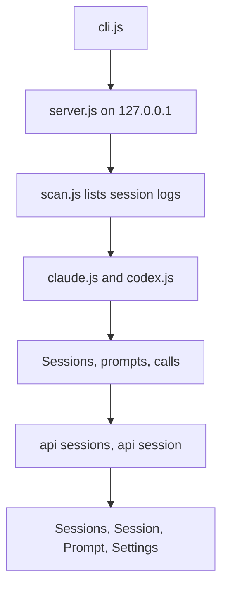
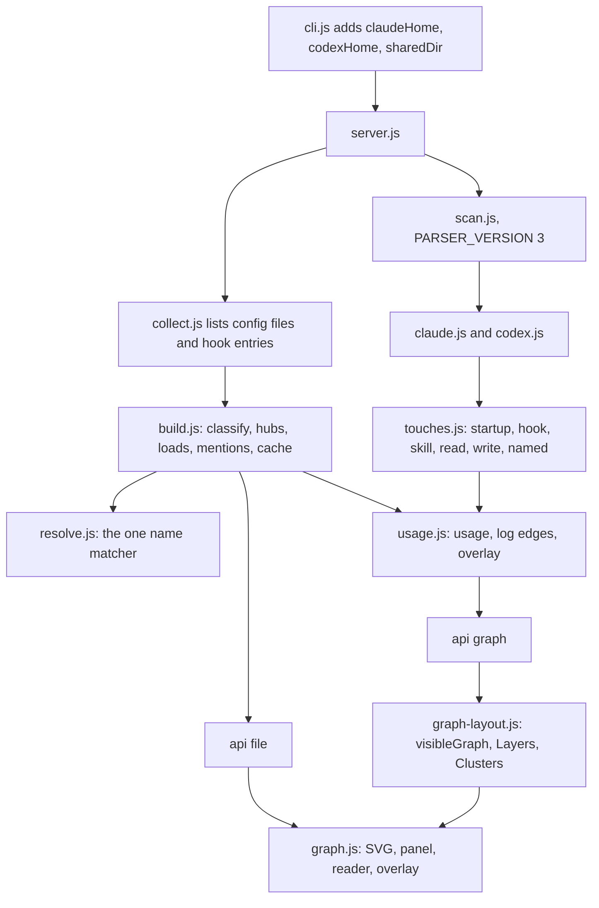
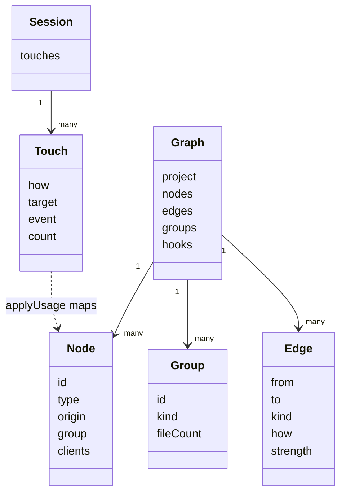

# AIConfigGraph Phase 2 Config Graph Implementation Plan

> **For agentic workers (Gemini, Claude, Codex):** Execute inline, task by task, in order. Do NOT use subagent-driven development. Steps use checkbox (`- [ ]`) syntax for tracking. Commit steps run only once the owner has said commits are wanted.

**Goal:** A Graph screen in the existing local tool that draws one project's AI config as a map: every config file a node, mention lines and load lines (from config and from session logs), outside sources as closed boxes, a side panel, a read-only file reader and a per-session overlay, in two layouts and four themes.

**Architecture:** A config scan (`src/graph/`) lists project, global and plugin config files, classifies them, finds hubs, mention edges and config load edges, and caches the result by file stamps. The v1 parsers gain a `touches` list per session; `applyUsage` maps those touches to nodes for usage numbers, log load edges and the overlay. Two new endpoints serve the graph and single files. The browser lays the graph out with pure functions (`public/graph-layout.js`) and draws hand-written SVG (`public/graph.js`).

**Tech Stack:** Node 24 built-ins only (`node:fs`, `node:path`, `node:http`, `node:test`, `node:assert/strict`), ES modules. Browser: plain HTML, CSS custom properties, vanilla JS modules, hand-drawn SVG. No npm dependencies, no `npm install`.

**Spec:** [`.cursor/plans/design/2026-10-18-config-graph.md`](../design/2026-10-18-config-graph.md). v1 plan for style and context: [`2026-10-18-ai-config-graph-v1.md`](2026-10-18-ai-config-graph-v1.md).

## How to execute this plan

This plan carries the **complete code**. It was built and run in a scratch copy of this repo before the plan was written:

- `node --test` → **71 tests, 71 pass, 0 fail** (Node v24.12.0, Windows 11). v1 had 48.
- On the real PetVsMonster project: the graph built in 0.7 s (0.06 s cached) with 680 nodes, 2,959 mention edges and 21 sessions of usage. Headless Chrome check: the map draws in all four themes and both layouts, clicking a node fills the panel, opening a box adds its files, Read shows the file with 352 working links, search selects `mem-bugs-ui`, and the session overlay lights up the files a session touched.

Rules for the executor:

1. **Copy every code block verbatim** into the named file. Do not rename, reformat, "improve", add dependencies, add TypeScript, or add files the plan does not name.
2. Work in `G:\Projects\AIConfigGraph`. The shell is **Windows PowerShell 5.1**: use `curl.exe` (not `curl`), use `node -e` for checks (there is no `grep`), and quote paths that contain spaces.
3. **Edit steps** show an exact `Find` block and a `Replace with` block. The `Find` text occurs exactly once in the file. Replace it and nothing else.
4. Run each verification command and compare with the **Expected** line. If the result differs, **stop and report** the command and its output to the owner. Do not patch around a failure.
5. Never write to `~/.claude`, `~/.codex`, the shared repo or any project folder. The tool only reads them.
6. `.claude/package.json` (`{ "type": "commonjs" }`) already exists and keeps the shared hook scripts working under the root `"type": "module"`. Leave it alone.
7. In test output, `test\helpers.js` appears as one extra passing file. That is expected and is part of every count below.

## Global Constraints

- No dependencies: Node built-ins on the server; plain HTML, CSS and JS in the browser; the map is hand-drawn SVG.
- Server binds `127.0.0.1` only, keeps the v1 Host check. No outbound network, no web fonts, no CDN.
- Read-only: never write to config, logs or projects. Writes go only to `settings.local.json` and `cache/` in the workspace root.
- One project per map: the active project from v1 Settings.
- File token size: `estTokens = Math.ceil(chars / 4)`, labelled "estimate". A hook script's size is never counted as context tokens.
- `/api/file` serves only files that are nodes of the current graph.
- Observed (seen in the log) and named (a command named the file) must look different on the map and count separately in the panel.
- Hubs, Unfiled, Playbooks, Docs and outside boxes start closed; clients, entry files, rules, Cursor rules, hooks, skills, agents and the index start open.
- Four themes per `.claude/rules/ui-design-system.md`, each with its node shape and edge routing; two layouts, Layers and Clusters, chosen in Settings.

## Findings that refine the spec

Checked on PetVsMonster, `~/.claude`, `~/.codex` and the three enabled plugins while building the code:

| Spec assumption | Reality | Plan response |
|---|---|---|
| Hook runs are known only by event (`hook_additional_context`) | Claude also logs `attachment.type: hook_success` with `command` (or the hook's `statusMessage` text, or the unexpanded `${CLAUDE_PLUGIN_ROOT}` form) and `toolUseID`. `UserPromptSubmit` runs have no `hook_success` lines | A `hook_success` command matching a configured hook's `command` or `statusMessage` is **observed** for that script. A context line whose `toolUseID` has no `hook_success` counts by event: observed when one script serves the event, **named** for each script when several do |
| Plugin hooks live in `hooks.json` | superpowers uses `hooks/hooks.json`; caveman and ponytail declare `hooks` inside `.claude-plugin/plugin.json` | Both files are read; `${CLAUDE_PLUGIN_ROOT}` is expanded to the install path |
| Global hooks live under `~/.claude` | `~/.claude/settings.json` also runs `C:/Users/PC/.orca/agent-hooks/claude-hook.cmd` on every event | Any script a global setting runs becomes a hook node in the Global Claude box, wherever it lives |
| Codex AGENTS.md lines name the project file | One injected block `# AGENTS.md instructions for <dir>` carries global and project AGENTS.md together | A Codex startup touch credits the project `AGENTS.md` and `~/.codex/AGENTS.md` |
| Commands name files by project path | Bash commands use Git Bash paths (`/g/Unity/...`) and `cd` then bare names | The resolver turns `/g/` into `g:/`, then tries exact path, path relative to the file, unique path suffix, unique file name, and a bare `mem-` stem |
| Memories without a hub go to Unfiled | Playbooks and docs have no Parent lines | Fallback groups per type: Unfiled (memories), Playbooks, Docs |
| Spec sketches three endpoints | The session overlay only needs one more query value | `GET /api/graph?from=&to=&session=client/id` returns graph, usage, log edges, overlay and the session list; `GET /api/file?id=` serves one node file |
| Theme check uses a fixture graph | The theme check page frames the real app | Theme check gains links to the Graph in Layers and Clusters for the active project |
| Root `package.json` `"type": "module"` (v1) is harmless | It made Node load the shared CommonJS hooks as ES modules: `ReferenceError: require is not defined in ES module scope` on every prompt and every Edit or Write | Fixed before this plan: `.claude/package.json` `{ "type": "commonjs" }` |

## Review Focus

Each item has a test in the named task.

1. A common file name written in a file (`SKILL.md`, `README.md`) must never link to an arbitrary node with that name: ambiguous names are dropped. Task 3, `mentions: … ambiguous dropped` and `resolver: …`.
2. A Git Bash path in a command (`/g/Unity/...`) or a path whose case differs from disk still finds its node. Task 3 `resolver: …`, Task 4 `usage maps touches …`.
3. `/api/file` refuses any path that is not a graph node, including the tool's own files. Task 5, `GET /api/file … refuses anything else`.
4. A `**Parent:**` loop or a parent that does not exist never hangs or crashes the scan; the file lands in Unfiled. Task 3, `hub walk: …`.
5. A hook script's size is never added to context tokens, and a subagent transcript's repeated `tool_use` is never counted twice. Task 4 `usage maps touches …`, Task 2 `claude touches: …`.

---

## Flow

Current (v1):



Target:



## File structure

| File | Responsibility | Task |
|---|---|---|
| `src/graph/classify.js` | Pure text rules: path ids, name tokens, HUB rows, Parent, Framework header, alwaysApply, index path, labels, hook commands | 1 |
| `src/graph/resolve.js` | `makeResolver` (the one name-to-node matcher) and `extractMentions` | 1 |
| `src/parse/touches.js` | What a session loaded, ran, read, wrote or named | 2 |
| `src/parse/claude.js`, `src/parse/codex.js`, `src/model.js`, `src/scan.js` | Fill `session.touches`; cache version 3 | 2 |
| `src/graph/collect.js` | Find project, global and plugin config files and hook entries | 3 |
| `src/graph/build.js` | Nodes, hubs, groups, client nodes, config load edges, mention edges; cached | 3 |
| `test/helpers.js` | `fakeConfig()`: a fake project, shared repo, `~/.claude`, `~/.codex`, plugin | 3 |
| `src/graph/usage.js` | Touches to nodes: usage, log load edges, overlay | 4 |
| `src/settings.js`, `src/server.js`, `src/cli.js` | `layout` and `showDocs` settings; `/api/graph`, `/api/file`; new context paths | 5 |
| `public/graph-layout.js` | Pure: visible items and edges, Layers and Clusters positions | 6 |
| `public/dom.js`, `public/graph.js`, `public/app.js`, `public/app.css`, `public/themes.css`, `public/index.html`, `public/theme-check.html` | Graph screen, settings rows, nav, tokens, theme check links | 7 |

## Shared shapes

```js
// Session (v1) gains:
{ ..., touches: Touch[] }
// Touch  (how: startup | hook | skill | read | write | named)
{ how, target: string | null, event: string | null, count }

// Node  (type: client | entry | rule | cursor-rule | hook | index | hub | memory | playbook | skill | agent | doc)
//       (origin: project | universal | generated | framework | global | plugin | null for clients)
{ id, path, type, origin, originLabel, group, title, label, chars, estTokens,
  clients: { claude?: 'startup' | 'hook' | 'on-demand', codex?: ..., cursor?: ..., gemini?: ... },
  skill: string | null, missing?: boolean /* clients only */ }
// Group (kind: hub | unfiled | playbooks | docs | outside)
{ id, kind, label, title, fileCount, estTokens }
// Edge  (kind: mention | load; how: link | wikilink | name | startup | hook | on-demand;
//        strength: config | observed | named)
{ from, to, kind, how, strength, count? }
// Graph (server side; hooks are not sent to the browser)
{ project, builtAt, nodes, edges, groups, hooks: [{ event, command, statusMessage, nodeId }] }
// Usage per node id
{ sessions, observed, named, estTokens, lastSeen }
// GET /api/graph response
{ project, builtAt, nodes, edges /* config plus log */, groups, usage, overlay: [{ id, how, strength, count }] | null,
  sessions: [{ id, client, title, start }] }
```

Node ids are `normPath(absolutePath)`: absolute, forward slashes, lower case. Client ids are `client:claude`, `client:codex`, `client:cursor`, `client:gemini`. Group ids are `hub:<hub node id>`, `unfiled`, `playbooks`, `docs`, `outside:claude-global`, `outside:codex-global`, `outside:plugin:<name>`.



---

### Task 1: Text rules and the name matcher

**Files:**
- Create: `src/graph/classify.js`, `src/graph/resolve.js`, `test/classify.test.js`

**Interfaces:**
- Produces (`classify.js`): `normPath(p) → string`, `NAME_TOKEN` (global RegExp), `namedIn(text) → string[]` (unique, in order), `hubRows(indexText) → [{ label, file }]`, `parentOf(text) → string | null`, `frameworkOrigin(text) → string | null`, `alwaysApply(text) → boolean`, `indexPathFrom(ruleText | null) → string`, `titleOf(text, file) → string`, `labelOf(file) → string`, `scriptOf(command, vars) → absolute path | null`, `hookEntries(json, vars, source) → [{ event, command, statusMessage, script, source }]`.
- Produces (`resolve.js`): `makeResolver(nodes) → resolve(token, fromDir?) → node id | null`; `extractMentions(nodes, textOf(id), resolve) → Edge[]`.

- [ ] **Step 1: Create `test/classify.test.js`**

```js
import test from 'node:test';
import assert from 'node:assert/strict';
import os from 'node:os';
import path from 'node:path';
import { parentOf, scriptOf, namedIn, hubRows, alwaysApply, frameworkOrigin } from '../src/graph/classify.js';

test('classify helpers', () => {
  assert.equal(parentOf('# T\n**Parent:** `mem-layer5-main` (co-owned)\n'), 'mem-layer5-main');
  assert.equal(parentOf('**Parent:** `mem-arch.md` — this is a method'), 'mem-arch');
  assert.equal(parentOf('no parent'), null);
  assert.deepEqual(hubRows('| HUB: Bugs - records | `bugs/README.md` |\n| plain | `mem-x.md` |'), [{ label: 'Bugs - records', file: 'bugs/README.md' }]);
  assert.equal(alwaysApply('---\ndescription: x\nalwaysApply: true\n---\nbody'), true);
  assert.equal(alwaysApply('alwaysApply: true'), false);
  assert.equal(frameworkOrigin('<!-- GENERATED from com.hung.autotest@0.4.4 — edit -->\n'), 'com.hung.autotest@0.4.4');
  assert.equal(scriptOf('node "$CLAUDE_PROJECT_DIR/.claude/hooks/a.js"', { CLAUDE_PROJECT_DIR: 'C:/p' }), path.resolve('C:/p/.claude/hooks/a.js'));
  assert.equal(scriptOf('"${CLAUDE_PLUGIN_ROOT}/hooks/run-hook.cmd" session-start', { CLAUDE_PLUGIN_ROOT: 'C:/pl' }), path.resolve('C:/pl/hooks/run-hook.cmd'));
  assert.equal(scriptOf('C:/x/claude-hook.cmd || echo {}'), path.resolve('C:/x/claude-hook.cmd'));
  assert.equal(scriptOf('"${UNKNOWN}/a.js"'), null);
  assert.equal(scriptOf('echo hi'), null);
  assert.equal(scriptOf('node .claude/hooks/a.js', {}, 'C:/p'), path.resolve('C:/p/.claude/hooks/a.js'));
  assert.equal(scriptOf('bash ~/hooks/a.sh', {}, 'C:/p'), path.join(os.homedir(), 'hooks', 'a.sh'));
  assert.deepEqual(namedIn('cat .cursor/memory/mem-a.md; grep -l mem-b-c x; node G:\\p\\h.js'),
    ['.cursor/memory/mem-a.md', 'mem-b-c', 'G:\\p\\h.js']);
});
```

- [ ] **Step 2: Run it and see it fail**

Run: `node --test test/classify.test.js`
Expected: FAIL, `Cannot find module` for `src/graph/classify.js`.

- [ ] **Step 3: Create `src/graph/classify.js`**

```js
import os from 'node:os';
import path from 'node:path';

// Node id and path compare form: absolute, forward slashes, lower case, no trailing slash.
export function normPath(p) {
  return path.resolve(p).replace(/\\/g, '/').replace(/\/+$/, '').toLowerCase();
}

// A file name or path that may name a node (x.md, x.mdc, x.js, a/b/x.md, G:\a\x.md), or a bare mem- stem.
export const NAME_TOKEN = /(?:[\w.~:-]+[\\/])*[\w.-]+\.(?:mdc|md|js)\b|\bmem-[a-z0-9](?:[a-z0-9-]*[a-z0-9])?/gi;

export const namedIn = text => [...new Set(text.match(NAME_TOKEN) || [])];

// `| HUB: label | `file` |` rows of the memory index.
export function hubRows(indexText) {
  const rows = [];
  for (const line of indexText.split('\n')) {
    const m = line.match(/^\|\s*HUB:\s*(.+?)\s*\|\s*`([^`]+)`/);
    if (m) rows.push({ label: m[1], file: m[2] });
  }
  return rows;
}

// First backticked token on the first `**Parent:**` line, without a .md ending.
export function parentOf(text) {
  const m = text.match(/^\*\*Parent:\*\*[^`\n]*`([^`]+)`/m);
  return m ? m[1].replace(/\.md$/i, '') : null;
}

export function frameworkOrigin(text) {
  const head = text.split('\n', 5).join('\n');
  const m = head.match(/GENERATED from (com\.hung\.[\w.-]+@[\w.-]+)/);
  return m ? m[1] : null;
}

export function alwaysApply(text) {
  const m = text.match(/^---\r?\n([\s\S]*?)\r?\n---/);
  return !!m && /^alwaysApply:\s*true\s*$/m.test(m[1]);
}

// Memory index path from the memory-first-workflow rule's PROJECT CONFIG, relative to the project.
export function indexPathFrom(ruleText) {
  const m = ruleText?.match(/MEMORY_MASTER_INDEX\s*=\s*(\S+)/);
  return m ? m[1] : '.cursor/memory/mem-arch-assemblies-canonical.md';
}

export function titleOf(text, file) {
  const m = text.match(/^#\s+(.+)$/m);
  return m ? m[1].trim() : path.basename(file);
}

export function labelOf(file) {
  const base = path.basename(file);
  if (/^SKILL\.md$/i.test(base)) return path.basename(path.dirname(file));
  return base.replace(/\.(md|mdc)$/i, '');
}

const SCRIPT = /("[^"]+\.(?:js|mjs|cjs|ps1|sh|py|cmd)"|[^\s"]+\.(?:js|mjs|cjs|ps1|sh|py|cmd))(?=\s|$)/i;

// The script file a hook command runs, with ${VAR} and $VAR expanded from vars, a leading ~ expanded
// to the home folder and a relative path resolved against base (the hook's working folder); null when none.
export function scriptOf(command, vars = {}, base = process.cwd()) {
  const m = command.match(SCRIPT);
  if (!m) return null;
  let p = m[1].replace(/^"|"$/g, '');
  p = p.replace(/\$\{(\w+)\}|\$(\w+)/g, (all, a, b) => vars[a || b] ?? all);
  p = p.replace(/^~(?=[\\/])/, os.homedir());
  return /\$/.test(p) ? null : path.resolve(base, p);
}

// Hook entries of a settings.json, hooks.json or plugin.json object.
export function hookEntries(json, vars, source, base) {
  const out = [];
  for (const [event, groups] of Object.entries(json?.hooks || {})) {
    if (!Array.isArray(groups)) continue;
    for (const g of groups) for (const h of g.hooks || []) {
      if (typeof h.command !== 'string') continue;
      out.push({ event, command: h.command, statusMessage: h.statusMessage ?? null, script: scriptOf(h.command, vars, base), source });
    }
  }
  return out;
}
```

- [ ] **Step 4: Create `src/graph/resolve.js`** (tested through the graph in Task 3)

```js
import path from 'node:path';
import { normPath, NAME_TOKEN } from './classify.js';

// The one matcher from a written name or path to a node id. Returns null when unknown or ambiguous.
export function makeResolver(nodes) {
  const ids = new Set();
  const byName = new Map(); // lower basename -> ids
  for (const n of nodes) {
    if (!n.path) continue;
    ids.add(n.id);
    const k = path.basename(n.path).toLowerCase();
    byName.set(k, [...(byName.get(k) || []), n.id]);
  }
  const idList = [...ids];

  return function resolve(token, fromDir) {
    let t = token.replace(/\\/g, '/').replace(/^~\//, '').replace(/^\.\//, '');
    try { t = decodeURIComponent(t); } catch { /* keep as written */ }
    t = t.replace(/^\/([a-z])\//i, '$1:/'); // Git Bash /g/x -> g:/x
    if (!/\.(md|mdc|js)$/i.test(t)) {
      if (/^mem-[\w-]+$/i.test(t)) t += '.md';
      else return null;
    }
    if (t.includes('/')) {
      if (/^[a-z]:\//i.test(t)) return ids.has(normPath(t)) ? normPath(t) : null;
      if (fromDir) {
        const id = normPath(path.join(fromDir, t));
        if (ids.has(id)) return id;
      }
      const tail = '/' + t.toLowerCase().replace(/^(\.\.\/)+/, '').replace(/^\//, '');
      const hits = idList.filter(id => id.endsWith(tail));
      return hits.length === 1 ? hits[0] : null;
    }
    const hits = byName.get(t.toLowerCase()) || [];
    return hits.length === 1 ? hits[0] : null;
  };
}

const RANK = { link: 0, wikilink: 1, name: 2 };

// Mention edges: Markdown link, [[wikilink]], or a node's file name or path written in the text.
// One edge per ordered pair, strongest kind kept; self-links and unknown or ambiguous names dropped.
export function extractMentions(nodes, textOf, resolve) {
  const edges = new Map();
  for (const n of nodes) {
    const text = n.path ? textOf(n.id) : '';
    if (!text) continue;
    const dir = path.dirname(n.path);
    const hit = (raw, how) => {
      const to = resolve(raw, dir);
      if (!to || to === n.id) return;
      const k = `${n.id}|${to}`;
      const e = edges.get(k);
      if (!e || RANK[how] < RANK[e.how]) edges.set(k, { from: n.id, to, kind: 'mention', how, strength: 'config' });
    };
    for (const m of text.matchAll(/\]\(<?([^)\s>]+?)>?(?:#[^)]*)?\)/g)) hit(m[1], 'link');
    for (const m of text.matchAll(/\[\[([^\]|#]+)/g)) hit(/\.\w+$/.test(m[1]) ? m[1] : m[1] + '.md', 'wikilink');
    for (const m of text.matchAll(NAME_TOKEN)) hit(m[0], 'name');
  }
  return [...edges.values()];
}
```

- [ ] **Step 5: Run the tests**

Run: `node --test`
Expected: `tests 49`, `pass 49`, `fail 0`.

- [ ] **Step 6: Commit** `feat: graph text rules and name matcher`

---

### Task 2: Session touches in the parsers

**Files:**
- Create: `src/parse/touches.js`, `test/touches.test.js`
- Modify: `src/parse/claude.js`, `src/parse/codex.js`, `src/model.js`, `src/scan.js`

**Interfaces:**
- Consumes: `namedIn` (Task 1).
- Produces: `claudeTouches(rowLists: object[][]) → Touch[]`, `codexTouches(rows: object[]) → Touch[]`; every Session gets `touches`. `PARSER_VERSION` becomes `3` so cached v1 sessions are parsed again.

Rules the code implements (for review, not for re-design):
- Claude: `instructions` files → `startup`; `hook_success` → `hook` with its `command` and `hookEvent`; `hook_additional_context` → `hook` by event only, unless a `hook_success` in the same file has its `toolUseID`; `Skill` → `skill`; `Read` → `read`; `Edit`, `Write`, `MultiEdit`, `NotebookEdit` → `write`; `Bash`, `PowerShell`, `Grep`, `Glob` → `named` for each name token in `command`, `pattern` and `path`. A `tool_use` id seen in the main file and a subagent file counts once.
- Codex: a user `input_text` starting `# AGENTS.md instructions for <dir>` → `startup` of `<dir>\AGENTS.md`; `custom_tool_call.input` and `function_call.arguments` → `named`.

- [ ] **Step 1: Create `test/touches.test.js`**

```js
import test from 'node:test';
import assert from 'node:assert/strict';
import path from 'node:path';
import { claudeTouches, codexTouches } from '../src/parse/touches.js';
import { parseClaudeSession } from '../src/parse/claude.js';
import { readFixture } from './helpers.js';

const tool = (id, name, input) => ({ type: 'assistant', message: { content: [{ type: 'tool_use', id, name, input }] } });
const att = attachment => ({ type: 'attachment', attachment });
const pick = (touches, how) => touches.filter(t => t.how === how).map(t => [t.target, t.event, t.count]);

test('claude touches: startup, hooks, skill, read, write, named; tool ids counted once', () => {
  const main = [
    att({ type: 'instructions', files: [{ path: 'C:\\p\\CLAUDE.md', type: 'Project', content: 'x' }] }),
    att({ type: 'hook_success', hookEvent: 'SessionStart', toolUseID: 'h1', command: 'Loading g' }),
    att({ type: 'hook_additional_context', hookEvent: 'SessionStart', toolUseID: 'h1', content: ['x'] }),
    att({ type: 'hook_additional_context', hookName: 'UserPromptSubmit', hookEvent: 'UserPromptSubmit', toolUseID: 'h2', content: ['y'] }),
    tool('t1', 'Skill', { skill: 'pl:brainstorming' }),
    tool('t2', 'Read', { file_path: 'C:\\p\\a.md' }),
    tool('t3', 'Edit', { file_path: 'C:\\p\\a.md' }),
    tool('t4', 'Bash', { command: 'grep -n x .cursor/memory/mem-a.md mem-b; cat mem-a.md' }),
    tool('t5', 'Grep', { pattern: 'x', path: 'C:/p/.claude/rules/r1.md' }),
  ];
  const sub = [tool('t2', 'Read', { file_path: 'C:\\p\\a.md' }), tool('t6', 'Read', { file_path: 'C:\\p\\a.md' })];
  const t = claudeTouches([main, sub]);
  assert.deepEqual(pick(t, 'startup'), [['C:\\p\\CLAUDE.md', null, 1]]);
  assert.deepEqual(pick(t, 'hook'), [['Loading g', 'SessionStart', 1], [null, 'UserPromptSubmit', 1]], 'context line of a logged run not counted again');
  assert.deepEqual(pick(t, 'skill'), [['pl:brainstorming', null, 1]]);
  assert.deepEqual(pick(t, 'read'), [['C:\\p\\a.md', null, 2]], 't2 in both files counts once, t6 counts');
  assert.deepEqual(pick(t, 'write'), [['C:\\p\\a.md', null, 1]]);
  assert.deepEqual(pick(t, 'named'), [['.cursor/memory/mem-a.md', null, 1], ['mem-b', null, 1], ['mem-a.md', null, 1], ['C:/p/.claude/rules/r1.md', null, 1]]);
});

test('codex touches: AGENTS.md block and named files in commands', () => {
  const rows = [
    { type: 'response_item', payload: { type: 'message', role: 'user', content: [{ type: 'input_text', text: '# AGENTS.md instructions for G:\\Proj\n\n<INSTRUCTIONS>' }] } },
    { type: 'response_item', payload: { type: 'custom_tool_call', name: 'exec', input: 'tools.exec_command({cmd:"Get-Content .agents/skills/s1/SKILL.md"})' } },
    { type: 'response_item', payload: { type: 'function_call', name: 'shell', arguments: '{"cmd":"cat mem-x.md"}' } },
  ];
  const t = codexTouches(rows);
  assert.deepEqual(pick(t, 'startup'), [[path.join('G:\\Proj', 'AGENTS.md'), null, 1]]);
  assert.deepEqual(pick(t, 'named'), [['.agents/skills/s1/SKILL.md', null, 1], ['mem-x.md', null, 1]]);
});

test('parser fills session touches', () => {
  const s = parseClaudeSession(readFixture('claude-session.jsonl'), { id: 's1', file: 'x', project: 'G:\\Proj' });
  assert.deepEqual(pick(s.touches, 'startup').map(x => x[0]), ['C:\\u\\.claude\\CLAUDE.md', 'P\\.claude\\rules\\a.md', 'C:\\u\\memory\\MEMORY.md']);
  assert.deepEqual(pick(s.touches, 'read'), [['a.md', null, 1]]);
});
```

- [ ] **Step 2: Run it and see it fail**

Run: `node --test test/touches.test.js`
Expected: FAIL, `Cannot find module` for `src/parse/touches.js`.

- [ ] **Step 3: Create `src/parse/touches.js`**

```js
import path from 'node:path';
import { namedIn } from '../graph/classify.js';

const WRITE_TOOLS = new Set(['Edit', 'Write', 'MultiEdit', 'NotebookEdit']);
const COMMAND_TOOLS = new Set(['Bash', 'PowerShell', 'Grep', 'Glob']);
const AGENTS_HEADER = '# AGENTS.md instructions for ';

// Touch = { how: startup|hook|skill|read|write|named, target: string|null, event: string|null, count }
function counter() {
  const counts = new Map();
  const add = (how, target, event = null) => {
    if (typeof target !== 'string' && !(how === 'hook' && event)) return;
    const k = `${how}\0${event ?? ''}\0${target ?? ''}`;
    const t = counts.get(k);
    if (t) t.count++;
    else counts.set(k, { how, target: target ?? null, event, count: 1 });
  };
  return { add, list: () => [...counts.values()] };
}

// rowLists = [main rows, ...subagent rows]. A tool_use id seen in two files counts once.
export function claudeTouches(rowLists) {
  const { add, list } = counter();
  const seenTools = new Set();
  for (const rows of rowLists) {
    // Hook runs logged with their command; context lines with the same toolUseID are not counted again.
    const ran = new Set(rows.filter(l => l.attachment?.type === 'hook_success').map(l => l.attachment.toolUseID));
    for (const l of rows) {
      const a = l.type === 'attachment' ? l.attachment : null;
      if (a?.type === 'instructions') {
        for (const f of a.files || []) add('startup', f.path);
      } else if (a?.type === 'hook_success') {
        add('hook', a.command, a.hookEvent ?? null);
      } else if (a?.type === 'hook_additional_context') {
        if (!ran.has(a.toolUseID)) add('hook', null, a.hookEvent || a.hookName || null);
      } else if (l.type === 'assistant') {
        for (const b of l.message?.content || []) {
          if (b.type !== 'tool_use' || seenTools.has(b.id)) continue;
          seenTools.add(b.id);
          const i = b.input || {};
          if (b.name === 'Skill') add('skill', i.skill);
          else if (b.name === 'Read') add('read', i.file_path);
          else if (WRITE_TOOLS.has(b.name)) add('write', i.file_path ?? i.notebook_path);
          else if (COMMAND_TOOLS.has(b.name)) {
            const text = [i.command, i.pattern, i.path].filter(x => typeof x === 'string').join(' ');
            for (const tok of namedIn(text)) add('named', tok);
          }
        }
      }
    }
  }
  return list();
}

// Codex reads files through commands and code it runs; AGENTS.md arrives as one injected user message.
export function codexTouches(rows) {
  const { add, list } = counter();
  for (const l of rows) {
    const p = l.payload;
    if (!p) continue;
    if (l.type === 'response_item' && p.type === 'message' && p.role === 'user') {
      for (const c of p.content || []) {
        const t = typeof c.text === 'string' ? c.text : '';
        if (t.startsWith(AGENTS_HEADER)) add('startup', path.join(t.split('\n')[0].slice(AGENTS_HEADER.length).trim(), 'AGENTS.md'));
      }
    } else if (p.type === 'custom_tool_call' && typeof p.input === 'string') {
      for (const tok of namedIn(p.input)) add('named', tok);
    } else if (p.type === 'function_call' && typeof p.arguments === 'string') {
      for (const tok of namedIn(p.arguments)) add('named', tok);
    }
  }
  return list();
}
```

- [ ] **Step 4: Edit `src/parse/claude.js`** (three edits)

Find:
```js
import { splitSetupPieces } from '../pieces.js';
```
Replace with:
```js
import { splitSetupPieces } from '../pieces.js';
import { claudeTouches } from './touches.js';
```

Find:
```js
  for (const extra of opts.extraTexts || []) addSubagentCalls(s, extra, seen);
```
Replace with:
```js
  const extraRows = (opts.extraTexts || []).map(t => readJsonl(t).rows);
  for (const extra of extraRows) addSubagentCalls(s, extra, seen);
  s.touches = claudeTouches([rows, ...extraRows]);
```

Find:
```js
function addSubagentCalls(s, text, seen) {
  for (const l of readJsonl(text).rows) {
```
Replace with:
```js
function addSubagentCalls(s, rows, seen) {
  for (const l of rows) {
```

- [ ] **Step 5: Edit `src/parse/codex.js`** (two edits)

Find:
```js
import { readJsonl, newSession, newPrompt, finishSession } from '../model.js';
```
Replace with:
```js
import { readJsonl, newSession, newPrompt, finishSession } from '../model.js';
import { codexTouches } from './touches.js';
```

Find:
```js
  s.title = s.prompts.find
```
Replace with:
```js
  s.touches = codexTouches(rows);
  s.title = s.prompts.find
```

- [ ] **Step 6: Edit `src/model.js`**

Find:
```js
    rateLimitPercent: null, badLines: 0, totals: null, cost: null, unpriced: [],
```
Replace with:
```js
    rateLimitPercent: null, badLines: 0, totals: null, cost: null, unpriced: [], touches: [],
```

- [ ] **Step 7: Edit `src/scan.js`**

Find:
```js
export const PARSER_VERSION = 2;
```
Replace with:
```js
export const PARSER_VERSION = 3;
```

- [ ] **Step 8: Run the tests**

Run: `node --test`
Expected: `tests 52`, `pass 52`, `fail 0`.

- [ ] **Step 9: Commit** `feat: record what each session loaded, ran, read and named`

---

### Task 3: Config scan and graph build

**Files:**
- Create: `src/graph/collect.js`, `src/graph/build.js`, `test/graph.test.js`
- Modify: `test/helpers.js`

**Interfaces:**
- Consumes: Task 1 (`classify.js`, `resolve.js`), `findClaudeDirs` and `claudeSlug` from `src/scan.js`, `estTokens` from `src/model.js`.
- Produces: `collectFiles({ project, claudeHome, codexHome, sharedDir, showDocs }) → { files, hooks, indexId }`; `buildGraph(sameCtx) → Graph` (returns the same object while no file stamp, project or `showDocs` changed); `CLIENTS`.
- Produces (`test/helpers.js`): `fakeConfig() → { dir, project, claudeHome, codexHome, sharedDir, plugin, slugDir }`.

What becomes a node (verified on PetVsMonster; see spec section 5):

| Source | Files | Type, client, load |
|---|---|---|
| Project root | `CLAUDE.md`, `AGENTS.md`, `GEMINI.md` | entry; claude, codex, gemini; startup |
| `.claude/rules/*.md` | | rule; claude; startup |
| `.cursor/rules/*.mdc` | | cursor-rule; cursor; startup when `alwaysApply: true`, else on-demand |
| `.claude/hooks/*` scripts and scripts run by `.claude/settings.json` hooks | | hook; claude; hook |
| `MEMORY_MASTER_INDEX` from `memory-first-workflow.md` (default `.cursor/memory/mem-arch-assemblies-canonical.md`) | | index |
| `.cursor/memory/**/*.md`, `.cursor/playbooks/**/*.md`, `docs/**/*.md` (only with `showDocs`) | | memory (hub when named in a `HUB:` row), playbook, doc |
| `.claude/skills`, `.agents/skills`, `.codex/skills`, `.cursor/skills` `*/SKILL.md`; `.claude/agents/*.md` | | skill or agent; claude, codex, codex, cursor; on-demand |
| `~/.claude`: `CLAUDE.md`, auto-memory `projects/<slug>/memory/*.md`, `skills/*/SKILL.md`, scripts run by `settings.json` hooks | | group `outside:claude-global`, origin global |
| `~/.codex`: `AGENTS.md`, `skills/*/SKILL.md` | | group `outside:codex-global`, origin global |
| Each plugin enabled in `~/.claude/settings.json` (`installPath` from `plugins/installed_plugins.json`): `skills/*/SKILL.md`, `agents/*.md`, hook scripts from `hooks/hooks.json` and `.claude-plugin/plugin.json` | | group `outside:plugin:<name>`, origin plugin |

- [ ] **Step 1: Edit `test/helpers.js`** (two edits)

Find:
```js
import { fileURLToPath } from 'node:url';
```
Replace with:
```js
import { fileURLToPath } from 'node:url';
import { claudeSlug } from '../src/scan.js';
```

Then append this to the end of the file:

```js
// A fake project, shared repo, ~/.claude and ~/.codex for the config graph. Paths are real temp paths.
export function fakeConfig() {
  const dir = tempDir();
  const project = path.join(dir, 'proj');
  const shared = path.join(dir, 'shared');
  const claudeHome = path.join(dir, 'claude-home');
  const codexHome = path.join(dir, 'codex-home');
  const plugin = path.join(dir, 'plugin-pl');
  const put = (file, text) => {
    fs.mkdirSync(path.dirname(file), { recursive: true });
    fs.writeFileSync(file, text);
  };
  const p = (...x) => path.join(project, ...x);

  put(p('CLAUDE.md'), '# Proj\nSee [rule one](.claude/rules/r1.md) and `mem-alpha.md`.\n');
  put(p('AGENTS.md'), '# Agents\n');
  put(p('.claude', 'rules', 'r1.md'), '# R1\nIndex: mem-index.md. Self: r1.md. Skill: SKILL.md\n');
  put(p('.claude', 'rules', 'r2.md'), '<!-- GENERATED from com.hung.autotest@0.4.4 — edit in Package_Repo -->\n# R2\nUnknown: mem-nope.md\n');
  put(p('.claude', 'rules', 'memory-first-workflow.md'), 'MEMORY_MASTER_INDEX  = .cursor/memory/mem-index.md\n');
  put(p('.claude', 'settings.json'), JSON.stringify({ hooks: { UserPromptSubmit: [{ hooks: [
    { type: 'command', command: 'node "$CLAUDE_PROJECT_DIR/.claude/hooks/inject.js"' }] }] } }));
  put(p('.claude', 'hooks', 'inject.js'), '// prints mem-index.md\n');
  put(p('.claude', 'skills', 's1', 'SKILL.md'), '# s1\n');
  put(p('.agents', 'skills', 's1', 'SKILL.md'), '# s1 codex\n');
  put(p('.claude', 'agents', 'helper.md'), '# helper\n');
  put(p('.cursor', 'rules', 'always.mdc'), '---\nalwaysApply: true\n---\nx\n');
  put(p('.cursor', 'rules', 'maybe.mdc'), '---\nalwaysApply: false\n---\ny\n');
  put(p('.cursor', 'memory', 'mem-index.md'), '| HUB: Alpha hub | `mem-alpha.md` |\n| HUB: Bugs | `bugs/README.md` |\n| Beta | `mem-beta.md` |\n');
  put(p('.cursor', 'memory', 'mem-alpha.md'), '# Alpha\n**Parent:** `mem-index`\nSee [[mem-beta]].\n');
  put(p('.cursor', 'memory', 'mem-beta.md'), '# Beta\n**Parent:** `mem-alpha` — note\n');
  put(p('.cursor', 'memory', 'mem-gamma.md'), '**Parent:** `mem-beta`\n');
  put(p('.cursor', 'memory', 'mem-loop1.md'), '**Parent:** `mem-loop2`\n');
  put(p('.cursor', 'memory', 'mem-loop2.md'), '**Parent:** `mem-loop1`\n');
  put(p('.cursor', 'memory', 'mem-orphan.md'), '**Parent:** `mem-missing`\n');
  put(p('.cursor', 'memory', 'bugs', 'README.md'), '# Bugs\n');
  put(p('.cursor', 'memory', 'bugs', 'mem-bugs-ui.md'), '# UI bugs\n');
  put(p('.cursor', 'playbooks', 'run.md'), '# Run\n');
  put(p('docs', 'guide.md'), '# Guide\n');

  put(path.join(shared, 'manifest.json'), JSON.stringify({
    files: [{ src: 'files/x', bucket: 'universal', dest: ['.claude/rules/memory-first-workflow.md'] }],
    generated: ['.claude/settings.json'],
  }));

  put(path.join(claudeHome, 'CLAUDE.md'), '# Global\n');
  put(path.join(claudeHome, 'hooks', 'g.js'), '// global hook\n');
  put(path.join(claudeHome, 'settings.json'), JSON.stringify({
    enabledPlugins: { 'pl@market': true, 'off@market': false },
    hooks: { SessionStart: [{ hooks: [{ type: 'command', command: `node "${path.join(claudeHome, 'hooks', 'g.js')}"`, statusMessage: 'Loading g' }] }] },
  }));
  const slugDir = path.join(claudeHome, 'projects', claudeSlug(project));
  put(path.join(slugDir, 'memory', 'MEMORY.md'), '- [Fb](feedback-x.md)\n');
  put(path.join(slugDir, 'memory', 'feedback-x.md'), '# Feedback\n');
  put(path.join(claudeHome, 'skills', 'gs', 'SKILL.md'), '# gs\n');
  put(path.join(claudeHome, 'plugins', 'installed_plugins.json'), JSON.stringify({ version: 2, plugins: {
    'pl@market': [{ installPath: plugin }], 'off@market': [{ installPath: path.join(dir, 'nope') }] } }));
  put(path.join(plugin, 'skills', 'brainstorming', 'SKILL.md'), '# brainstorming\n');
  put(path.join(plugin, 'hooks', 'run.cmd'), '@echo off\n');
  put(path.join(plugin, '.claude-plugin', 'plugin.json'), JSON.stringify({ hooks: { SessionStart: [{ hooks: [
    { type: 'command', command: '"${CLAUDE_PLUGIN_ROOT}/hooks/run.cmd" start' }] }] } }));

  put(path.join(codexHome, 'AGENTS.md'), '# Global codex\n');

  return { dir, project, claudeHome, codexHome, sharedDir: shared, plugin, slugDir };
}
```

- [ ] **Step 2: Create `test/graph.test.js`**

```js
import test from 'node:test';
import assert from 'node:assert/strict';
import fs from 'node:fs';
import path from 'node:path';
import { buildGraph } from '../src/graph/build.js';
import { normPath } from '../src/graph/classify.js';
import { makeResolver } from '../src/graph/resolve.js';
import { fakeConfig } from './helpers.js';

const f = fakeConfig();
const g = buildGraph({ ...f, showDocs: false });
const node = (...parts) => g.nodes.find(n => n.id === normPath(path.join(f.project, ...parts)));
const count = type => g.nodes.filter(n => n.type === type).length;
const edge = (from, to, kind) => g.edges.find(e => e.from === from && e.to === to && e.kind === kind);

test('node types and counts', () => {
  assert.equal(count('client'), 4);
  assert.equal(count('entry'), 4); // CLAUDE.md, AGENTS.md, global CLAUDE.md, global codex AGENTS.md
  assert.equal(count('rule'), 3);
  assert.equal(count('cursor-rule'), 2);
  assert.equal(count('hook'), 3); // project inject.js, global g.js, plugin run.cmd
  assert.equal(count('index'), 2); // project index, auto-memory MEMORY.md
  assert.equal(count('hub'), 2);
  assert.equal(count('memory'), 7); // beta, gamma, loop1, loop2, orphan, bugs ui, global feedback-x
  assert.equal(count('playbook'), 1);
  assert.equal(count('skill'), 4); // .claude s1, .agents s1, global gs, plugin brainstorming
  assert.equal(count('agent'), 1);
  assert.equal(count('doc'), 0);
  assert.equal(node('.cursor', 'memory', 'mem-index.md').type, 'index');
});

test('docs only with showDocs', () => {
  const withDocs = buildGraph({ ...f, showDocs: true });
  assert.equal(withDocs.nodes.filter(n => n.type === 'doc').length, 1);
  assert.equal(withDocs.groups.find(x => x.id === 'docs').fileCount, 1);
});

test('origin: manifest, generated header, global, plugin', () => {
  assert.equal(node('.claude', 'rules', 'memory-first-workflow.md').origin, 'universal');
  const r2 = node('.claude', 'rules', 'r2.md');
  assert.deepEqual([r2.origin, r2.originLabel], ['framework', 'com.hung.autotest@0.4.4']);
  assert.equal(node('.claude', 'rules', 'r1.md').origin, 'project');
  const gClaude = g.nodes.find(n => n.id === normPath(path.join(f.claudeHome, 'CLAUDE.md')));
  assert.deepEqual([gClaude.origin, gClaude.group], ['global', 'outside:claude-global']);
  const brain = g.nodes.find(n => n.skill === 'brainstorming');
  assert.deepEqual([brain.origin, brain.originLabel, brain.group], ['plugin', 'pl', 'outside:plugin:pl']);
  assert.ok(!g.groups.some(x => x.id === 'outside:plugin:off'), 'disabled plugin left out');
});

test('hub walk: own hub, Parent chain, loop, missing parent, bugs folder', () => {
  const alpha = `hub:${node('.cursor', 'memory', 'mem-alpha.md').id}`;
  assert.equal(node('.cursor', 'memory', 'mem-alpha.md').group, alpha);
  assert.equal(node('.cursor', 'memory', 'mem-beta.md').group, alpha);
  assert.equal(node('.cursor', 'memory', 'mem-gamma.md').group, alpha);
  assert.equal(node('.cursor', 'memory', 'mem-loop1.md').group, 'unfiled');
  assert.equal(node('.cursor', 'memory', 'mem-orphan.md').group, 'unfiled');
  assert.equal(node('.cursor', 'memory', 'bugs', 'mem-bugs-ui.md').group, `hub:${node('.cursor', 'memory', 'bugs', 'README.md').id}`);
  assert.equal(node('.cursor', 'playbooks', 'run.md').group, 'playbooks');
  const ga = g.groups.find(x => x.id === alpha);
  assert.deepEqual([ga.kind, ga.label, ga.title, ga.fileCount], ['hub', 'mem-alpha', 'Alpha hub', 3]);
  assert.equal(g.groups.find(x => x.kind === 'hub' && x.label === 'bugs/README').fileCount, 2);
});

test('mentions: link, wikilink, name; self, unknown and ambiguous dropped', () => {
  const claudeMd = node('CLAUDE.md').id;
  const r1 = node('.claude', 'rules', 'r1.md').id;
  assert.equal(edge(claudeMd, r1, 'mention').how, 'link');
  assert.equal(edge(claudeMd, node('.cursor', 'memory', 'mem-alpha.md').id, 'mention').how, 'name');
  assert.equal(edge(node('.cursor', 'memory', 'mem-alpha.md').id, node('.cursor', 'memory', 'mem-beta.md').id, 'mention').how, 'wikilink');
  assert.ok(edge(node('.claude', 'hooks', 'inject.js').id, node('.cursor', 'memory', 'mem-index.md').id, 'mention'), 'hook script mentions the index');
  const fromR1 = g.edges.filter(e => e.from === r1 && e.kind === 'mention').map(e => e.to);
  assert.deepEqual(fromR1, [node('.cursor', 'memory', 'mem-index.md').id], 'self and ambiguous SKILL.md dropped');
  assert.equal(g.edges.filter(e => e.from === node('.claude', 'rules', 'r2.md').id && e.kind === 'mention').length, 0, 'unknown dropped');
});

test('config loads per client; Gemini missing; alwaysApply', () => {
  const client = c => g.nodes.find(n => n.id === `client:${c}`);
  assert.equal(client('gemini').missing, true);
  assert.equal(client('cursor').missing, false);
  assert.equal(edge('client:claude', node('.claude', 'rules', 'r1.md').id, 'load').how, 'startup');
  assert.equal(edge('client:codex', node('AGENTS.md').id, 'load').how, 'startup');
  assert.equal(edge('client:cursor', node('.cursor', 'rules', 'always.mdc').id, 'load').how, 'startup');
  assert.equal(edge('client:cursor', node('.cursor', 'rules', 'maybe.mdc').id, 'load').how, 'on-demand');
  assert.equal(edge('client:claude', node('.claude', 'hooks', 'inject.js').id, 'load').how, 'hook');
  assert.equal(edge('client:codex', node('.agents', 'skills', 's1', 'SKILL.md').id, 'load').how, 'on-demand');
  assert.equal(edge('client:claude', normPath(path.join(f.slugDir, 'memory', 'MEMORY.md')), 'load').how, 'startup');
  assert.deepEqual(node('.claude', 'rules', 'r1.md').clients, { claude: 'startup' });
});

test('hook entries from project, global and plugin settings', () => {
  assert.deepEqual(g.hooks.map(h => [h.event, path.basename(h.nodeId)]).sort(),
    [['SessionStart', 'g.js'], ['SessionStart', 'run.cmd'], ['UserPromptSubmit', 'inject.js']]);
  assert.equal(g.hooks.find(h => h.nodeId.endsWith('g.js')).statusMessage, 'Loading g');
  assert.equal(g.nodes.find(n => n.id.endsWith('/run.cmd')).group, 'outside:plugin:pl');
});

test('relative and missing hook scripts, outside index path', () => {
  const h = fakeConfig();
  const put = (file, text) => fs.writeFileSync(path.join(h.project, file), text);
  put('.claude/settings.json', JSON.stringify({ hooks: { UserPromptSubmit: [{ hooks: [
    { type: 'command', command: 'node .claude/hooks/inject.js' },
    { type: 'command', command: 'node .claude/hooks/missing.js' }] }] } }));
  fs.writeFileSync(path.join(h.dir, 'secret.md'), '# outside\n');
  put('.claude/rules/memory-first-workflow.md', 'MEMORY_MASTER_INDEX  = ../secret.md\n');
  const hg = buildGraph({ ...h, showDocs: false });
  const inject = normPath(path.join(h.project, '.claude', 'hooks', 'inject.js'));
  assert.deepEqual(hg.hooks.filter(x => x.event === 'UserPromptSubmit').map(x => x.nodeId), [inject], 'relative resolves in project; missing has no node');
  assert.ok(!hg.nodes.some(n => n.id.endsWith('/missing.js') || n.id.endsWith('/secret.md')));
});

test('resolver: git bash, relative, suffix and stem forms', () => {
  const resolve = makeResolver(g.nodes);
  const alpha = node('.cursor', 'memory', 'mem-alpha.md').id;
  const gitBash = '/' + f.project[0].toLowerCase() + f.project.slice(2).replace(/\\/g, '/') + '/.cursor/memory/mem-alpha.md';
  assert.equal(resolve(gitBash), alpha);
  assert.equal(resolve('.cursor/memory/mem-alpha.md'), alpha);
  assert.equal(resolve('memory/mem-alpha.md'), alpha);
  assert.equal(resolve('mem-alpha'), alpha);
  assert.equal(resolve('MEM-ALPHA.MD'), alpha);
  assert.equal(resolve('SKILL.md'), null);
  assert.equal(resolve('package.json'), null);
});

test('graph is cached until a file changes', () => {
  assert.equal(buildGraph({ ...f, showDocs: false }), buildGraph({ ...f, showDocs: false }));
});
```

- [ ] **Step 3: Run it and see it fail**

Run: `node --test test/graph.test.js`
Expected: FAIL, `Cannot find module` for `src/graph/build.js`.

- [ ] **Step 4: Create `src/graph/collect.js`**

```js
import fs from 'node:fs';
import path from 'node:path';
import { normPath, hookEntries, indexPathFrom } from './classify.js';
import { findClaudeDirs } from '../scan.js';

const isFile = p => { try { return fs.statSync(p).isFile(); } catch { return false; } };
const readJson = p => { try { return JSON.parse(fs.readFileSync(p, 'utf8')); } catch { return null; } };

function list(dir, test) {
  try {
    return fs.readdirSync(dir, { withFileTypes: true }).filter(e => e.isFile() && test(e.name)).map(e => path.join(dir, e.name));
  } catch { return []; }
}

function walk(dir, test, out = []) {
  let entries;
  try { entries = fs.readdirSync(dir, { withFileTypes: true }); } catch { return out; }
  for (const e of entries) {
    const p = path.join(dir, e.name);
    if (e.isDirectory()) walk(p, test, out);
    else if (test(e.name)) out.push(p);
  }
  return out;
}

const skillsIn = dir => {
  try {
    return fs.readdirSync(dir, { withFileTypes: true })
      .filter(e => e.isDirectory()).map(e => path.join(dir, e.name, 'SKILL.md')).filter(isFile);
  } catch { return []; }
};
const md = n => /\.md$/i.test(n);

// Universal and generated paths from the shared repo manifest, relative to a project root.
function manifestSets(sharedDir) {
  const m = sharedDir ? readJson(path.join(sharedDir, 'manifest.json')) : null;
  const universal = new Set();
  const generated = new Set();
  for (const f of m?.files || []) for (const d of f.dest || []) universal.add(d.replace(/\\/g, '/').toLowerCase());
  for (const g of m?.generated || []) if (typeof g === 'string') generated.add(g.replace(/\\/g, '/').toLowerCase());
  return { universal, generated };
}

function enabledPlugins(claudeHome) {
  const enabled = readJson(path.join(claudeHome, 'settings.json'))?.enabledPlugins || {};
  const installed = readJson(path.join(claudeHome, 'plugins', 'installed_plugins.json')) || {};
  const all = installed.plugins || installed;
  const out = [];
  for (const [key, on] of Object.entries(enabled)) {
    const dir = on && Array.isArray(all[key]) ? all[key][0]?.installPath : null;
    if (dir && fs.existsSync(dir)) out.push({ name: key.split('@')[0], dir });
  }
  return out.sort((a, b) => a.name.localeCompare(b.name));
}

// Every config file the graph shows, plus every hook entry. Reads folders only; file text is read by build.
// ctx = { project, claudeHome, codexHome, sharedDir, showDocs }
export function collectFiles({ project, claudeHome, codexHome, sharedDir, showDocs }) {
  const files = new Map(); // normPath -> FileEntry
  const hooks = [];
  const { universal, generated } = manifestSets(sharedDir);

  const add = (p, type, extra = {}) => {
    const id = normPath(p);
    if (files.has(id) || !isFile(p)) return;
    let origin = extra.group ? extra.origin : 'project';
    if (!extra.group) {
      const rel = path.relative(project, p).replace(/\\/g, '/').toLowerCase();
      if (universal.has(rel)) origin = 'universal';
      else if (generated.has(rel)) origin = 'generated';
    }
    files.set(id, { id, path: path.resolve(p), type, originLabel: null, group: null, client: null, load: null, skill: null, ...extra, origin });
  };
  const at = (...parts) => path.join(project, ...parts);

  // Project
  add(at('CLAUDE.md'), 'entry', { client: 'claude', load: 'startup' });
  add(at('AGENTS.md'), 'entry', { client: 'codex', load: 'startup' });
  add(at('GEMINI.md'), 'entry', { client: 'gemini', load: 'startup' });
  for (const p of list(at('.claude', 'rules'), md)) add(p, 'rule', { client: 'claude', load: 'startup' });
  for (const p of list(at('.cursor', 'rules'), n => /\.mdc$/i.test(n))) add(p, 'cursor-rule', { client: 'cursor' });

  const vars = { CLAUDE_PROJECT_DIR: project };
  // Claude Code runs every hook (project, global, plugin) with the project as its working folder.
  for (const h of hookEntries(readJson(at('.claude', 'settings.json')), vars, 'project', project)) hooks.push({ ...h, group: null });
  for (const p of list(at('.claude', 'hooks'), n => /\.(js|mjs|cjs|ps1|sh|py|cmd)$/i.test(n))) add(p, 'hook', { client: 'claude', load: 'hook' });

  const ruleText = isFile(at('.claude', 'rules', 'memory-first-workflow.md'))
    ? fs.readFileSync(at('.claude', 'rules', 'memory-first-workflow.md'), 'utf8') : null;
  // The index must be a .md inside the project, so a repo's rule cannot pull an outside file into /api/file.
  let indexPath = path.resolve(project, indexPathFrom(ruleText));
  const indexRel = path.relative(project, indexPath);
  if (indexRel.startsWith('..') || path.isAbsolute(indexRel) || !md(indexPath)) indexPath = path.resolve(project, indexPathFrom(null));
  add(indexPath, 'index');
  for (const p of walk(at('.cursor', 'memory'), md)) add(p, 'memory');
  for (const p of walk(at('.cursor', 'playbooks'), md)) add(p, 'playbook');
  for (const [dir, client] of [[at('.claude', 'skills'), 'claude'], [at('.agents', 'skills'), 'codex'], [at('.codex', 'skills'), 'codex'], [at('.cursor', 'skills'), 'cursor']]) {
    for (const p of skillsIn(dir)) add(p, 'skill', { client, load: 'on-demand', skill: path.basename(path.dirname(p)) });
  }
  for (const p of list(at('.claude', 'agents'), md)) add(p, 'agent', { client: 'claude', load: 'on-demand' });
  if (showDocs) for (const p of walk(at('docs'), md)) add(p, 'doc');

  // Global Claude
  const gc = { group: 'outside:claude-global', origin: 'global' };
  add(path.join(claudeHome, 'CLAUDE.md'), 'entry', { ...gc, client: 'claude', load: 'startup' });
  for (const dir of findClaudeDirs(project, path.join(claudeHome, 'projects'))) {
    for (const p of list(path.join(dir, 'memory'), md)) {
      const isIndex = /^MEMORY\.md$/i.test(path.basename(p));
      add(p, isIndex ? 'index' : 'memory', isIndex ? { ...gc, client: 'claude', load: 'startup' } : gc);
    }
  }
  for (const p of skillsIn(path.join(claudeHome, 'skills'))) add(p, 'skill', { ...gc, client: 'claude', load: 'on-demand', skill: path.basename(path.dirname(p)) });
  for (const h of hookEntries(readJson(path.join(claudeHome, 'settings.json')), {}, 'global', project)) hooks.push({ ...h, group: gc.group });

  // Global Codex
  const gx = { group: 'outside:codex-global', origin: 'global' };
  add(path.join(codexHome, 'AGENTS.md'), 'entry', { ...gx, client: 'codex', load: 'startup' });
  for (const p of skillsIn(path.join(codexHome, 'skills'))) add(p, 'skill', { ...gx, client: 'codex', load: 'on-demand', skill: path.basename(path.dirname(p)) });

  // Enabled Claude plugins
  for (const pl of enabledPlugins(claudeHome)) {
    const g = { group: `outside:plugin:${pl.name}`, origin: 'plugin', originLabel: pl.name };
    for (const p of skillsIn(path.join(pl.dir, 'skills'))) add(p, 'skill', { ...g, client: 'claude', load: 'on-demand', skill: path.basename(path.dirname(p)) });
    for (const p of list(path.join(pl.dir, 'agents'), md)) add(p, 'agent', { ...g, client: 'claude', load: 'on-demand' });
    const pv = { CLAUDE_PLUGIN_ROOT: pl.dir };
    for (const f of [path.join(pl.dir, 'hooks', 'hooks.json'), path.join(pl.dir, '.claude-plugin', 'plugin.json')]) {
      for (const h of hookEntries(readJson(f), pv, pl.name, project)) hooks.push({ ...h, group: g.group, originLabel: pl.name });
    }
  }

  // Hook scripts named by settings become hook nodes in the group that named them.
  for (const h of hooks) {
    if (!h.script) continue;
    const extra = h.group ? { group: h.group, origin: h.group.startsWith('outside:plugin:') ? 'plugin' : 'global', originLabel: h.originLabel ?? null } : {};
    add(h.script, 'hook', { ...extra, client: 'claude', load: 'hook' });
    // A script that is not on disk has no node; leave the hook unmatched rather than point at nothing.
    if (files.has(normPath(h.script))) h.nodeId = normPath(h.script);
  }

  return { files: [...files.values()], hooks, indexId: normPath(indexPath) };
}
```

- [ ] **Step 5: Create `src/graph/build.js`**

```js
import fs from 'node:fs';
import path from 'node:path';
import { estTokens } from '../model.js';
import { normPath, hubRows, parentOf, frameworkOrigin, alwaysApply, titleOf, labelOf } from './classify.js';
import { collectFiles } from './collect.js';
import { makeResolver, extractMentions } from './resolve.js';

export const CLIENTS = [['claude', 'Claude'], ['codex', 'Codex'], ['cursor', 'Cursor'], ['gemini', 'Gemini']];
const FALLBACK_GROUP = { memory: 'unfiled', playbook: 'playbooks', doc: 'docs' };
const GROUP_LABEL = { unfiled: 'Unfiled', playbooks: 'Playbooks', docs: 'Docs', 'outside:claude-global': 'Global Claude', 'outside:codex-global': 'Global Codex' };

function readText(p) {
  try { return fs.readFileSync(p, 'utf8'); } catch { return ''; }
}

function stampOf(files) {
  return files.map(f => {
    try { const st = fs.statSync(f.path); return `${f.id}:${st.size}:${st.mtimeMs}`; } catch { return f.id; }
  }).join('|');
}

let last = { key: null, graph: null };

// Graph = { project, builtAt, nodes, edges, groups, hooks }. Rebuilt only when a file, the project or showDocs changed.
// ctx = { project, claudeHome, codexHome, sharedDir, showDocs }
export function buildGraph(ctx) {
  const { files, hooks, indexId } = collectFiles(ctx);
  const key = `${ctx.project}|${!!ctx.showDocs}|${stampOf(files)}`;
  if (last.key === key) return last.graph;

  const text = new Map(files.map(f => [f.id, readText(f.path)]));
  const nodes = files.map(f => {
    const t = text.get(f.id);
    const n = {
      id: f.id, path: f.path, type: f.type, origin: f.origin, originLabel: f.originLabel, group: f.group,
      title: titleOf(t, f.path), label: labelOf(f.path), chars: t.length, estTokens: estTokens(t.length),
      clients: {}, skill: f.skill,
    };
    const fw = n.origin === 'project' ? frameworkOrigin(t) : null;
    if (fw) { n.origin = 'framework'; n.originLabel = fw; }
    const load = f.type === 'cursor-rule' ? (alwaysApply(t) ? 'startup' : 'on-demand') : f.load;
    if (f.client && load) n.clients[f.client] = load;
    return n;
  });
  const byId = new Map(nodes.map(n => [n.id, n]));

  // Hubs: files named in HUB: rows, relative to the index folder.
  const indexDir = path.dirname(byId.get(indexId)?.path || indexId);
  const hubLabel = new Map();
  const hubFile = new Map();
  for (const row of hubRows(text.get(indexId) || '')) {
    const id = normPath(path.join(indexDir, row.file));
    if (byId.has(id)) { byId.get(id).type = 'hub'; hubLabel.set(id, row.label); hubFile.set(id, row.file.replace(/\.md$/i, '')); }
  }

  // Membership: own hub, bugs folder, Parent chain up to a hub, else the type's fallback group.
  const byStem = new Map();
  for (const n of nodes) if (!n.group && (n.type === 'memory' || n.type === 'hub')) byStem.set(n.label.toLowerCase(), n.id);
  const bugsHub = normPath(path.join(indexDir, 'bugs', 'README.md'));
  const hubOf = n => {
    if (hubLabel.has(n.id)) return n.id;
    if (hubLabel.has(bugsHub) && n.id.startsWith(path.posix.dirname(bugsHub) + '/')) return bugsHub;
    const seen = new Set();
    let cur = n;
    while (cur && !seen.has(cur.id)) {
      seen.add(cur.id);
      const parent = parentOf(text.get(cur.id) || '');
      const id = parent && byStem.get(parent.toLowerCase());
      if (!id || id === indexId) return null;
      if (hubLabel.has(id)) return id;
      cur = byId.get(id);
    }
    return null;
  };
  for (const n of nodes) {
    if (n.group || !FALLBACK_GROUP[n.type === 'hub' ? 'memory' : n.type]) continue;
    const hub = hubOf(n);
    n.group = hub ? `hub:${hub}` : FALLBACK_GROUP[n.type === 'hub' ? 'memory' : n.type];
  }

  const groups = new Map();
  for (const n of nodes) {
    if (!n.group) continue;
    const g = groups.get(n.group) || {
      id: n.group,
      kind: n.group.startsWith('hub:') ? 'hub' : n.group.startsWith('outside:') ? 'outside' : n.group,
      label: n.group.startsWith('hub:') ? hubFile.get(n.group.slice(4))
        : n.group.startsWith('outside:plugin:') ? `Plugin: ${n.group.slice(15)}` : GROUP_LABEL[n.group],
      title: hubLabel.get(n.group.slice(4)) ?? null,
      fileCount: 0, estTokens: 0,
    };
    g.fileCount++;
    g.estTokens += n.estTokens;
    groups.set(n.group, g);
  }

  const clients = CLIENTS.map(([c, label]) => ({
    id: `client:${c}`, path: null, type: 'client', label, title: label, origin: null, originLabel: null, group: null,
    chars: 0, estTokens: 0, clients: {}, skill: null,
    missing: !nodes.some(n => n.clients[c] === 'startup'),
  }));

  const loads = nodes.flatMap(n => Object.entries(n.clients).map(([c, how]) =>
    ({ from: `client:${c}`, to: n.id, kind: 'load', how, strength: 'config' })));
  const mentions = extractMentions(nodes, id => text.get(id), makeResolver(nodes));

  const graph = {
    project: ctx.project, builtAt: new Date().toISOString(),
    nodes: [...clients, ...nodes], edges: [...loads, ...mentions], groups: [...groups.values()],
    hooks: hooks.filter(h => h.nodeId).map(({ event, command, statusMessage, nodeId }) => ({ event, command, statusMessage, nodeId })),
  };
  last = { key, graph };
  return graph;
}
```

- [ ] **Step 6: Run the tests**

Run: `node --test`
Expected: `tests 62`, `pass 62`, `fail 0`.

- [ ] **Step 7: Commit** `feat: build the config graph from project, global and plugin files`

---

### Task 4: Usage from session touches

**Files:**
- Create: `src/graph/usage.js`, `test/usage.test.js`

**Interfaces:**
- Consumes: `Graph` (Task 3), `Session.touches` (Task 2), `makeResolver`, `normPath` (Task 1).
- Produces: `applyUsage(graph, sessions, pick: "client/id" | null) → { usage: { [nodeId]: Usage }, logEdges: Edge[], overlay: Touch-on-node[] | null }`.

Mapping (for review): `startup`, `read`, `write` → the node at that path, observed; Codex `startup` also credits `~/.codex/AGENTS.md`. `skill` `plugin:name` → that plugin's skill, plain `name` → a non-plugin skill folder of that name for the session's client; observed. `hook` with a command → hook entries whose `command` or `statusMessage` equals it, observed; event only → every hook entry of that event, observed if there is one, named if several. `named` → the resolver, named. Log edges go from `client:<session client>` with `how` `startup`, `hook` or `on-demand`.

- [ ] **Step 1: Create `test/usage.test.js`**

```js
import test from 'node:test';
import assert from 'node:assert/strict';
import fs from 'node:fs';
import path from 'node:path';
import { buildGraph } from '../src/graph/build.js';
import { applyUsage } from '../src/graph/usage.js';
import { normPath } from '../src/graph/classify.js';
import { fakeConfig } from './helpers.js';

const f = fakeConfig();
const g = buildGraph({ ...f, showDocs: false });
const id = (...parts) => normPath(path.join(f.project, ...parts));
const session = (sid, client, touches, start = '2026-10-18T10:00:00Z') => ({ id: sid, client, start, touches });

test('usage maps touches to nodes with strength', () => {
  const t = (how, target, count = 1, event = null) => ({ how, target, event, count });
  const s1 = session('s1', 'claude', [
    t('startup', path.join(f.project, 'CLAUDE.MD')),                      // case differs
    t('read', path.join(f.project, '.cursor', 'memory', 'mem-beta.md'), 2),
    t('skill', 'pl:brainstorming'),
    t('skill', 's1'),
    t('hook', 'Loading g', 1, 'SessionStart'),                               // statusMessage match
    t('hook', null, 3, 'UserPromptSubmit'),                                  // one script serves the event
    t('hook', null, 1, 'SessionStart'),                                      // two scripts: named
    t('named', '/' + f.project[0].toLowerCase() + f.project.slice(2).replace(/\\/g, '/') + '/.cursor/memory/mem-gamma.md'),
    t('read', 'C:\\elsewhere\\nope.md'),
  ]);
  const s2 = session('s2', 'codex', [t('startup', path.join(f.project, 'AGENTS.md'))], '2026-10-17T10:00:00Z');
  const { usage, logEdges, overlay } = applyUsage(g, [s1, s2], 'codex/s2');

  assert.deepEqual(usage[id('CLAUDE.md')], { sessions: 1, observed: 1, named: 0, estTokens: g.nodes.find(n => n.id === id('CLAUDE.md')).estTokens, lastSeen: '2026-10-18T10:00:00Z' });
  assert.equal(usage[id('.cursor', 'memory', 'mem-beta.md')].observed, 2);
  assert.equal(usage[g.nodes.find(n => n.skill === 'brainstorming').id].observed, 1);
  assert.equal(usage[id('.claude', 'skills', 's1', 'SKILL.md')].observed, 1, 'plain skill name: project Claude skill');
  assert.equal(usage[id('.agents', 'skills', 's1', 'SKILL.md')], undefined, 'Codex copy not credited for a Claude session');
  const gjs = normPath(path.join(f.claudeHome, 'hooks', 'g.js'));
  assert.deepEqual([usage[gjs].observed, usage[gjs].named, usage[gjs].estTokens], [1, 1, 0], 'hook script size never counted as tokens');
  assert.equal(usage[id('.claude', 'hooks', 'inject.js')].observed, 3);
  assert.equal(usage[id('.cursor', 'memory', 'mem-gamma.md')].named, 1);
  assert.equal(usage[id('AGENTS.md')].observed, 1);
  assert.equal(usage[normPath(path.join(f.codexHome, 'AGENTS.md'))].observed, 1, 'Codex block includes global AGENTS.md');

  const e = logEdges.find(x => x.from === 'client:claude' && x.to === id('.cursor', 'memory', 'mem-beta.md'));
  assert.deepEqual([e.kind, e.how, e.strength, e.count], ['load', 'on-demand', 'observed', 2]);
  assert.equal(logEdges.find(x => x.to === id('.cursor', 'memory', 'mem-gamma.md')).strength, 'named');
  assert.deepEqual(overlay.map(o => [o.id, o.how, o.strength]).sort(),
    [[id('AGENTS.md'), 'startup', 'observed'], [normPath(path.join(f.codexHome, 'AGENTS.md')), 'startup', 'observed']].sort());
  assert.equal(applyUsage(g, [s1], null).overlay, null);
});

test('a hook whose script is missing does not break usage', () => {
  const h = fakeConfig();
  fs.writeFileSync(path.join(h.project, '.claude', 'settings.json'), JSON.stringify({ hooks: { Stop: [{ hooks: [
    { type: 'command', command: 'node .claude/hooks/missing.js' }] }] } }));
  const hg = buildGraph({ ...h, showDocs: false });
  const s = session('s', 'claude', [{ how: 'hook', target: null, event: 'Stop', count: 1 }]);
  assert.doesNotThrow(() => applyUsage(hg, [s], 'claude/s'));
});
```

- [ ] **Step 2: Run it and see it fail**

Run: `node --test test/usage.test.js`
Expected: FAIL, `Cannot find module` for `src/graph/usage.js`.

- [ ] **Step 3: Create `src/graph/usage.js`**

```js
import { normPath } from './classify.js';
import { makeResolver } from './resolve.js';

const LOAD_HOW = { startup: 'startup', hook: 'hook' }; // everything else a session touches is on demand
const RANK = { observed: 0, named: 1 };

// Node ids a session touch points at, with strength observed (log saw it) or named (a command named it).
function targetsOf(t, client, graph, byId, resolve) {
  const one = (id, strength) => (id && byId.has(id) ? [{ id, strength }] : []);
  const fromPath = p => {
    const id = resolve(p, graph.project);
    return id && byId.has(id) ? id : (byId.has(normPath(p)) ? normPath(p) : null);
  };
  switch (t.how) {
    case 'startup': {
      const hits = one(fromPath(t.target), 'observed');
      // Codex sends global and project AGENTS.md in one injected block.
      if (client === 'codex') {
        for (const n of graph.nodes) if (n.group === 'outside:codex-global' && n.type === 'entry') hits.push({ id: n.id, strength: 'observed' });
      }
      return hits;
    }
    case 'read':
    case 'write':
      return one(fromPath(t.target), 'observed');
    case 'skill': {
      const [plugin, name] = t.target.includes(':') ? t.target.split(':', 2) : [null, t.target];
      return graph.nodes
        .filter(n => n.type === 'skill' && n.skill === name && n.clients[client] &&
          (plugin ? n.group === `outside:plugin:${plugin}` : !n.group?.startsWith('outside:plugin:')))
        .map(n => ({ id: n.id, strength: 'observed' }));
    }
    case 'hook': {
      if (t.target) {
        return graph.hooks.filter(h => h.event === t.event && (h.command === t.target || h.statusMessage === t.target))
          .map(h => ({ id: h.nodeId, strength: 'observed' }));
      }
      const same = graph.hooks.filter(h => h.event === t.event);
      return same.map(h => ({ id: h.nodeId, strength: same.length === 1 ? 'observed' : 'named' }));
    }
    case 'named':
      return one(resolve(t.target, graph.project), 'named');
    default:
      return [];
  }
}

// usage: per node over the given sessions; logEdges: client to node, observed or named;
// overlay: what the picked session touched (null when no session is picked).
// sessions: v1 Session objects with touches; pick: "client/id" or null.
export function applyUsage(graph, sessions, pick) {
  const byId = new Map(graph.nodes.map(n => [n.id, n]));
  const resolve = makeResolver(graph.nodes);
  const usage = {};
  const logEdges = new Map();
  let overlay = null;

  for (const s of sessions) {
    const picked = pick === `${s.client}/${s.id}`;
    if (picked) overlay = [];
    for (const t of s.touches || []) {
      for (const { id, strength } of targetsOf(t, s.client, graph, byId, resolve)) {
        const u = usage[id] ||= { sessions: [], observed: 0, named: 0, estTokens: 0, lastSeen: null };
        if (!u.sessions.includes(s.id)) u.sessions.push(s.id);
        u[strength] += t.count;
        // A hook's script never enters the context; its injected text is counted by v1's hook panel.
        if (strength === 'observed' && byId.get(id).type !== 'hook') u.estTokens += t.count * byId.get(id).estTokens;
        if (s.start && (!u.lastSeen || s.start > u.lastSeen)) u.lastSeen = s.start;

        const how = LOAD_HOW[t.how] || 'on-demand';
        const k = `client:${s.client}|${id}`;
        const e = logEdges.get(k);
        if (!e) logEdges.set(k, { from: `client:${s.client}`, to: id, kind: 'load', how, strength, count: t.count });
        else {
          e.count += t.count;
          if (RANK[strength] < RANK[e.strength]) Object.assign(e, { strength, how });
        }
        if (picked) overlay.push({ id, how: t.how, strength, count: t.count });
      }
    }
  }
  for (const u of Object.values(usage)) u.sessions = u.sessions.length;
  return { usage, logEdges: [...logEdges.values()], overlay };
}
```

- [ ] **Step 4: Run the tests**

Run: `node --test`
Expected: `tests 64`, `pass 64`, `fail 0`.

- [ ] **Step 5: Commit** `feat: map session touches to graph usage and overlay`

---

### Task 5: Settings, endpoints, CLI

**Files:**
- Modify (full replace): `src/settings.js`, `src/server.js`
- Modify: `src/cli.js`, `test/scan.test.js`
- Create: `test/graph-server.test.js`

**Interfaces:**
- Consumes: `buildGraph` (Task 3), `applyUsage` (Task 4), `makeResolver`, `namedIn` (Task 1).
- Produces: settings `{ projects, active, theme, layout: 'layers' | 'clusters', showDocs: boolean }`; `GET /api/graph?from=&to=&session=` and `GET /api/file?id=` (shapes in "Shared shapes"); server context gains `claudeHome`, `codexHome`, `sharedDir`.

- [ ] **Step 1: Create `test/graph-server.test.js`**

```js
import test from 'node:test';
import assert from 'node:assert/strict';
import http from 'node:http';
import path from 'node:path';
import { fileURLToPath } from 'node:url';
import { createServer } from '../src/server.js';
import { saveSettings } from '../src/settings.js';
import { normPath } from '../src/graph/classify.js';
import { fakeLogs, fakeConfig } from './helpers.js';

const root = path.resolve(path.dirname(fileURLToPath(import.meta.url)), '..');
const logs = fakeLogs();
const cfg = fakeConfig();
const settingsFile = path.join(logs.dir, 'settings.local.json');
saveSettings(settingsFile, { projects: [cfg.project], active: cfg.project });
const server = createServer({ ...logs, ...cfg, root, settingsFile, prices: { models: {} }, pricesFile: 'prices.json' });

test.before(() => new Promise(r => server.listen(0, '127.0.0.1', r)));
test.after(() => server.close());

function get(urlPath) {
  const port = server.address().port;
  return new Promise((resolve, reject) => {
    http.get({ host: '127.0.0.1', port, path: urlPath, headers: { host: `127.0.0.1:${port}` } }, res => {
      let text = '';
      res.on('data', c => (text += c));
      res.on('end', () => resolve({ status: res.statusCode, body: JSON.parse(text) }));
    }).on('error', reject);
  });
}

test('GET /api/graph returns nodes, edges, groups, usage; no hook list', async () => {
  const r = await get('/api/graph');
  assert.equal(r.status, 200);
  assert.equal(r.body.project, cfg.project);
  assert.ok(r.body.nodes.some(n => n.id === normPath(path.join(cfg.project, 'CLAUDE.md'))));
  assert.ok(r.body.edges.length > 0);
  assert.ok(r.body.groups.some(g => g.id === 'unfiled'));
  assert.deepEqual(r.body.usage, {});
  assert.equal(r.body.overlay, null);
  assert.deepEqual(r.body.sessions, []);
  assert.equal(r.body.hooks, undefined);
});

test('GET /api/file serves graph files with refs, refuses anything else', async () => {
  const id = normPath(path.join(cfg.project, 'CLAUDE.md'));
  const r = await get('/api/file?id=' + encodeURIComponent(id));
  assert.equal(r.status, 200);
  assert.match(r.body.text, /^# Proj/);
  assert.deepEqual(r.body.refs, {
    '.claude/rules/r1.md': normPath(path.join(cfg.project, '.claude', 'rules', 'r1.md')),
    'mem-alpha.md': normPath(path.join(cfg.project, '.cursor', 'memory', 'mem-alpha.md')),
  });
  assert.equal((await get('/api/file?id=' + encodeURIComponent(normPath(path.join(root, 'package.json'))))).status, 404);
  assert.equal((await get('/api/file?id=client%3Aclaude')).status, 404);
  assert.equal((await get('/api/file')).status, 404);
});
```

- [ ] **Step 2: Edit `test/scan.test.js`** (the settings shape gains two fields)

Find:
```js
  assert.deepEqual(sanitizeSettings({ projects: ['a', 3, 'a', ' '], theme: 'Z' }), { projects: ['a'], active: 'a', theme: 'A' });
  assert.deepEqual(sanitizeSettings(null ?? {}), { projects: [], active: null, theme: 'A' });
```
Replace with:
```js
  assert.deepEqual(sanitizeSettings({ projects: ['a', 3, 'a', ' '], theme: 'Z' }), { projects: ['a'], active: 'a', theme: 'A', layout: 'layers', showDocs: false });
  assert.deepEqual(sanitizeSettings(null ?? {}), { projects: [], active: null, theme: 'A', layout: 'layers', showDocs: false });
```

Find:
```js
  assert.deepEqual(loadSettings(file), { projects: ['x', 'y'], active: 'y', theme: 'C' });
  fs.writeFileSync(file, '{oops');
  assert.deepEqual(loadSettings(file), { projects: [], active: null, theme: 'A' });
```
Replace with:
```js
  assert.deepEqual(loadSettings(file), { projects: ['x', 'y'], active: 'y', theme: 'C', layout: 'layers', showDocs: false });
  fs.writeFileSync(file, '{oops');
  assert.deepEqual(loadSettings(file), { projects: [], active: null, theme: 'A', layout: 'layers', showDocs: false });
```

- [ ] **Step 3: Run the new test and see it fail**

Run: `node --test test/graph-server.test.js`
Expected: FAIL; `/api/graph` answers 404 (`not found`) because the route does not exist yet.

- [ ] **Step 4: Replace `src/settings.js` with**

```js
import fs from 'node:fs';

export const THEMES = ['A', 'B', 'C', 'D'];
export const LAYOUTS = ['layers', 'clusters'];

export function sanitizeSettings(raw = {}) {
  const list = Array.isArray(raw.projects) ? raw.projects : [];
  const projects = [...new Set(list.filter(p => typeof p === 'string' && p.trim()).map(p => p.trim()))];
  const active = projects.includes(raw.active) ? raw.active : (projects[0] ?? null);
  const theme = THEMES.includes(raw.theme) ? raw.theme : 'A';
  const layout = LAYOUTS.includes(raw.layout) ? raw.layout : 'layers';
  const showDocs = raw.showDocs === true;
  return { projects, active, theme, layout, showDocs };
}

export function loadSettings(file) {
  try { return sanitizeSettings(JSON.parse(fs.readFileSync(file, 'utf8'))); }
  catch { return sanitizeSettings({}); }
}

export function saveSettings(file, raw) {
  const s = sanitizeSettings(raw);
  fs.writeFileSync(file, JSON.stringify(s, null, 2));
  return s;
}
```

- [ ] **Step 5: Replace `src/server.js` with**

```js
import http from 'node:http';
import fs from 'node:fs';
import path from 'node:path';
import { scanProject } from './scan.js';
import { priceSession } from './prices.js';
import { loadSettings, saveSettings } from './settings.js';
import { buildGraph } from './graph/build.js';
import { applyUsage } from './graph/usage.js';
import { makeResolver } from './graph/resolve.js';
import { namedIn } from './graph/classify.js';

const TYPES = {
  '.html': 'text/html; charset=utf-8',
  '.js': 'text/javascript; charset=utf-8',
  '.css': 'text/css; charset=utf-8',
  '.json': 'application/json; charset=utf-8',
  '.svg': 'image/svg+xml',
};
const MAX_BODY = 64 * 1024;

function send(res, status, body) {
  res.writeHead(status, { 'content-type': TYPES['.json'], 'cache-control': 'no-store' });
  res.end(JSON.stringify(body));
}

function readBody(req) {
  return new Promise((resolve, reject) => {
    let size = 0;
    const chunks = [];
    req.on('data', c => {
      size += c.length;
      // Keep draining past the limit (destroying the socket would kill the 413 response too).
      if (size > MAX_BODY) reject(Object.assign(new Error('body too large'), { status: 413 }));
      else chunks.push(c);
    });
    req.on('end', () => resolve(Buffer.concat(chunks).toString('utf8')));
    req.on('error', reject);
  });
}

const day = s => (s.start || '').slice(0, 10);
const inRange = (s, from, to) => (!from || day(s) >= from) && (!to || day(s) <= to);

function summary(s) {
  return {
    id: s.id, client: s.client, title: s.title, model: s.model, start: s.start,
    promptCount: s.prompts.length, totals: s.totals, cost: s.cost, unpriced: s.unpriced,
  };
}

// ctx = { root, settingsFile, cacheFile, claudeRoot, codexRoot, claudeHome, codexHome, sharedDir, prices, pricesFile }
export function createServer(ctx) {
  const publicDir = path.join(ctx.root, 'public');
  let last = { project: null, sessions: [], scannedAt: null };

  const scan = () => {
    const { active } = loadSettings(ctx.settingsFile);
    const sessions = active ? scanProject(active, ctx) : [];
    last = { project: active, sessions, scannedAt: new Date().toISOString() };
    return last;
  };

  const graphFor = project => buildGraph({
    project, claudeHome: ctx.claudeHome, codexHome: ctx.codexHome, sharedDir: ctx.sharedDir,
    showDocs: loadSettings(ctx.settingsFile).showDocs,
  });

  async function handle(req, res, url) {
    if (url.pathname === '/api/sessions' && req.method === 'GET') {
      const { project, sessions, scannedAt } = scan();
      const client = url.searchParams.get('client');
      const from = url.searchParams.get('from');
      const to = url.searchParams.get('to');
      const picked = sessions
        .filter(s => !client || s.client === client)
        .filter(s => inRange(s, from, to))
        .map(s => priceSession(s, ctx.prices));
      const unpriced = [...new Set(picked.flatMap(s => s.unpriced))].sort();
      return send(res, 200, { project, scannedAt, unpriced, sessions: picked.map(summary) });
    }

    const m = url.pathname.match(/^\/api\/session\/(claude|codex)\/([^/]+)$/);
    if (m && req.method === 'GET') {
      // Rescan (cheap: parsed cache is in memory) so new sessions and a switched project are seen.
      const s = scan().sessions.find(x => x.client === m[1] && x.id === decodeURIComponent(m[2]));
      return s ? send(res, 200, priceSession(s, ctx.prices)) : send(res, 404, { error: 'not found' });
    }

    if (url.pathname === '/api/graph' && req.method === 'GET') {
      const { project, sessions } = scan();
      if (!project) return send(res, 200, { project: null });
      const graph = graphFor(project);
      const pick = url.searchParams.get('session');
      const inDates = sessions.filter(s => inRange(s, url.searchParams.get('from'), url.searchParams.get('to')));
      const { usage, logEdges, overlay } = applyUsage(graph, inDates, pick);
      // A picked session outside the date range still lights up the map.
      const pickedOverlay = overlay ?? (pick ? applyUsage(graph, sessions.filter(s => `${s.client}/${s.id}` === pick), pick).overlay : null);
      const { hooks, ...rest } = graph;
      return send(res, 200, {
        ...rest, edges: [...graph.edges, ...logEdges], usage, overlay: pickedOverlay,
        sessions: inDates.map(s => ({ id: s.id, client: s.client, title: s.title, start: s.start })),
      });
    }

    if (url.pathname === '/api/file' && req.method === 'GET') {
      const { project } = scan();
      const graph = project ? graphFor(project) : null;
      const id = url.searchParams.get('id');
      // Only files that are nodes of the current graph are ever served.
      const node = graph?.nodes.find(n => n.id === id && n.path);
      if (!node) return send(res, 404, { error: 'not a graph file' });
      const text = fs.readFileSync(node.path, 'utf8');
      const resolve = makeResolver(graph.nodes);
      const refs = {};
      for (const tok of namedIn(text)) {
        const to = resolve(tok, path.dirname(node.path));
        if (to && to !== node.id) refs[tok] = to;
      }
      return send(res, 200, { id: node.id, path: node.path, text, refs });
    }

    if (url.pathname === '/api/settings' && req.method === 'GET') {
      return send(res, 200, { ...loadSettings(ctx.settingsFile), pricesFile: ctx.pricesFile ?? null, scannedAt: last.scannedAt });
    }

    if (url.pathname === '/api/settings' && req.method === 'POST') {
      if (!(req.headers['content-type'] || '').startsWith('application/json')) return send(res, 415, { error: 'json only' });
      let body;
      try { body = JSON.parse(await readBody(req)); } catch (e) { return send(res, e.status || 400, { error: e.message }); }
      return send(res, 200, saveSettings(ctx.settingsFile, { ...loadSettings(ctx.settingsFile), ...body }));
    }

    if (req.method !== 'GET') return send(res, 405, { error: 'method not allowed' });
    return serveStatic(res, url.pathname);
  }

  function serveStatic(res, pathname) {
    let rel;
    try { rel = decodeURIComponent(pathname); } catch { return send(res, 404, { error: 'not found' }); }
    if (rel === '/') rel = '/index.html';
    const file = path.join(publicDir, rel);
    if (!file.startsWith(publicDir + path.sep) || !fs.existsSync(file) || !fs.statSync(file).isFile()) {
      return send(res, 404, { error: 'not found' });
    }
    res.writeHead(200, { 'content-type': TYPES[path.extname(file)] || 'application/octet-stream' });
    fs.createReadStream(file).pipe(res);
  }

  const server = http.createServer((req, res) => {
    // Only this machine's own origin; blocks DNS-rebinding pages from reading the API.
    const port = server.address().port;
    const host = req.headers.host;
    if (host !== `127.0.0.1:${port}` && host !== `localhost:${port}`) return send(res, 403, { error: 'bad host' });
    handle(req, res, new URL(req.url, `http://${host}`))
      .catch(e => send(res, 500, { error: String(e.message || e) }));
  });
  return server;
}
```

- [ ] **Step 6: Edit `src/cli.js`**

Find:
```js
  codexRoot: path.join(os.homedir(), '.codex', 'sessions'),
```
Replace with:
```js
  codexRoot: path.join(os.homedir(), '.codex', 'sessions'),
  claudeHome: path.join(os.homedir(), '.claude'),
  codexHome: path.join(os.homedir(), '.codex'),
  sharedDir: process.env.SHARED_CONFIG_DIR || 'G:\\Unity\\claude-unity-shared',
```

- [ ] **Step 7: Run the tests**

Run: `node --test`
Expected: `tests 66`, `pass 66`, `fail 0`.

- [ ] **Step 8: Smoke the endpoint on the real project**

Run (PowerShell, two windows or one background job): `node src/cli.js --no-open --port 4399` then `curl.exe -s -o NUL -w "%{http_code} %{size_download}\n" http://127.0.0.1:4399/api/graph`
Expected: `200` and a size above 100000 bytes when the active project is PetVsMonster (about 1 MB at plan time). Stop the server with Ctrl+C.

- [ ] **Step 9: Commit** `feat: graph and file endpoints, layout and docs settings`

---

### Task 6: Layout

**Files:**
- Create: `public/graph-layout.js`, `test/graph-layout.test.js`

**Interfaces:**
- Consumes: the `/api/graph` shape (nodes, groups, edges).
- Produces: `ROW` (22), `COL` (210), `WRAP` (30); `visibleGraph(graph, open: Set<groupId>, hidden?: node → boolean) → { items: [{ id, kind: 'group' | 'node', open?, group?, node?, label }], edges }`; `layoutLayers(vis) → { [id]: { x, y } }`; `layoutClusters(vis) → same`; `LAYOUTS = { layers, clusters }`.

Rules (for review): closed groups draw as one box and edges to their files point at the box, merged per pair and kind with the strongest strength kept (observed, then named, then config) and a count; edges inside one closed group are dropped; hidden nodes drop their edges. Layers: columns client, entry, rules, hooks and skills and agents, index; then a group column (outside boxes first, then hubs by name, then Unfiled, Playbooks, Docs); an open group's files sit one column to its right and push the next group down; every column wraps after 30 rows. Clusters: project entry files at the centre, the other skeleton nodes on an inner ring, non-outside groups on an outer ring with open files circled around them, clients in a row on top, outside boxes down the left edge.

- [ ] **Step 1: Create `test/graph-layout.test.js`**

```js
import test from 'node:test';
import assert from 'node:assert/strict';
import { visibleGraph, layoutLayers, layoutClusters, ROW, COL, WRAP } from '../public/graph-layout.js';

const n = (id, type, group = null) => ({ id, type, group, label: id });
const graph = {
  nodes: [
    n('client:claude', 'client'), n('entry', 'entry'), n('r1', 'rule'), n('r2', 'rule'), n('hk', 'hook'), n('idx', 'index'),
    n('hubA', 'hub', 'hub:hubA'), n('m1', 'memory', 'hub:hubA'), n('m2', 'memory', 'hub:hubA'),
    n('u1', 'memory', 'unfiled'), n('g1', 'skill', 'outside:plugin:pl'),
  ],
  groups: [
    { id: 'hub:hubA', kind: 'hub', label: 'hubA', fileCount: 3 },
    { id: 'unfiled', kind: 'unfiled', label: 'Unfiled', fileCount: 1 },
    { id: 'outside:plugin:pl', kind: 'outside', label: 'Plugin: pl', fileCount: 1 },
  ],
  edges: [
    { from: 'client:claude', to: 'entry', kind: 'load', how: 'startup', strength: 'config' },
    { from: 'entry', to: 'm1', kind: 'mention', how: 'name', strength: 'config' },
    { from: 'entry', to: 'm2', kind: 'mention', how: 'link', strength: 'config' },
    { from: 'm1', to: 'm2', kind: 'mention', how: 'name', strength: 'config' },
    { from: 'client:claude', to: 'm1', kind: 'load', how: 'on-demand', strength: 'named' },
    { from: 'client:claude', to: 'm2', kind: 'load', how: 'on-demand', strength: 'observed' },
  ],
};

test('closed groups: edges re-pointed, merged, strongest kept, inner edges dropped', () => {
  const v = visibleGraph(graph, new Set());
  assert.deepEqual(v.items.filter(i => i.kind === 'group').map(i => [i.id, i.open]), [['hub:hubA', false], ['unfiled', false], ['outside:plugin:pl', false]]);
  assert.ok(!v.items.some(i => i.id === 'm1'));
  const mention = v.edges.find(e => e.from === 'entry' && e.to === 'hub:hubA');
  assert.deepEqual([mention.kind, mention.count], ['mention', 2]);
  const load = v.edges.find(e => e.from === 'client:claude' && e.to === 'hub:hubA');
  assert.deepEqual([load.strength, load.count], ['observed', 2]);
  assert.ok(!v.edges.some(e => e.from === 'hub:hubA' && e.to === 'hub:hubA'));
});

test('open group shows its files; hidden nodes leave no edges', () => {
  const v = visibleGraph(graph, new Set(['hub:hubA']), x => x.id === 'm2');
  assert.ok(v.items.some(i => i.id === 'm1'));
  assert.ok(!v.items.some(i => i.id === 'm2'));
  assert.ok(!v.edges.some(e => e.to === 'm2' || e.from === 'm2'));
  assert.equal(v.items.find(i => i.id === 'hub:hubA').open, true);
});

test('layers: load order columns, groups after, open files to the right', () => {
  const pos = layoutLayers(visibleGraph(graph, new Set(['hub:hubA'])));
  assert.ok(pos['client:claude'].x < pos.entry.x && pos.entry.x < pos.r1.x && pos.r1.x < pos.hk.x && pos.hk.x < pos.idx.x);
  assert.equal(pos.r2.y - pos.r1.y, ROW);
  assert.ok(pos['outside:plugin:pl'].y < pos['hub:hubA'].y, 'outside boxes first');
  assert.equal(pos.m1.x, pos['hub:hubA'].x + COL);
  assert.ok(pos.unfiled.y > pos.m2.y, 'next group pushed below the open one');
});

test('layers: a long column wraps into sub-columns', () => {
  const many = { nodes: Array.from({ length: WRAP + 1 }, (_, k) => n('r' + String(k).padStart(2, '0'), 'rule')), groups: [], edges: [] };
  const pos = layoutLayers(visibleGraph(many, new Set()));
  assert.equal(pos['r' + WRAP].x, pos.r00.x + COL);
  assert.equal(pos['r' + WRAP].y, 0);
});

test('clusters: every drawn item placed, finite, deterministic', () => {
  const v = visibleGraph(graph, new Set(['hub:hubA', 'outside:plugin:pl']));
  const a = layoutClusters(v);
  assert.deepEqual(a, layoutClusters(v));
  for (const i of v.items) assert.ok(Number.isFinite(a[i.id]?.x) && Number.isFinite(a[i.id]?.y), i.id);
  assert.deepEqual(a.entry, { x: 0, y: 0 });
  assert.ok(a['client:claude'].y < a['hub:hubA'].y);
  assert.ok(a['outside:plugin:pl'].x < Math.min(a.r1.x, a['hub:hubA'].x));
});
```

- [ ] **Step 2: Run it and see it fail**

Run: `node --test test/graph-layout.test.js`
Expected: FAIL, `Cannot find module` for `public/graph-layout.js`.

- [ ] **Step 3: Create `public/graph-layout.js`**

```js
// Pure layout, no DOM: graph.js draws it and node --test checks it.

export const ROW = 22;      // vertical step between nodes
export const COL = 210;     // column width
export const WRAP = 30;     // nodes per column before it wraps into a sub-column
const RANK = { observed: 0, named: 1, config: 2 };
const COLUMN = { client: 0, entry: 1, rule: 2, 'cursor-rule': 2, hook: 3, agent: 3, skill: 3, index: 4, hub: 4, memory: 4, playbook: 4, doc: 4 };
const GROUP_ORDER = { outside: 0, hub: 1, unfiled: 2, playbooks: 3, docs: 4 };

const byLabel = (a, b) => (a.label || '').localeCompare(b.label || '') || a.id.localeCompare(b.id);

// What gets drawn: every group (closed ones as boxes), open nodes; edges re-pointed to the box of a
// closed group, merged per pair and kind with the strongest strength kept.
export function visibleGraph(graph, open, hidden = () => false) {
  const items = graph.groups.map(g => ({ id: g.id, kind: 'group', open: open.has(g.id), group: g, label: g.label }));
  const drawnAs = new Map();
  for (const n of graph.nodes) {
    if (hidden(n)) continue;
    if (n.group && !open.has(n.group)) { drawnAs.set(n.id, n.group); continue; }
    items.push({ id: n.id, kind: 'node', node: n, label: n.label });
    drawnAs.set(n.id, n.id);
  }
  const edges = new Map();
  for (const e of graph.edges) {
    const from = drawnAs.get(e.from), to = drawnAs.get(e.to);
    if (!from || !to || from === to) continue;
    const k = `${from}|${to}|${e.kind}`;
    const x = edges.get(k);
    if (!x) edges.set(k, { from, to, kind: e.kind, how: e.how, strength: e.strength, count: 1 });
    else {
      x.count++;
      if (RANK[e.strength] < RANK[x.strength]) Object.assign(x, { strength: e.strength, how: e.how });
    }
  }
  return { items, edges: [...edges.values()] };
}

function groupsSorted(items) {
  return items.filter(i => i.kind === 'group')
    .sort((a, b) => GROUP_ORDER[a.group.kind] - GROUP_ORDER[b.group.kind] || byLabel(a, b));
}
const membersOf = (items, groupId) => items.filter(i => i.kind === 'node' && i.node.group === groupId).sort(byLabel);

// Layers: columns in load order, then one column of groups; an open group's files fan out to its right.
export function layoutLayers(vis) {
  const pos = {};
  const cols = [[], [], [], [], []];
  for (const i of vis.items) if (i.kind === 'node' && !i.node.group) cols[COLUMN[i.node.type] ?? 4].push(i);
  let x = 0;
  for (const col of cols) {
    col.sort((a, b) => a.node.type.localeCompare(b.node.type) || byLabel(a, b));
    col.forEach((item, k) => { pos[item.id] = { x: x + Math.floor(k / WRAP) * COL, y: (k % WRAP) * ROW }; });
    x += COL * Math.max(1, Math.ceil(col.length / WRAP));
  }
  let y = 0;
  for (const g of groupsSorted(vis.items)) {
    pos[g.id] = { x, y };
    const members = g.open ? membersOf(vis.items, g.id) : [];
    members.forEach((m, k) => { pos[m.id] = { x: x + COL + Math.floor(k / WRAP) * COL, y: y + (k % WRAP) * ROW }; });
    y += Math.max(1, Math.min(members.length, WRAP)) * ROW + ROW;
  }
  return pos;
}

const ring = (n, r, cx = 0, cy = 0, start = -Math.PI / 2) =>
  Array.from({ length: n }, (_, k) => ({ x: cx + r * Math.cos(start + (2 * Math.PI * k) / n), y: cy + r * Math.sin(start + (2 * Math.PI * k) / n) }));
const ringRadius = (n, min) => Math.max(min, (n * ROW * 1.4) / (2 * Math.PI));

// Clusters: project entry files in the middle, the rest of the skeleton on an inner ring, groups on an
// outer ring with open files circled around them, clients on top, outside sources down the left edge.
// ponytail: big open groups can overlap their ring neighbours; pan and zoom cope, a force pass would fix it
export function layoutClusters(vis) {
  const pos = {};
  const skeleton = vis.items.filter(i => i.kind === 'node' && !i.node.group).sort((a, b) => a.node.type.localeCompare(b.node.type) || byLabel(a, b));
  const centre = skeleton.filter(i => i.node.type === 'entry');
  const clients = skeleton.filter(i => i.node.type === 'client');
  const inner = skeleton.filter(i => i.node.type !== 'entry' && i.node.type !== 'client');
  centre.forEach((item, k) => { pos[item.id] = { x: 0, y: (k - (centre.length - 1) / 2) * ROW }; });

  const r1 = ringRadius(inner.length, 180);
  ring(inner.length, r1).forEach((p, k) => { pos[inner[k].id] = p; });

  const groups = groupsSorted(vis.items);
  const ringGroups = groups.filter(g => g.group.kind !== 'outside');
  const memberR = g => (g.open ? ringRadius(membersOf(vis.items, g.id).length, 60) : 0);
  const r2 = r1 + 220 + Math.max(0, ...ringGroups.map(memberR));
  ring(ringGroups.length, r2).forEach((p, k) => {
    const g = ringGroups[k];
    pos[g.id] = p;
    const members = g.open ? membersOf(vis.items, g.id) : [];
    ring(members.length, memberR(g), p.x, p.y).forEach((q, j) => { pos[members[j].id] = q; });
  });

  clients.forEach((item, k) => { pos[item.id] = { x: (k - (clients.length - 1) / 2) * COL / 2, y: -r2 - 160 }; });

  let y = -r2;
  const left = -r2 - 2 * COL;
  for (const g of groups.filter(x => x.group.kind === 'outside')) {
    pos[g.id] = { x: left, y };
    const members = g.open ? membersOf(vis.items, g.id) : [];
    members.forEach((m, k) => { pos[m.id] = { x: left - COL + Math.floor(k / WRAP) * -COL, y: y + (k % WRAP) * ROW }; });
    y += Math.max(1, Math.min(members.length, WRAP)) * ROW + 2 * ROW;
  }
  return pos;
}

export const LAYOUTS = { layers: layoutLayers, clusters: layoutClusters };
```

- [ ] **Step 4: Run the tests**

Run: `node --test`
Expected: `tests 71`, `pass 71`, `fail 0`.

- [ ] **Step 5: Commit** `feat: Layers and Clusters graph layout`

---

### Task 7: Graph screen

**Files:**
- Create: `public/dom.js`, `public/graph.js`
- Modify: `public/app.js`, `public/app.css`, `public/themes.css`, `public/index.html`, `public/theme-check.html`

**Interfaces:**
- Consumes: `/api/graph`, `/api/file`, `/api/settings` (Task 5); `visibleGraph`, `LAYOUTS` (Task 6); `compact`, `exact` (v1 `format.js`).
- Produces: `h(tag, attrs, ...children)` and `api(path, options)` in `public/dom.js` (moved out of `app.js`, same code); `renderGraph(main, query: URLSearchParams)` in `public/graph.js`; route `#/graph?from=&to=&session=&type=&origin=&layout=`.

Screen behaviour (for review): header with project and counts by type; filters From, To, Session, Type, Origin, Search with Find, Open all, Close all, Fit. Map: drag pans, wheel zooms around the pointer. Click a box opens it; click the open group's label closes it. Click a node selects it: its neighbours stay lit, everything else dims; the panel shows label, title, path, type, origin, size and estimate, loaded by, usage in the date range (observed and named separately; hooks say "see hook injections"), this session's touches, Mentions and Mentioned by (each entry jumps to that node, opening its box), and a Read button. Read opens a full-screen reader with the file as plain text; names that resolve to nodes are links that close the reader and jump. With a session picked, the boxes holding touched files open, touched nodes show `how count` after their label, and everything untouched dims. Theme tokens drive node fill per type, `--node-shape` (circle, square, diamond) and `--edge-route` (curve, ortho).

- [ ] **Step 1: Create `public/dom.js`**

```js
export function h(tag, attrs = {}, ...children) {
  const e = document.createElement(tag);
  for (const [k, v] of Object.entries(attrs)) {
    if (k.startsWith('on')) e.addEventListener(k.slice(2), v);
    else if (v !== undefined && v !== null && v !== false) e.setAttribute(k, v);
  }
  e.append(...children.flat().filter(c => c !== null && c !== undefined).map(c => (c instanceof Node ? c : String(c))));
  return e;
}

export async function api(path, options) {
  const r = await fetch(path, options);
  if (!r.ok) throw new Error(`${path}: ${r.status}`);
  return r.json();
}
```

- [ ] **Step 2: Edit `public/app.js`** (five edits)

Find:
```js
import { stackedBar, promptTimeline } from './charts.js';
```
Replace with:
```js
import { stackedBar, promptTimeline } from './charts.js';
import { h, api } from './dom.js';
import { renderGraph } from './graph.js';
```

Find (and delete; they now live in `dom.js`):
```js
function h(tag, attrs = {}, ...children) {
  const e = document.createElement(tag);
  for (const [k, v] of Object.entries(attrs)) {
    if (k.startsWith('on')) e.addEventListener(k.slice(2), v);
    else if (v !== undefined && v !== null && v !== false) e.setAttribute(k, v);
  }
  e.append(...children.flat().filter(c => c !== null && c !== undefined).map(c => (c instanceof Node ? c : String(c))));
  return e;
}

async function api(path, options) {
  const r = await fetch(path, options);
  if (!r.ok) throw new Error(`${path}: ${r.status}`);
  return r.json();
}

```
Replace with nothing (the next line, `const write = t => t.cacheWrite5m + t.cacheWrite1h;`, stays).

Find:
```js
    if (parts[0] === 'settings') await renderSettings(main);
```
Replace with:
```js
    if (parts[0] === 'settings') await renderSettings(main);
    else if (parts[0] === 'graph') await renderGraph(main, query);
```

Find:
```js
    h('h1', {}, s.title || s.id),
    unpricedBanner(s.unpriced),
```
Replace with:
```js
    h('h1', {}, s.title || s.id),
    h('p', { class: 'meta' }, h('a', { href: `#/graph?session=${encodeURIComponent(`${client}/${id}`)}` }, 'Show on map')),
    unpricedBanner(s.unpriced),
```

Find:
```js
const THEMES = [['A', 'Midnight Craft'], ['B', 'Paper Workspace'], ['C', 'Blueprint'], ['D', 'Signal Terminal']];
```
Replace with:
```js
const THEMES = [['A', 'Midnight Craft'], ['B', 'Paper Workspace'], ['C', 'Blueprint'], ['D', 'Signal Terminal']];
const LAYOUTS = [['layers', 'Layers, left to right'], ['clusters', 'Clusters by hub']];
```

Find:
```js
      h('p', { class: 'meta' }, h('a', { href: '/theme-check.html' }, 'Open the theme check page'))),
```
Replace with:
```js
      h('p', { class: 'meta' }, h('a', { href: '/theme-check.html' }, 'Open the theme check page'))),
    h('div', { class: 'panel' }, h('h2', {}, 'Graph'),
      h('div', { class: 'filters' }, LAYOUTS.map(([key, name]) => h('label', { class: 'inline' },
        h('input', { type: 'radio', name: 'layout', checked: key === s.layout, onchange: () => save({ layout: key }) }), ` ${name}`))),
      h('label', { class: 'inline' }, h('input', { type: 'checkbox', checked: s.showDocs, onchange: e => save({ showDocs: e.target.checked }) }), ' Show docs/ files')),
```

- [ ] **Step 3: Create `public/graph.js`**

```js
import { h, api } from './dom.js';
import { compact, exact } from './format.js';
import { visibleGraph, LAYOUTS } from './graph-layout.js';

const NS = 'http://www.w3.org/2000/svg';
const RADIUS = { client: 7, entry: 10, rule: 5, 'cursor-rule': 5, hook: 7, index: 9, hub: 7, memory: 4, playbook: 5, skill: 5, agent: 5, doc: 4 };
const FILL = { 'cursor-rule': 'rule', agent: 'skill', doc: 'playbook' }; // types sharing a colour token
const TYPES = ['entry', 'rule', 'cursor-rule', 'hook', 'index', 'hub', 'memory', 'playbook', 'skill', 'agent', 'doc'];
const ORIGINS = ['project', 'universal', 'generated', 'framework', 'global', 'plugin'];
const HOW_LABEL = { startup: 'at startup', hook: 'through a hook', 'on-demand': 'on demand' };

// Kept between renders of the same project: which groups are open, the selection, the camera, the reader.
const state = { project: null, open: new Set(), selected: null, view: null, reading: null };

function svg(tag, attrs = {}, ...children) {
  const e = document.createElementNS(NS, tag);
  for (const [k, v] of Object.entries(attrs)) {
    if (k.startsWith('on')) e.addEventListener(k.slice(2), v);
    else if (v !== undefined && v !== null) e.setAttribute(k, v);
  }
  e.append(...children);
  return e;
}

const token = name => getComputedStyle(document.documentElement).getPropertyValue(name).trim();
const fillOf = type => `var(--n-${FILL[type] || type})`;

function edgePath(a, b, route) {
  const mx = (a.x + b.x) / 2;
  return route === 'ortho'
    ? `M${a.x} ${a.y} H${mx} V${b.y} H${b.x}`
    : `M${a.x} ${a.y} C${mx} ${a.y} ${mx} ${b.y} ${b.x} ${b.y}`;
}

function nodeShape(n, shape) {
  const r = RADIUS[n.type] || 5;
  const attrs = { class: `shape${n.missing ? ' missing' : ''}${n.origin ? ` origin-${n.origin}` : ''}`, style: n.missing ? null : `fill:${fillOf(n.type)}` };
  if (shape === 'square') return svg('rect', { ...attrs, x: -r, y: -r, width: 2 * r, height: 2 * r });
  if (shape === 'diamond') return svg('rect', { ...attrs, x: -r * 0.8, y: -r * 0.8, width: r * 1.6, height: r * 1.6, transform: 'rotate(45)' });
  return svg('circle', { ...attrs, r });
}

export async function renderGraph(main, q) {
  const params = new URLSearchParams();
  for (const k of ['from', 'to', 'session']) if (q.get(k)) params.set(k, q.get(k));
  const [data, settings] = await Promise.all([api('/api/graph?' + params), api('/api/settings')]);
  if (!data.project) {
    main.replaceChildren(h('p', {}, 'No project set. ', h('a', { href: '#/settings' }, 'Add one in Settings.')));
    return;
  }
  if (state.project !== data.project) Object.assign(state, { project: data.project, open: new Set(), selected: null, view: null, reading: null });

  const layout = LAYOUTS[q.get('layout')] ? q.get('layout') : settings.layout;
  const byId = new Map(data.nodes.map(n => [n.id, n]));
  const groupById = new Map(data.groups.map(g => [g.id, g]));
  const typeFilter = q.get('type') || '';
  const originFilter = q.get('origin') || '';
  const hidden = n => n.type !== 'client' && ((typeFilter && n.type !== typeFilter) || (originFilter && n.origin !== originFilter));

  // Session overlay: what the picked session touched; the groups holding those files open.
  const touched = new Map();
  for (const o of data.overlay || []) touched.set(o.id, [...(touched.get(o.id) || []), o]);
  for (const id of touched.keys()) { const g = byId.get(id)?.group; if (g) state.open.add(g); }

  const setQuery = changes => {
    const next = new URLSearchParams(q);
    for (const [k, v] of Object.entries(changes)) v ? next.set(k, v) : next.delete(k);
    location.hash = '#/graph?' + next;
  };

  const canvas = h('div', { class: 'graph-canvas' });
  const panel = h('aside', { class: 'panel graph-panel' });
  const reader = h('div', { class: 'reader', hidden: true });
  let pos = {};

  function focus(id) {
    const n = byId.get(id);
    if (!n) return;
    if (n.group) state.open.add(n.group);
    state.selected = id;
    draw();
    const p = pos[id];
    if (p) { state.view = { x: p.x - 450, y: p.y - 280, w: 900, h: 560 }; draw(); }
  }

  function draw() {
    const vis = visibleGraph(data, state.open, hidden);
    pos = LAYOUTS[layout](vis);
    const shape = token('--node-shape') || 'circle';
    const route = token('--edge-route') || 'curve';

    const sel = state.selected;
    const near = new Set(sel ? [sel] : []);
    for (const e of vis.edges) if (e.from === sel || e.to === sel) { near.add(e.from); near.add(e.to); }
    const touchedGroups = new Set([...touched.keys()].map(id => byId.get(id)?.group).filter(Boolean));
    const lit = id => (sel ? near.has(id) : !touched.size || touched.has(id) || id.startsWith('client:') || touchedGroups.has(id));

    const xs = Object.values(pos).map(p => p.x), ys = Object.values(pos).map(p => p.y);
    if (!state.view) {
      const minX = Math.min(...xs) - 140, minY = Math.min(...ys) - 40;
      state.view = { x: minX, y: minY, w: Math.max(...xs) - minX + 260, h: Math.max(...ys) - minY + 60 };
    }
    const v = state.view;
    const root = svg('svg', { class: `graph${touched.size ? ' overlay' : ''}`, viewBox: `${v.x} ${v.y} ${v.w} ${v.h}` });

    const edgeLayer = svg('g');
    for (const e of vis.edges) {
      const a = pos[e.from], b = pos[e.to];
      if (!a || !b) continue;
      const on = sel ? e.from === sel || e.to === sel : lit(e.from) && lit(e.to);
      edgeLayer.append(svg('path', { class: `edge ${e.kind} ${e.strength}${on ? '' : ' dim'}`, d: edgePath(a, b, route) },
        svg('title', {}, `${e.kind} ${e.how} ${e.strength}${e.count > 1 ? ` ×${e.count}` : ''}`)));
    }
    root.append(edgeLayer);

    for (const item of vis.items) {
      const p = pos[item.id];
      if (!p) continue;
      if (item.kind === 'group') {
        const g = item.group;
        const toggle = () => { item.open ? state.open.delete(g.id) : state.open.add(g.id); draw(); };
        root.append(item.open
          ? svg('g', { class: 'group open', transform: `translate(${p.x},${p.y})`, onclick: toggle },
            svg('text', { x: 0, y: 4 }, `${g.label} (close)`))
          : svg('g', { class: `group${lit(g.id) ? '' : ' dim'}`, transform: `translate(${p.x},${p.y})`, onclick: toggle },
            svg('rect', { x: -6, y: -15, width: 170, height: 30 }),
            svg('text', { x: 2, y: -2 }, g.label.length > 30 ? g.label.slice(0, 29) + '…' : g.label),
            svg('text', { x: 2, y: 10, class: 'sub' }, `${g.fileCount} files · ~${compact(g.estTokens)} tokens`),
            svg('title', {}, g.title || g.label)));
        continue;
      }
      const n = item.node;
      const hits = touched.get(n.id);
      const label = hits ? `${n.label} · ${hits.map(t => `${t.how} ${t.count}`).join(', ')}` : n.label;
      root.append(svg('g', {
        class: `node${n.id === sel ? ' sel' : ''}${lit(n.id) ? '' : ' dim'}`, transform: `translate(${p.x},${p.y})`,
        onclick: ev => { ev.stopPropagation(); state.selected = n.id; draw(); },
      }, nodeShape(n, shape), svg('text', { x: n.type === 'client' ? -12 : (RADIUS[n.type] || 5) + 4, y: 4, 'text-anchor': n.type === 'client' ? 'end' : 'start' }, label),
      svg('title', {}, n.path || n.label)));
    }
    panZoom(root);
    canvas.replaceChildren(root);
    renderPanel();
  }

  function panZoom(root) {
    let drag = null;
    root.addEventListener('mousedown', e => { drag = { x: e.clientX, y: e.clientY, vx: state.view.x, vy: state.view.y }; });
    root.addEventListener('mousemove', e => {
      if (!drag) return;
      const k = state.view.w / root.clientWidth;
      state.view.x = drag.vx - (e.clientX - drag.x) * k;
      state.view.y = drag.vy - (e.clientY - drag.y) * k;
      root.setAttribute('viewBox', `${state.view.x} ${state.view.y} ${state.view.w} ${state.view.h}`);
    });
    root.addEventListener('mouseup', () => { drag = null; });
    root.addEventListener('mouseleave', () => { drag = null; });
    root.addEventListener('wheel', e => {
      e.preventDefault();
      const f = e.deltaY > 0 ? 1.15 : 1 / 1.15;
      const r = root.getBoundingClientRect();
      const px = state.view.x + ((e.clientX - r.left) / r.width) * state.view.w;
      const py = state.view.y + ((e.clientY - r.top) / r.height) * state.view.h;
      Object.assign(state.view, { x: px - (px - state.view.x) * f, y: py - (py - state.view.y) * f, w: state.view.w * f, h: state.view.h * f });
      root.setAttribute('viewBox', `${state.view.x} ${state.view.y} ${state.view.w} ${state.view.h}`);
    }, { passive: false });
  }

  const link = id => h('li', {}, h('a', { href: 'javascript:void 0', onclick: () => focus(id) }, byId.get(id)?.label || id),
    h('span', { class: 'tag' }, byId.get(id)?.type || ''));

  function renderPanel() {
    const n = byId.get(state.selected);
    if (!n) {
      panel.replaceChildren(h('h2', {}, 'Legend'),
        h('ul', { class: 'list' }, TYPES.map(t => h('li', {}, h('span', {}, h('i', { class: 'swatch', style: `background:${fillOf(t)}` }), t)))),
        h('p', { class: 'note' }, 'Solid line: a client loads the file. Dotted line: one file names another. Thick: seen in the logs. Dashed accent: named in a command.'),
        h('p', { class: 'note' }, 'File border: none for project files, dashed for universal (edit in the shared repo), dotted for generated, thick for framework (edit in the package).'),
        h('p', { class: 'note' }, 'Click a box to open it. Click a file to see its links.'));
      return;
    }
    const out = data.edges.filter(e => e.kind === 'mention' && e.from === n.id).map(e => e.to);
    const into = data.edges.filter(e => e.kind === 'mention' && e.to === n.id).map(e => e.from);
    const loads = Object.entries(n.clients);
    const u = data.usage[n.id];
    const hits = touched.get(n.id) || [];
    const children = n.type === 'client'
      ? [h('h2', {}, n.label), n.missing ? h('p', { class: 'note' }, 'No startup file for this client in this project.') : null,
        h('ul', { class: 'list' }, ['startup', 'hook', 'on-demand'].map(how =>
          h('li', {}, h('span', {}, `Loads ${HOW_LABEL[how]}`), h('span', { class: 'num' }, data.edges.filter(e => e.kind === 'load' && e.from === n.id && e.how === how && e.strength === 'config').length))))]
      : [
        h('h2', {}, n.label),
        h('p', { class: 'meta' }, n.title),
        h('p', { class: 'path' }, n.path),
        h('p', {}, h('span', { class: 'tag' }, n.type), ' ', h('span', { class: 'tag' }, n.originLabel ? `${n.origin}: ${n.originLabel}` : n.origin)),
        h('p', { class: 'meta', title: `${exact(n.chars)} chars` }, `${exact(n.chars)} chars · ~${compact(n.estTokens)} tokens estimate`),
        h('h3', {}, 'Loaded by'),
        loads.length ? h('ul', { class: 'list' }, loads.map(([c, how]) => h('li', {}, h('span', {}, c), h('span', {}, HOW_LABEL[how]))))
          : h('p', { class: 'note' }, 'No client loads it directly; reached through links.'),
        h('h3', {}, 'In sessions (date range)'),
        u ? h('ul', { class: 'list' },
          h('li', {}, h('span', {}, 'Sessions'), h('span', { class: 'num' }, u.sessions)),
          h('li', {}, h('span', {}, 'Loaded or read (seen in log)'), h('span', { class: 'num' }, u.observed)),
          h('li', {}, h('span', {}, 'Named in a command'), h('span', { class: 'num' }, u.named)),
          h('li', {}, h('span', {}, 'Tokens, estimate'), h('span', { class: 'num' }, n.type === 'hook' ? 'see hook injections' : `~${compact(u.estTokens)}`)),
          h('li', {}, h('span', {}, 'Last seen'), h('span', {}, u.lastSeen ? new Date(u.lastSeen).toLocaleString('en-GB') : '–')))
          : h('p', { class: 'note' }, 'No session touched it in this range.'),
        hits.length ? h('p', { class: 'hot' }, `This session: ${hits.map(t => `${t.how} ×${t.count} (${t.strength})`).join(', ')}`) : null,
        h('h3', {}, `Mentions (${out.length})`), h('ul', { class: 'list links' }, out.map(link)),
        h('h3', {}, `Mentioned by (${into.length})`), h('ul', { class: 'list links' }, into.map(link)),
        h('button', { onclick: () => openReader(n.id) }, 'Read'),
      ];
    panel.replaceChildren(...children.filter(Boolean));
  }

  async function openReader(id) {
    const f = await api('/api/file?id=' + encodeURIComponent(id));
    const keys = Object.keys(f.refs).sort((a, b) => b.length - a.length).map(k => k.replace(/[.*+?^${}()|[\]\\]/g, '\\$&'));
    const parts = keys.length ? f.text.split(new RegExp(`(${keys.join('|')})`, 'g')) : [f.text];
    const close = () => { reader.hidden = true; state.reading = null; };
    reader.replaceChildren(
      h('div', { class: 'reader-head' }, h('button', { onclick: close }, 'Back to map'), h('span', { class: 'path' }, f.path)),
      h('pre', {}, parts.map(part => (f.refs[part]
        ? h('a', { href: 'javascript:void 0', onclick: () => { close(); focus(f.refs[part]); } }, part)
        : part))));
    reader.hidden = false;
    state.reading = id;
  }

  const counts = {};
  for (const n of data.nodes) if (n.type !== 'client') counts[n.type] = (counts[n.type] || 0) + 1;
  const search = h('input', { type: 'search', placeholder: 'Find a file', list: 'graph-files' });
  const find = () => {
    const s = search.value.trim().toLowerCase();
    const hit = s ? (data.nodes.find(n => n.label.toLowerCase() === s)
      || data.nodes.find(n => n.label.toLowerCase().includes(s) || (n.path || '').toLowerCase().includes(s))) : null;
    if (hit) focus(hit.id);
  };
  search.addEventListener('keydown', e => { if (e.key === 'Enter') find(); });
  const select = (key, options, label) => h('label', {}, label, h('select', { onchange: e => setQuery({ [key]: e.target.value }) },
    options.map(([value, text]) => h('option', { value, selected: (q.get(key) || '') === value }, text))));

  main.replaceChildren(
    h('h1', {}, 'Config graph'),
    h('p', { class: 'meta' }, `${data.project} · ${Object.entries(counts).map(([t, c]) => `${c} ${t}`).join(' · ')}`),
    h('div', { class: 'filters' },
      h('label', {}, 'From', h('input', { type: 'date', value: q.get('from') || '', onchange: e => setQuery({ from: e.target.value }) })),
      h('label', {}, 'To', h('input', { type: 'date', value: q.get('to') || '', onchange: e => setQuery({ to: e.target.value }) })),
      select('session', [['', 'No session'], ...data.sessions.map(s => [`${s.client}/${s.id}`, `${(s.start || '').slice(0, 10)} ${s.client} ${(s.title || s.id).slice(0, 40)}`])], 'Session'),
      select('type', [['', 'All'], ...TYPES.map(t => [t, t])], 'Type'),
      select('origin', [['', 'All'], ...ORIGINS.map(o => [o, o])], 'Origin'),
      h('label', {}, 'Search', search),
      h('datalist', { id: 'graph-files' }, data.nodes.filter(n => n.path).map(n => h('option', { value: n.label }))),
      h('button', { onclick: find }, 'Find'),
      h('button', { onclick: () => { data.groups.forEach(g => state.open.add(g.id)); state.view = null; draw(); } }, 'Open all'),
      h('button', { onclick: () => { state.open.clear(); state.view = null; draw(); } }, 'Close all'),
      h('button', { onclick: () => { state.view = null; draw(); } }, 'Fit')),
    h('div', { class: 'graph-wrap' }, canvas, panel),
    reader);
  draw();
  if (state.reading) openReader(state.reading);
}
```

- [ ] **Step 4: Append to `public/themes.css`**

```css
/* Config graph tokens, from the approved mockup visual-style-graph.html (2026-10-18).
   --node-shape and --edge-route are read by graph.js; the rest are fills and strokes. */
:root[data-theme="A"] {
  --n-client: #f7f8f8; --n-entry: #5e6ad2; --n-rule: #3e4377; --n-hook: #828fff; --n-index: #5e6ad2;
  --n-hub: #8a8f98; --n-memory: #34343a; --n-playbook: #62666d; --n-skill: #4a4f8a;
  --n-stroke: none; --e-line: #2a2c38; --e-hot: #828fff; --e-idle-dash: none;
  --node-shape: circle; --edge-route: curve;
}
:root[data-theme="B"] {
  --n-client: #2f3437; --n-entry: #111111; --n-rule: #9fc2db; --n-hook: #e2b4b3; --n-index: #e8cf8a;
  --n-hub: #a9c9a4; --n-memory: #d6d3cc; --n-playbook: #c9b6dd; --n-skill: #9fc2db;
  --n-stroke: none; --e-line: #d6d3cc; --e-hot: #9f2f2d; --e-idle-dash: none;
  --node-shape: circle; --edge-route: curve;
}
:root[data-theme="C"] {
  --n-client: #111111; --n-entry: #111111; --n-rule: #f4f4f0; --n-hook: #e61919; --n-index: #111111;
  --n-hub: #555555; --n-memory: #f4f4f0; --n-playbook: #999999; --n-skill: #f4f4f0;
  --n-stroke: #111111; --e-line: #111111; --e-hot: #e61919; --e-idle-dash: none;
  --node-shape: square; --edge-route: ortho;
}
:root[data-theme="D"] {
  --n-client: #eaeaea; --n-entry: #eaeaea; --n-rule: #5a5a5a; --n-hook: #ff2a2a; --n-index: #eaeaea;
  --n-hub: #9a9a9a; --n-memory: #3a3a3a; --n-playbook: #777777; --n-skill: #5a5a5a;
  --n-stroke: none; --e-line: #2e2e2e; --e-hot: #ff2a2a; --e-idle-dash: 1 3;
  --node-shape: diamond; --edge-route: curve;
}
```

- [ ] **Step 5: Append to `public/app.css`**

```css
/* Config graph */
label.inline { flex-direction: row; display: inline-flex; gap: 6px; align-items: center; }
.graph-wrap { display: grid; grid-template-columns: 1fr 360px; gap: 16px; margin-top: 12px; }
.graph-canvas { background: var(--surface); border: var(--rule-width) solid var(--border); border-radius: var(--radius); overflow: hidden; }
svg.graph { display: block; width: 100%; height: 72vh; cursor: grab; font: 11px var(--font-body); user-select: none; }
svg.graph text { fill: var(--text-2); text-transform: var(--label-case); letter-spacing: var(--label-tracking); }
svg.graph .edge { fill: none; stroke: var(--e-line); stroke-width: 1; }
svg.graph .edge.load.config { stroke-dasharray: var(--e-idle-dash); }
svg.graph .edge.mention { stroke-dasharray: 2 3; }
svg.graph .edge.observed { stroke-width: 2.2; }
svg.graph.overlay .edge.observed { stroke: var(--e-hot); }
svg.graph .edge.named { stroke: var(--e-hot); stroke-dasharray: 5 3; }
svg.graph .node { cursor: pointer; }
svg.graph .node .shape { stroke: var(--n-stroke); stroke-width: 1.5; }
/* Origin border: files not owned by this project. Project, global and plugin keep the theme stroke. */
svg.graph .node .shape.origin-universal { stroke: var(--text); stroke-dasharray: 3 2; }
svg.graph .node .shape.origin-generated { stroke: var(--text); stroke-dasharray: 1 2; }
svg.graph .node .shape.origin-framework { stroke: var(--text); stroke-width: 3; }
svg.graph .node .shape.missing { fill: none; stroke: var(--muted); stroke-dasharray: 2 2; }
svg.graph .node.sel .shape { stroke: var(--e-hot); stroke-width: 2.5; }
svg.graph .node.sel text { fill: var(--text); font-weight: 600; }
svg.graph .group { cursor: pointer; }
svg.graph .group rect { fill: var(--surface-2); stroke: var(--muted); stroke-dasharray: 4 3; rx: var(--radius); }
svg.graph .group:hover rect { stroke: var(--e-hot); }
svg.graph .group text.sub { fill: var(--muted); font-size: 9px; }
svg.graph .group.open text { fill: var(--e-hot); }
svg.graph .dim { opacity: .15; }
.graph-panel { margin-top: 0; max-height: 72vh; overflow: auto; }
.graph-panel h3 { font: var(--head-weight) 13px var(--font-head); margin: 14px 0 4px; text-transform: var(--label-case); color: var(--muted); }
.graph-panel .path, .reader .path { font-family: var(--font-mono); font-size: 12px; color: var(--muted); word-break: break-all; }
.graph-panel ul.links { max-height: 180px; overflow: auto; }
.graph-panel button { margin-top: 14px; }
.swatch { display: inline-block; width: 10px; height: 10px; margin-right: 8px; border: 1px solid var(--border); }
.reader { position: fixed; inset: 48px 24px 24px; background: var(--bg); border: var(--rule-width) solid var(--border); border-radius: var(--radius); display: flex; flex-direction: column; z-index: 10; }
.reader[hidden] { display: none; }
.reader-head { display: flex; gap: 12px; align-items: center; padding: 10px 14px; background: var(--surface); }
.reader pre { margin: 0; padding: 14px; overflow: auto; flex: 1; white-space: pre-wrap; font: 13px/1.5 var(--font-mono); color: var(--text-2); }
.reader pre a { color: var(--accent); }
@media (max-width: 900px) { .graph-wrap { grid-template-columns: 1fr; } }
```

- [ ] **Step 6: Edit `public/index.html`**

Find:
```html
    <nav><a href="#/">Sessions</a><a href="#/settings">Settings</a></nav>
```
Replace with:
```html
    <nav><a href="#/">Sessions</a><a href="#/graph">Graph</a><a href="#/settings">Settings</a></nav>
```

- [ ] **Step 7: Edit `public/theme-check.html`**

Find:
```html
  <div class="grid" id="grid"></div>
```
Replace with:
```html
  <p style="padding: 0 8px">Show: <a href="/theme-check.html">Session view</a> · <a href="/theme-check.html?view=%2Fgraph%3Flayout%3Dlayers">Graph, Layers</a> · <a href="/theme-check.html?view=%2Fgraph%3Flayout%3Dclusters">Graph, Clusters</a></p>
  <div class="grid" id="grid"></div>
```

- [ ] **Step 8: Run the tests**

Run: `node --test`
Expected: `tests 71`, `pass 71`, `fail 0`. Then run `node --check public/graph.js`, `node --check public/app.js` and `node --check public/dom.js`. Expected: no output from any of them.

- [ ] **Step 9: Check the screen in a browser**

Run: `node src/cli.js` (PetVsMonster active). In the browser:

| Check | Expected |
|---|---|
| Click **Graph** in the top nav | Map draws; header lists counts such as `26 rule`, `15 hub`; a Legend panel on the right |
| Click a dashed box, for example `mem-combat-module` | Its files appear to its right (Layers) or around it (Clusters); click its label to close |
| Click the node `mem-arch-assemblies-canonical` | Panel shows path, `index`, `project`, chars and estimate, "In sessions" numbers, Mentions list |
| Click **Read** | Full-screen text; file names are links; clicking one closes the reader and selects that file |
| Type `mem-bugs-ui` in Search, press Enter | Bugs box opens, `mem-bugs-ui` selected |
| Open a session from Sessions, click **Show on map** | Map with that session picked; touched files lit with `read 2` style tags; the rest dimmed |
| Settings → Graph → Clusters, back to Graph | Clusters layout |
| `/theme-check.html?view=%2Fgraph%3Flayout%3Dlayers` and the Clusters link | Four themes: A circles curved, B circles curved on paper, C squares with ink borders and right-angle lines, D diamonds with dotted idle lines |

If any row differs, stop and report it with a screenshot.

- [ ] **Step 10: Commit** `feat: config graph screen with panel, reader and session overlay`

---

### Task 8: Verify against PetVsMonster and record

**Files:**
- Modify: `.cursor/memory/mem-project-context.md` (status and a "Phase 2 verification" section)

- [ ] **Step 1: Count the real files independently**

Run:
```
node -e "const fs=require('fs'),p='G:/Unity/Project/PetVsMonster';const idx=fs.readFileSync(p+'/.cursor/memory/mem-arch-assemblies-canonical.md','utf8');console.log('rules',fs.readdirSync(p+'/.claude/rules').filter(f=>f.endsWith('.md')).length,'hubs',idx.split('\n').filter(l=>/^\|\s*HUB:/.test(l)).length,'plugins',Object.values(JSON.parse(fs.readFileSync(require('os').homedir()+'/.claude/settings.json','utf8')).enabledPlugins||{}).filter(Boolean).length)"
```
Expected at plan time: `rules 26 hubs 15 plugins 3`.

- [ ] **Step 2: Compare with the graph**

With the server running on port 4317: `curl.exe -s http://127.0.0.1:4317/api/graph -o graph.json` then
```
node -e "const g=require('./graph.json');const c={};for(const n of g.nodes)c[n.type]=(c[n.type]||0)+1;console.log('rules',(c.rule||0),'hubs',(c.hub||0),'plugins',g.groups.filter(x=>x.id.startsWith('outside:plugin:')).length)"
```
Expected: the same three numbers as Step 1. Delete `graph.json` afterwards.

- [ ] **Step 3: Compare one session's reads with a hand count**

Run (session `1045f30c`, the brainstorm session from v1):
```
node -e "const fs=require('fs');const f=require('os').homedir()+'/.claude/projects/G--Unity-Project-PetVsMonster/1045f30c-36e3-47d0-8e62-d9596f6b71d4.jsonl';const ids=new Set();let skill=0,ins=0;for(const s of fs.readFileSync(f,'utf8').split('\n')){if(!s)continue;let l;try{l=JSON.parse(s)}catch{continue}if(l.attachment?.type==='instructions')ins+=l.attachment.files.length;if(l.type!=='assistant')continue;for(const b of l.message.content||[])if(b.type==='tool_use'&&!ids.has(b.id)){ids.add(b.id);if(b.name==='Skill')skill++}}console.log('skill',skill,'instructions files',ins)"
```
Then `curl.exe -s "http://127.0.0.1:4317/api/graph?session=claude%2F1045f30c-36e3-47d0-8e62-d9596f6b71d4" -o graph.json` and
```
node -e "const g=require('./graph.json');const s=k=>g.overlay.filter(o=>o.how===k).reduce((n,o)=>n+o.count,0);console.log('overlay skill',s('skill'),'startup files',g.overlay.filter(o=>o.how==='startup').length)"
```
Expected at plan time: hand `skill 1 instructions files 28`; overlay `skill 1 startup files 28`. The overlay can be lower than the hand count, never higher: a skill from a since-disabled plugin, or an instructions file that no longer exists, is not on the map. Record both pairs. Delete `graph.json`.

- [ ] **Step 4: Record** in `.cursor/memory/mem-project-context.md`: set the status line to "Phase 2 config graph built and verified", replace "Resume here" item 3 with the next step the owner names, and add a "Phase 2 verification (date)" section with the numbers from Steps 1 to 3, the test count, and any row of Task 7 Step 9 that needed a change.

- [ ] **Step 5: Commit** `docs: record phase 2 verification`
